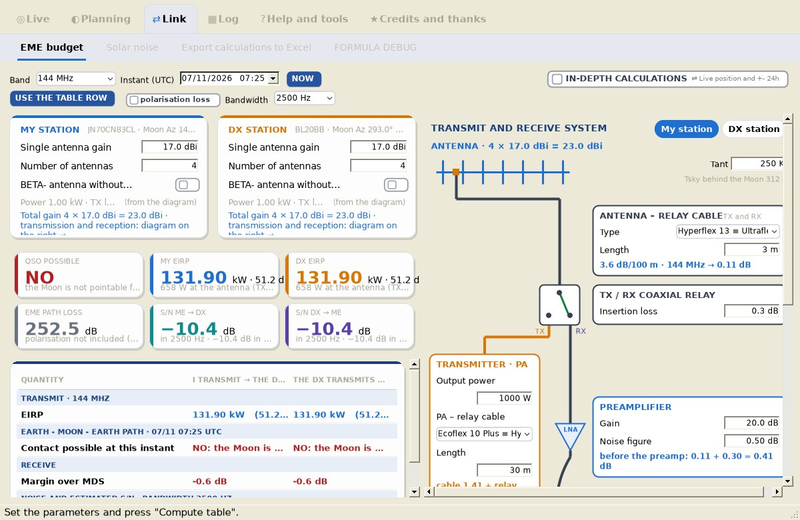
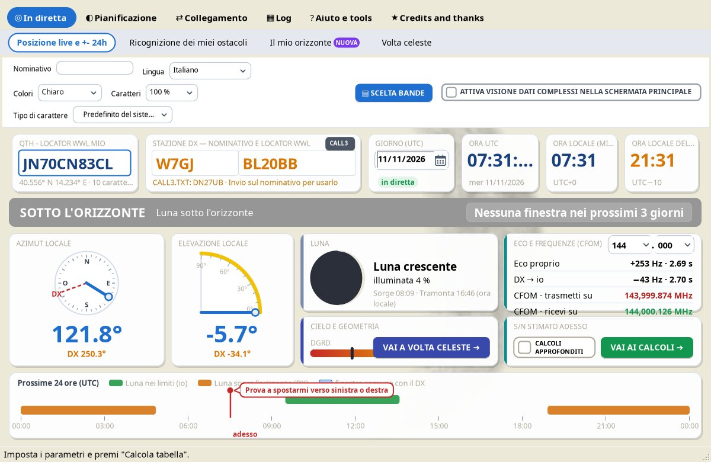
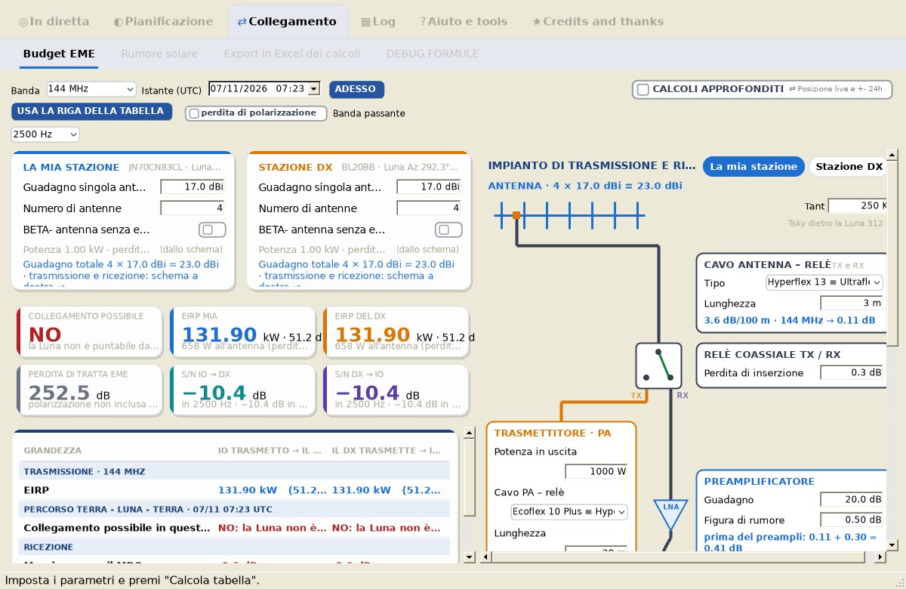

# YAEC – Yet Another EME Calc

*a cura di Costantino IC8TEM*

Moon position, pointing windows, EME link budget, sky and solar noise calculator for radio amateurs, in 37 languages. Windows, Linux and macOS (Linux and macOS with Mono).

Posizione della Luna, finestre di puntamento, budget del collegamento EME, rumore del cielo e del Sole per radioamatori, in 37 lingue. Windows, Linux e macOS (Linux e macOS con Mono).

[](https://ko-fi.com/ic8tem)

## Videos

| | English | Italiano |
|---|---|---|
| [▶ What YAEC calculates](docs/video/YAEC_presentation_en.mp4) (2 min) · [subtitles](docs/video/YAEC_presentation_en.srt) | A tour of the calculation tabs | Le linguette di calcolo |
| [▶ Getting started](docs/video/YAEC_getting_started_en.mp4) (5 min) · [subtitles](docs/video/YAEC_getting_started_en.srt) | A first EME evening step by step | Una prima serata EME passo passo |

## README in 37 languages

[English](lingue/README_en.txt) · [Italiano](lingue/README_it.txt) · [Deutsch](lingue/README_de.txt) · [Français](lingue/README_fr.txt) · [Español](lingue/README_es.txt) · [Português](lingue/README_pt.txt) · [Português (Brasil)](lingue/README_pt-BR.txt) · [Nederlands](lingue/README_nl.txt) · [Svenska](lingue/README_sv.txt) · [Norsk](lingue/README_nb.txt) · [Dansk](lingue/README_da.txt) · [Íslenska](lingue/README_is.txt) · [Eesti](lingue/README_et.txt) · [Latviešu](lingue/README_lv.txt) · [Lietuvių](lingue/README_lt.txt) · [Polski](lingue/README_pl.txt) · [Čeština](lingue/README_cs.txt) · [Slovenčina](lingue/README_sk.txt) · [Magyar](lingue/README_hu.txt) · [Română](lingue/README_ro.txt) · [Ελληνικά](lingue/README_el.txt) · [Русский](lingue/README_ru.txt) · [Українська](lingue/README_uk.txt) · [Türkçe](lingue/README_tr.txt) · [Afrikaans](lingue/README_af.txt) · [العربية](lingue/README_ar.txt) · [עברית](lingue/README_he.txt) · [اردو](lingue/README_ur.txt) · [हिन्दी](lingue/README_hi.txt) · [বাংলা](lingue/README_bn.txt) · [Bahasa Indonesia](lingue/README_id.txt) · [Tagalog](lingue/README_tl.txt) · [ไทย](lingue/README_th.txt) · [中文 (简体)](lingue/README_zh.txt) · [中文 (繁體)](lingue/README_zh-TW.txt) · [日本語](lingue/README_ja.txt) · [한국어](lingue/README_ko.txt)

The program, its two manuals and the licence are in the same 37 languages; the language is chosen at the top of the main screen.

## Download

Download from the **[Releases](../../releases/latest)** page (x.y = version). Every release has `SHA256SUMS.txt` to check the files.

| System | Package |
|---|---|
| **Windows** 64 / 32 bit, ARM64 (Windows 7 SP1 to 11) | `YAEC-x.y-windows-x64-setup.exe` · `-x86-setup.exe` · `-arm64-setup.exe` (or the `-portatile.zip` of each) |
| **Debian, Ubuntu, Mint, Raspberry Pi OS** | `yaec_x.y_amd64.deb` · `_arm64.deb` · `_armhf.deb` |
| **Fedora, openSUSE** · **Arch, Manjaro** · **Slackware** | `yaec-x.y.x86_64.rpm` · `yaec-x.y-1-x86_64.pkg.tar.zst` · `yaec-x.y-x86_64-1_ic8tem.txz` |
| **Any Linux** | `YAEC-x.y-x86_64.AppImage` · `-aarch64.AppImage`, or `YAEC-x.y-linux-x64/-arm64/-armv7l/-x86.tar.gz` |
| **Alpine, FreeBSD, OpenBSD** | `YAEC-x.y-alpine-x64/-arm64.tar.gz` · `-freebsd-x64.tar.gz` · `-openbsd-x64.tar.gz` |
| **macOS** Apple Silicon (M1–M4) · Intel | `YAEC-x.y-mac-apple-silicon.dmg` · `YAEC-x.y-mac-intel.dmg` |

Windows 7, ARM64, i686, Slackware, AppImage, Alpine, FreeBSD and OpenBSD are not yet tested: reports are welcome.

## Installation

**English**
- **Windows** – run `YAEC-x.y-windows-x64-setup.exe`: it installs into *Documents\YAEC* without administrator rights. SmartScreen: *More info* → *Run anyway*. Without installing: extract the `-portatile.zip` and run `YAEC.exe`.
- **Debian, Ubuntu, Mint, Raspberry Pi** – `sudo apt install ./yaec_x.y_amd64.deb` (Mono is installed too), then start `yaec`.
- **Other Linux and BSD** – install Mono (`mono-complete`), extract the `.tar.gz` and run `./install.sh`; or use the AppImage.
- **macOS (experimental)**
  1. Install [Mono for macOS](https://www.mono-project.com/download/stable/) and [XQuartz](https://www.xquartz.org).
  2. Open the `.dmg` and drag YAEC into *Applications*; the first time, right-click YAEC → *Open* (the app is not signed by Apple).
  3. **Mac with an Apple processor (M1–M4):** Mono runs through **Rosetta 2**. If YAEC does not start (*"Bad CPU type in executable"* in `~/Library/Application Support/YAEC/data/mono-log.txt`), open *Terminal* and run

     ```
     sudo softwareupdate --install-rosetta --agree-to-license
     ```

     It asks for your Mac password, which is not shown while you type. Then start YAEC again.
- **Updates** – from 1.9.11 YAEC updates itself silently (Windows, AppImage, `.tar.gz`, macOS app): it checks GitHub at start-up and every 30 minutes, downloads in the background and checks SHA-256; on Windows the new version installs when you close YAEC, elsewhere it starts at the next launch; `.deb`, `.rpm`, Arch and Slackware packages are updated with the package manager.

**Italiano**
- **Windows** – avvia `YAEC-x.y-windows-x64-setup.exe`: installa in *Documenti\YAEC* senza diritti di amministratore. SmartScreen: *Ulteriori informazioni* → *Esegui comunque*. Senza installare: estrai il `-portatile.zip` e avvia `YAEC.exe`.
- **Debian, Ubuntu, Mint, Raspberry Pi** – `sudo apt install ./yaec_x.y_amd64.deb` (installa anche Mono), poi avvia `yaec`.
- **Altri Linux e BSD** – installa Mono (`mono-complete`), estrai il `.tar.gz` e lancia `./install.sh`; oppure usa l'AppImage.
- **macOS (sperimentale)**
  1. Installa [Mono per macOS](https://www.mono-project.com/download/stable/) e [XQuartz](https://www.xquartz.org).
  2. Apri il `.dmg` e trascina YAEC in *Applicazioni*; la prima volta clic destro su YAEC → *Apri* (l'app non è firmata da Apple).
  3. **Mac con processore Apple (M1–M4):** Mono funziona tramite **Rosetta 2**. Se YAEC non parte (*«Bad CPU type in executable»* in `~/Library/Application Support/YAEC/data/mono-log.txt`), apri *Terminale* e scrivi

     ```
     sudo softwareupdate --install-rosetta --agree-to-license
     ```

     Chiede la password del Mac, che non si vede mentre la scrivi. Poi riavvia YAEC.
- **Aggiornamenti** – dalla 1.9.11 YAEC si aggiorna da solo in silenzio (Windows, AppImage, `.tar.gz`, app per macOS): controlla GitHub all'avvio e ogni 30 minuti, scarica in background e controlla lo SHA-256; su Windows la nuova versione si installa quando chiudi YAEC, altrove parte al prossimo avvio; i pacchetti `.deb`, `.rpm`, Arch e Slackware si aggiornano con il gestore dei pacchetti.

Other languages: the README of each language in the [`lingue`](lingue) folder (links above).

## Features

<table><tr><td width="33%" align="center"><a href="docs/screenshots/en-1.jpg"></a><br><sub>Live position and +- 24h</sub></td><td width="33%" align="center"><a href="docs/screenshots/en-2.jpg"></a><br><sub>EME budget Yagi</sub></td><td width="33%" align="center"><a href="docs/screenshots/en-3.jpg"></a><br><sub>Distance and Dgrd</sub></td></tr></table>

- **Live** – Moon position every second with your antenna limits and the DX's, common window and countdown; map of your obstacles; your horizon from SRTM1 terrain data; sky view with sky-noise colours.
- **Planning** – Dgrd and distance for 7 to 61 days with the best days; Dgrd at your frequency; antenna temperature with the Skynoise method; stations to try from the N0UK chat and the PA0PLY directory; Moon tables, Moon over the world and Polarization over the world (Dpol map).
- **Link** – EME budget for Yagis and dishes (50 MHz to 23 cm) with an interactive station diagram, polarization risk, GRAVES radar, solar noise, Excel export and step-by-step calculation check.
- **Log, help and tools** – WWL map from ADIF or LoTW; user manual and *Theory and tips on EME*; database of coaxial cables.
- CALL3.TXT from W7GJ and WSJT-X Improved, merged and kept up to date; Moon positions to about 0.01° (Meeus, ELP-2000/82); all data in one `data` folder.

<table><tr><td width="33%" align="center"><a href="docs/screenshots/it-1.jpg"></a><br><sub>Posizione live e +- 24h</sub></td><td width="33%" align="center"><a href="docs/screenshots/it-2.jpg"></a><br><sub>Budget EME yagi</sub></td><td width="33%" align="center"><a href="docs/screenshots/it-3.jpg"></a><br><sub>Distanza e Dgrd</sub></td></tr></table>

- **Live** – posizione della Luna ogni secondo con i limiti della tua antenna e di quella del DX, finestra comune e conto alla rovescia; mappa dei tuoi ostacoli; il tuo orizzonte dai dati SRTM1; volta celeste con i colori del rumore del cielo.
- **Pianificazione** – Dgrd e distanza da 7 a 61 giorni con i giorni migliori; Dgrd alla tua frequenza; temperatura d'antenna con il metodo Skynoise; stazioni da provare dalla chat N0UK e dall'elenco PA0PLY; tabelle della Luna, Luna sul mondo e Polarizzazione sul mondo (mappa del Dpol).
- **Collegamento** – budget EME per yagi e dischi (da 50 MHz ai 23 cm) con lo schema interattivo della stazione, rischio di polarizzazione, radar GRAVES, rumore solare, esportazione in Excel e controllo dei calcoli passo passo.
- **Log, aiuto e strumenti** – mappa WWL da ADIF o LoTW; manuale d'uso e *Teoria e consigli sull'EME*; banca dati dei cavi coassiali.
- CALL3.TXT di W7GJ e WSJT-X Improved, uniti e aggiornati; posizioni della Luna a circa 0,01° (Meeus, ELP-2000/82); tutti i dati in una sola cartella `data`.

## Latest versions

**English**
- **1.9.12** – Less CPU and less memory, with the same calculations: on the Live page the top cards and the large panel are redrawn only when a visible value changes (the UTC clock every second), and only the language in use is loaded into memory; on Windows the CPU of the Live page drops by about 60% and the memory peak at start-up from about 350 to about 155 MB.
- **1.9.11** – Silent automatic update, as in YA-NEC: YAEC checks GitHub at start-up and every 30 minutes, downloads the package in the background and checks its SHA-256 fingerprint; on Windows it installs itself when you close the program, on Linux, BSD and macOS the new version starts at the next launch, and a message tells you which version it was updated from (.deb, .rpm, Arch and Slackware packages stay with the package manager). My horizon: the violet box of the pointable area has a stepped minimum, degree by degree of azimuth (the higher of the antenna limit and the terrain), for your station and for the DX.
- **1.9.10** – New tab Polarization over the world (Planning): world map coloured by the spatial polarization offset (Dpol) between your station and every place that sees the Moon, with the dashed 45° (3 dB) line; Dpol and loss on mouse hover and on the DX label.

**Italiano**
- **1.9.12** – Meno CPU e meno memoria, con gli stessi calcoli: nella pagina In diretta le schede in alto e il pannello grande si ridisegnano solo quando cambia un valore visibile (l'orologio UTC ogni secondo), e in memoria si carica solo la lingua in uso; su Windows la CPU della pagina In diretta scende di circa il 60% e il picco di memoria all'avvio da circa 350 a circa 155 MB.
- **1.9.11** – Aggiornamento automatico silenzioso, come in YA-NEC: YAEC controlla GitHub all'avvio e ogni 30 minuti, scarica il pacchetto in background e ne controlla l'impronta SHA-256; su Windows si installa da solo quando chiudi il programma, su Linux, BSD e macOS la nuova versione parte al prossimo avvio, e un avviso dice da quale versione è stato aggiornato (i pacchetti .deb, .rpm, Arch e Slackware restano al gestore dei pacchetti). Il mio orizzonte: il riquadro viola della zona puntabile ha il minimo a scalini, grado per grado di azimut (il più alto fra il limite dell'antenna e il terreno), per la tua stazione e per il DX.
- **1.9.10** – Nuova linguetta Polarizzazione sul mondo (Pianificazione): mappa del mondo colorata secondo l'offset di polarizzazione spaziale (Dpol) tra la tua stazione e ogni località che vede la Luna, con la linea tratteggiata dei 45° (3 dB); Dpol e perdita al passaggio del mouse e sull'etichetta del DX.

Full history in every README language: [CHANGELOG.md](CHANGELOG.md); in the program: *Help and tools*.

## For developers

You do not need to compile anything to use YAEC: the installer and the packages above are built automatically. If you want to build it yourself on Windows, `compila.bat` compiles `YAEC.cs` with the C# compiler included in Windows (.NET Framework 4, C# 5). Every push is compiled by GitHub Actions on Windows and started on Linux with Mono; when the `VERSION` file on `main` holds a new version, the workflow publishes the release with the Windows installer (Inno Setup) and the Linux and macOS packages (`.github/workflows/build.yml`).

## License

See `LICENZA.txt`.
