# YAEC – Yet Another EME Calc

*a cura di Costantino IC8TEM*

Moon position, pointing windows, EME link budget, sky and solar noise calculator for radio amateurs, in 37 languages.
Windows, Linux and macOS (Linux and macOS with Mono).

Posizione della Luna, finestre di puntamento, budget del collegamento EME, rumore del cielo e del Sole per radioamatori, in 37 lingue.

## Languages

YAEC, its two manuals (user manual and *Theory and tips on EME*), the licence and the README are available in **37 languages**; the language is chosen at the top of the main screen. Licence and README in every language are in the [`lingue`](lingue) folder.

| | | | |
|---|---|---|---|
| English `en` | Italiano `it` | Deutsch `de` | Français `fr` |
| Español `es` | Português `pt` | Nederlands `nl` | Svenska `sv` |
| Norsk (bokmål) `nb` | Íslenska `is` | Eesti `et` | Latviešu `lv` |
| Lietuvių `lt` | Русский `ru` | Українська `uk` | Türkçe `tr` |
| Afrikaans `af` | العربية `ar` | עברית `he` | اردو `ur` |
| हिन्दी `hi` | বাংলা `bn` | 中文 (简体) `zh` | 日本語 `ja` |
| 한국어 `ko` | Bahasa Indonesia `id` | Dansk `da` | Tagalog `tl` |
| Português (Brasil) `pt-BR` | ไทย `th` | 中文 (繁體) `zh-TW` | Polski `pl` |
| Čeština `cs` | Română `ro` | Ελληνικά `el` | Magyar `hu` |
| Slovenčina `sk` | | | |

## Installation

[English](#english) · [Italiano](#italiano) · [Deutsch](#deutsch) · [Français](#français) · [Español](#español) · [Português](#português) · [Türkçe](#türkçe) · [Čeština](#čeština) · [Slovenčina](#slovenčina) · [中文](#中文) · [日本語](#日本語) · [한국어](#한국어)

Download the files from the **[Releases](../../releases/latest)** page (x.y = version number).

### English
- **Windows** – download `YAEC-x.y-win-x64-setup.exe` and run it. It installs YAEC into *Documents\YAEC* without administrator rights, with Start menu and desktop shortcuts and an uninstaller. If SmartScreen warns you: *More info* → *Run anyway*. No installation wanted? Extract `YAEC-x.y-win-x64-portatile.zip` into a folder where you can write and run `YAEC.exe`.
- **Linux – Debian, Ubuntu, Mint** – download `yaec_x.y_amd64.deb` and run `sudo apt install ./yaec_x.y_amd64.deb` (Mono is installed too); start YAEC from the applications menu or with `yaec`.
- **Windows 32-bit** – `YAEC-x.y-win-x86-setup.exe` or `YAEC-x.y-win-x86-portatile.zip`.
- **Raspberry Pi** (Raspberry Pi OS 64-bit, Pi 4/5) – download `yaec_x.y_arm64.deb` and run `sudo apt install ./yaec_x.y_arm64.deb`.
- **Linux – other distributions** – install Mono (`sudo dnf install mono-complete`, `sudo pacman -S mono`, `sudo zypper install mono-complete`), extract `YAEC-x.y-linux-x64-portatile.tar.gz` (ARM: `YAEC-x.y-linux-arm64-portatile.tar.gz`, `YAEC-x.y-linux-arm-portatile.tar.gz`) and run `./install.sh`.
- **macOS (experimental)** – install Mono for macOS and XQuartz, open `YAEC-x.y-osx-arm64.dmg` (Apple Silicon) / `YAEC-x.y-osx-x64.dmg` (Intel) and drag YAEC into Applications; the first time, right-click → *Open*.
- Every release has `SHA256SUMS.txt` to check the downloaded files.

### Italiano
- **Windows** – scarica `YAEC-x.y-win-x64-setup.exe` ed eseguilo. Installa YAEC in *Documenti\YAEC* senza diritti di amministratore, con i collegamenti nel menu Start e sul desktop e il programma di disinstallazione. Se compare l'avviso di SmartScreen: *Ulteriori informazioni* → *Esegui comunque*. Senza installazione: estrai `YAEC-x.y-win-x64-portatile.zip` in una cartella in cui puoi scrivere e avvia `YAEC.exe`.
- **Linux – Debian, Ubuntu, Mint** – scarica `yaec_x.y_amd64.deb` e dai `sudo apt install ./yaec_x.y_amd64.deb` (installa anche Mono); YAEC si avvia dal menu delle applicazioni o con `yaec`.
- **Windows a 32 bit** – `YAEC-x.y-win-x86-setup.exe` oppure `YAEC-x.y-win-x86-portatile.zip`.
- **Raspberry Pi** (Raspberry Pi OS a 64 bit, Pi 4/5) – scarica `yaec_x.y_arm64.deb` e dai `sudo apt install ./yaec_x.y_arm64.deb`.
- **Linux – altre distribuzioni** – installa Mono (`sudo dnf install mono-complete`, `sudo pacman -S mono`, `sudo zypper install mono-complete`), estrai `YAEC-x.y-linux-x64-portatile.tar.gz` (ARM: `YAEC-x.y-linux-arm64-portatile.tar.gz`, `YAEC-x.y-linux-arm-portatile.tar.gz`) e avvia `./install.sh`.
- **macOS (sperimentale)** – installa Mono per macOS e XQuartz, apri `YAEC-x.y-osx-arm64.dmg` (Apple Silicon) / `YAEC-x.y-osx-x64.dmg` (Intel) e trascina YAEC in Applicazioni; la prima volta, clic destro → *Apri*.
- Ogni release ha il file `SHA256SUMS.txt` per controllare i file scaricati.

### Deutsch
- **Windows** – `YAEC-x.y-win-x64-setup.exe` herunterladen und ausführen. YAEC wird ohne Administratorrechte in *Dokumente\YAEC* installiert, mit Verknüpfungen im Startmenü und auf dem Desktop sowie einem Deinstallationsprogramm. Bei einer SmartScreen-Warnung: *Weitere Informationen* → *Trotzdem ausführen*. Ohne Installation: `YAEC-x.y-win-x64-portatile.zip` in einen beschreibbaren Ordner entpacken und `YAEC.exe` starten.
- **Linux – Debian, Ubuntu, Mint** – `yaec_x.y_amd64.deb` herunterladen und `sudo apt install ./yaec_x.y_amd64.deb` ausführen (Mono wird mitinstalliert); YAEC startet aus dem Anwendungsmenü oder mit `yaec`.
- **Windows 32 Bit** – `YAEC-x.y-win-x86-setup.exe` oder `YAEC-x.y-win-x86-portatile.zip`.
- **Raspberry Pi** (Raspberry Pi OS 64 Bit, Pi 4/5) – `yaec_x.y_arm64.deb` herunterladen und `sudo apt install ./yaec_x.y_arm64.deb` ausführen.
- **Linux – andere Distributionen** – Mono installieren (`sudo dnf install mono-complete`, `sudo pacman -S mono`, `sudo zypper install mono-complete`), `YAEC-x.y-linux-x64-portatile.tar.gz` (ARM: `YAEC-x.y-linux-arm64-portatile.tar.gz`, `YAEC-x.y-linux-arm-portatile.tar.gz`) entpacken und `./install.sh` ausführen.
- **macOS (experimentell)** – Mono für macOS und XQuartz installieren, `YAEC-x.y-osx-arm64.dmg` (Apple Silicon) / `YAEC-x.y-osx-x64.dmg` (Intel) öffnen und YAEC in den Ordner Programme ziehen; beim ersten Mal Rechtsklick → *Öffnen*.
- Jede Version enthält `SHA256SUMS.txt` zur Prüfung der heruntergeladenen Dateien.

### Français
- **Windows** – téléchargez `YAEC-x.y-win-x64-setup.exe` et lancez-le. Il installe YAEC dans *Documents\YAEC* sans droits d'administrateur, avec les raccourcis dans le menu Démarrer et sur le bureau et un programme de désinstallation. Si SmartScreen affiche un avertissement : *Informations complémentaires* → *Exécuter quand même*. Sans installation : extrayez `YAEC-x.y-win-x64-portatile.zip` dans un dossier où vous pouvez écrire et lancez `YAEC.exe`.
- **Linux – Debian, Ubuntu, Mint** – téléchargez `yaec_x.y_amd64.deb` et lancez `sudo apt install ./yaec_x.y_amd64.deb` (Mono est installé aussi) ; YAEC se lance depuis le menu des applications ou avec `yaec`.
- **Windows 32 bits** – `YAEC-x.y-win-x86-setup.exe` ou `YAEC-x.y-win-x86-portatile.zip`.
- **Raspberry Pi** (Raspberry Pi OS 64 bits, Pi 4/5) – téléchargez `yaec_x.y_arm64.deb` et lancez `sudo apt install ./yaec_x.y_arm64.deb`.
- **Linux – autres distributions** – installez Mono (`sudo dnf install mono-complete`, `sudo pacman -S mono`, `sudo zypper install mono-complete`), extrayez `YAEC-x.y-linux-x64-portatile.tar.gz` (ARM: `YAEC-x.y-linux-arm64-portatile.tar.gz`, `YAEC-x.y-linux-arm-portatile.tar.gz`) et lancez `./install.sh`.
- **macOS (expérimental)** – installez Mono pour macOS et XQuartz, ouvrez `YAEC-x.y-osx-arm64.dmg` (Apple Silicon) / `YAEC-x.y-osx-x64.dmg` (Intel) et faites glisser YAEC dans Applications ; la première fois, clic droit → *Ouvrir*.
- Chaque version contient `SHA256SUMS.txt` pour vérifier les fichiers téléchargés.

### Español
- **Windows** – descarga `YAEC-x.y-win-x64-setup.exe` y ejecútalo. Instala YAEC en *Documentos\YAEC* sin derechos de administrador, con accesos directos en el menú Inicio y en el escritorio y un desinstalador. Si SmartScreen muestra un aviso: *Más información* → *Ejecutar de todas formas*. Sin instalación: extrae `YAEC-x.y-win-x64-portatile.zip` en una carpeta en la que puedas escribir y ejecuta `YAEC.exe`.
- **Linux – Debian, Ubuntu, Mint** – descarga `yaec_x.y_amd64.deb` y ejecuta `sudo apt install ./yaec_x.y_amd64.deb` (también instala Mono); YAEC se abre desde el menú de aplicaciones o con `yaec`.
- **Windows de 32 bits** – `YAEC-x.y-win-x86-setup.exe` o `YAEC-x.y-win-x86-portatile.zip`.
- **Raspberry Pi** (Raspberry Pi OS de 64 bits, Pi 4/5) – descarga `yaec_x.y_arm64.deb` y ejecuta `sudo apt install ./yaec_x.y_arm64.deb`.
- **Linux – otras distribuciones** – instala Mono (`sudo dnf install mono-complete`, `sudo pacman -S mono`, `sudo zypper install mono-complete`), extrae `YAEC-x.y-linux-x64-portatile.tar.gz` (ARM: `YAEC-x.y-linux-arm64-portatile.tar.gz`, `YAEC-x.y-linux-arm-portatile.tar.gz`) y ejecuta `./install.sh`.
- **macOS (experimental)** – instala Mono para macOS y XQuartz, abre `YAEC-x.y-osx-arm64.dmg` (Apple Silicon) / `YAEC-x.y-osx-x64.dmg` (Intel) y arrastra YAEC a Aplicaciones; la primera vez, clic derecho → *Abrir*.
- Cada versión incluye `SHA256SUMS.txt` para comprobar los archivos descargados.

### Português
- **Windows** – descarrega `YAEC-x.y-win-x64-setup.exe` e executa-o. Instala o YAEC em *Documentos\YAEC* sem direitos de administrador, com atalhos no menu Iniciar e no ambiente de trabalho e um desinstalador. Se o SmartScreen avisar: *Mais informações* → *Executar mesmo assim*. Sem instalação: extrai `YAEC-x.y-win-x64-portatile.zip` para uma pasta onde possas escrever e executa `YAEC.exe`.
- **Linux – Debian, Ubuntu, Mint** – descarrega `yaec_x.y_amd64.deb` e executa `sudo apt install ./yaec_x.y_amd64.deb` (o Mono também é instalado); o YAEC abre-se a partir do menu de aplicações ou com `yaec`.
- **Windows de 32 bits** – `YAEC-x.y-win-x86-setup.exe` ou `YAEC-x.y-win-x86-portatile.zip`.
- **Raspberry Pi** (Raspberry Pi OS de 64 bits, Pi 4/5) – descarrega `yaec_x.y_arm64.deb` e executa `sudo apt install ./yaec_x.y_arm64.deb`.
- **Linux – outras distribuições** – instala o Mono (`sudo dnf install mono-complete`, `sudo pacman -S mono`, `sudo zypper install mono-complete`), extrai `YAEC-x.y-linux-x64-portatile.tar.gz` (ARM: `YAEC-x.y-linux-arm64-portatile.tar.gz`, `YAEC-x.y-linux-arm-portatile.tar.gz`) e executa `./install.sh`.
- **macOS (experimental)** – instala o Mono para macOS e o XQuartz, abre `YAEC-x.y-osx-arm64.dmg` (Apple Silicon) / `YAEC-x.y-osx-x64.dmg` (Intel) e arrasta o YAEC para Aplicações; da primeira vez, clique direito → *Abrir*.
- Cada versão inclui `SHA256SUMS.txt` para verificar os ficheiros descarregados.

### Türkçe
- **Windows** – `YAEC-x.y-win-x64-setup.exe` dosyasını indirip çalıştırın. YAEC, yönetici hakları olmadan *Belgeler\YAEC* klasörüne kurulur; Başlat menüsünde ve masaüstünde kısayollar ile bir kaldırma programı oluşturulur. SmartScreen uyarı verirse: *Ek bilgi* → *Yine de çalıştır*. Kurulum istemiyorsanız: `YAEC-x.y-win-x64-portatile.zip` dosyasını yazabildiğiniz bir klasöre açın ve `YAEC.exe` dosyasını çalıştırın.
- **Linux – Debian, Ubuntu, Mint** – `yaec_x.y_amd64.deb` dosyasını indirip `sudo apt install ./yaec_x.y_amd64.deb` komutunu çalıştırın (Mono da kurulur); YAEC uygulamalar menüsünden ya da `yaec` komutuyla açılır.
- **32 bit Windows** – `YAEC-x.y-win-x86-setup.exe` veya `YAEC-x.y-win-x86-portatile.zip`.
- **Raspberry Pi** (64 bit Raspberry Pi OS, Pi 4/5) – `yaec_x.y_arm64.deb` dosyasını indirip `sudo apt install ./yaec_x.y_arm64.deb` komutunu çalıştırın.
- **Linux – diğer dağıtımlar** – Mono'yu kurun (`sudo dnf install mono-complete`, `sudo pacman -S mono`, `sudo zypper install mono-complete`), `YAEC-x.y-linux-x64-portatile.tar.gz` dosyasını açın (ARM: `YAEC-x.y-linux-arm64-portatile.tar.gz`, `YAEC-x.y-linux-arm-portatile.tar.gz`) ve `./install.sh` komutunu çalıştırın.
- **macOS (deneysel)** – macOS için Mono'yu ve XQuartz'ı kurun, `YAEC-x.y-osx-arm64.dmg` (Apple Silicon) / `YAEC-x.y-osx-x64.dmg` (Intel) dosyasını açın ve YAEC'i Uygulamalar klasörüne sürükleyin; ilk seferde sağ tık → *Aç*.
- Her sürümde, indirilen dosyaları doğrulamak için `SHA256SUMS.txt` bulunur.

### Čeština
- **Windows** – stáhni `YAEC-x.y-win-x64-setup.exe` a spusť ho. Nainstaluje YAEC do *Dokumenty\YAEC* bez práv správce, se zástupci v nabídce Start a na ploše a s odinstalačním programem. Pokud se objeví upozornění SmartScreen: *Další informace* → *Přesto spustit*. Bez instalace: rozbal `YAEC-x.y-win-x64-portatile.zip` do složky, do které můžeš zapisovat, a spusť `YAEC.exe`.
- **Linux – Debian, Ubuntu, Mint** – stáhni `yaec_x.y_amd64.deb` a spusť `sudo apt install ./yaec_x.y_amd64.deb` (nainstaluje i Mono); YAEC se spouští z nabídky aplikací nebo příkazem `yaec`.
- **32bitové Windows** – `YAEC-x.y-win-x86-setup.exe` nebo `YAEC-x.y-win-x86-portatile.zip`.
- **Raspberry Pi** (64bitový Raspberry Pi OS, Pi 4/5) – stáhni `yaec_x.y_arm64.deb` a spusť `sudo apt install ./yaec_x.y_arm64.deb`.
- **Linux – jiné distribuce** – nainstaluj Mono (`sudo dnf install mono-complete`, `sudo pacman -S mono`, `sudo zypper install mono-complete`), rozbal `YAEC-x.y-linux-x64-portatile.tar.gz` (ARM: `YAEC-x.y-linux-arm64-portatile.tar.gz`, `YAEC-x.y-linux-arm-portatile.tar.gz`) a spusť `./install.sh`.
- **macOS (experimentální)** – nainstaluj Mono pro macOS a XQuartz, otevři `YAEC-x.y-osx-arm64.dmg` (Apple Silicon) / `YAEC-x.y-osx-x64.dmg` (Intel) a přetáhni YAEC do složky Aplikace; poprvé pravý klik → *Otevřít*.
- Každé vydání obsahuje `SHA256SUMS.txt` pro kontrolu stažených souborů.

### Slovenčina
- **Windows** – stiahni `YAEC-x.y-win-x64-setup.exe` a spusti ho. Nainštaluje YAEC do *Dokumenty\YAEC* bez práv správcu, so zástupcami v ponuke Štart a na ploche a s odinštalačným programom. Ak sa objaví upozornenie SmartScreen: *Ďalšie informácie* → *Napriek tomu spustiť*. Bez inštalácie: rozbaľ `YAEC-x.y-win-x64-portatile.zip` do priečinka, do ktorého môžeš zapisovať, a spusti `YAEC.exe`.
- **Linux – Debian, Ubuntu, Mint** – stiahni `yaec_x.y_amd64.deb` a spusti `sudo apt install ./yaec_x.y_amd64.deb` (nainštaluje aj Mono); YAEC sa spúšťa z ponuky aplikácií alebo príkazom `yaec`.
- **32-bitové Windows** – `YAEC-x.y-win-x86-setup.exe` alebo `YAEC-x.y-win-x86-portatile.zip`.
- **Raspberry Pi** (64-bitový Raspberry Pi OS, Pi 4/5) – stiahni `yaec_x.y_arm64.deb` a spusti `sudo apt install ./yaec_x.y_arm64.deb`.
- **Linux – iné distribúcie** – nainštaluj Mono (`sudo dnf install mono-complete`, `sudo pacman -S mono`, `sudo zypper install mono-complete`), rozbaľ `YAEC-x.y-linux-x64-portatile.tar.gz` (ARM: `YAEC-x.y-linux-arm64-portatile.tar.gz`, `YAEC-x.y-linux-arm-portatile.tar.gz`) a spusti `./install.sh`.
- **macOS (experimentálne)** – nainštaluj Mono pre macOS a XQuartz, otvor `YAEC-x.y-osx-arm64.dmg` (Apple Silicon) / `YAEC-x.y-osx-x64.dmg` (Intel) a pretiahni YAEC do priečinka Aplikácie; prvýkrát pravý klik → *Otvoriť*.
- Každé vydanie obsahuje `SHA256SUMS.txt` na kontrolu stiahnutých súborov.

### 中文
- **Windows** – 下载 `YAEC-x.y-win-x64-setup.exe` 并运行。它无需管理员权限，把 YAEC 安装到 *文档\YAEC*，并在开始菜单和桌面创建快捷方式，附带卸载程序。若 SmartScreen 发出警告：*更多信息* → *仍要运行*。不想安装：把 `YAEC-x.y-win-x64-portatile.zip` 解压到可写的文件夹，运行 `YAEC.exe`。
- **Linux – Debian、Ubuntu、Mint** – 下载 `yaec_x.y_amd64.deb`，运行 `sudo apt install ./yaec_x.y_amd64.deb`（会同时安装 Mono）；从应用菜单或用 `yaec` 命令启动 YAEC。
- **32 位 Windows** – `YAEC-x.y-win-x86-setup.exe` 或 `YAEC-x.y-win-x86-portatile.zip`。
- **树莓派**（64 位 Raspberry Pi OS，Pi 4/5）– 下载 `yaec_x.y_arm64.deb`，运行 `sudo apt install ./yaec_x.y_arm64.deb`。
- **Linux – 其他发行版** – 安装 Mono（`sudo dnf install mono-complete`、`sudo pacman -S mono`、`sudo zypper install mono-complete`），解压 `YAEC-x.y-linux-x64-portatile.tar.gz`（ARM：`YAEC-x.y-linux-arm64-portatile.tar.gz`、`YAEC-x.y-linux-arm-portatile.tar.gz`），运行 `./install.sh`。
- **macOS（实验性）** – 安装 macOS 版 Mono 和 XQuartz，打开 `YAEC-x.y-osx-arm64.dmg`（Apple Silicon）/ `YAEC-x.y-osx-x64.dmg`（Intel），把 YAEC 拖到“应用程序”；第一次请右键 → *打开*。
- 每个版本都附有 `SHA256SUMS.txt`，用于校验下载的文件。

### 日本語
- **Windows** – `YAEC-x.y-win-x64-setup.exe` をダウンロードして実行します。管理者権限なしで *ドキュメント\YAEC* にインストールされ、スタートメニューとデスクトップのショートカット、アンインストーラーが作成されます。SmartScreen の警告が出たら：*詳細情報* → *実行*。インストールしない場合：`YAEC-x.y-win-x64-portatile.zip` を書き込み可能なフォルダーに展開し、`YAEC.exe` を実行します。
- **Linux – Debian、Ubuntu、Mint** – `yaec_x.y_amd64.deb` をダウンロードし、`sudo apt install ./yaec_x.y_amd64.deb` を実行します（Mono も一緒にインストールされます）。YAEC はアプリケーションメニューまたは `yaec` コマンドで起動します。
- **32 ビット Windows** – `YAEC-x.y-win-x86-setup.exe` または `YAEC-x.y-win-x86-portatile.zip`。
- **Raspberry Pi**（64 ビット Raspberry Pi OS、Pi 4/5）– `yaec_x.y_arm64.deb` をダウンロードし、`sudo apt install ./yaec_x.y_arm64.deb` を実行します。
- **Linux – その他のディストリビューション** – Mono をインストールし（`sudo dnf install mono-complete`、`sudo pacman -S mono`、`sudo zypper install mono-complete`）、`YAEC-x.y-linux-x64-portatile.tar.gz`（ARM：`YAEC-x.y-linux-arm64-portatile.tar.gz`、`YAEC-x.y-linux-arm-portatile.tar.gz`）を展開して `./install.sh` を実行します。
- **macOS（試験的）** – macOS 用 Mono と XQuartz をインストールし、`YAEC-x.y-osx-arm64.dmg`（Apple Silicon）/ `YAEC-x.y-osx-x64.dmg`（Intel）を開いて YAEC をアプリケーションへドラッグします。初回は右クリック → *開く*。
- 各リリースには、ダウンロードしたファイルを確認するための `SHA256SUMS.txt` が含まれます。

### 한국어
- **Windows** – `YAEC-x.y-win-x64-setup.exe`를 내려받아 실행합니다. 관리자 권한 없이 *문서\YAEC*에 설치되며, 시작 메뉴와 바탕 화면 바로 가기, 제거 프로그램이 만들어집니다. SmartScreen 경고가 나오면: *추가 정보* → *실행*. 설치하지 않으려면: `YAEC-x.y-win-x64-portatile.zip`을 쓰기 가능한 폴더에 풀고 `YAEC.exe`를 실행합니다.
- **Linux – Debian, Ubuntu, Mint** – `yaec_x.y_amd64.deb`를 내려받아 `sudo apt install ./yaec_x.y_amd64.deb`를 실행합니다(Mono도 함께 설치됨). YAEC는 응용 프로그램 메뉴나 `yaec` 명령으로 시작합니다.
- **32비트 Windows** – `YAEC-x.y-win-x86-setup.exe` 또는 `YAEC-x.y-win-x86-portatile.zip`.
- **Raspberry Pi**(64비트 Raspberry Pi OS, Pi 4/5) – `yaec_x.y_arm64.deb`를 내려받아 `sudo apt install ./yaec_x.y_arm64.deb`를 실행합니다.
- **Linux – 기타 배포판** – Mono를 설치하고(`sudo dnf install mono-complete`, `sudo pacman -S mono`, `sudo zypper install mono-complete`), `YAEC-x.y-linux-x64-portatile.tar.gz`(ARM: `YAEC-x.y-linux-arm64-portatile.tar.gz`, `YAEC-x.y-linux-arm-portatile.tar.gz`)를 풀고 `./install.sh`를 실행합니다.
- **macOS(실험적)** – macOS용 Mono와 XQuartz를 설치하고 `YAEC-x.y-osx-arm64.dmg`(Apple Silicon) / `YAEC-x.y-osx-x64.dmg`(Intel)를 열어 YAEC를 응용 프로그램으로 끌어다 놓습니다. 처음에는 오른쪽 클릭 → *열기*.
- 각 릴리스에는 내려받은 파일을 확인하는 `SHA256SUMS.txt`가 들어 있습니다.

All the versions before 1.0 are called **beta**.

## Features

[English](#english-1) · [Italiano](#italiano-1) · [Deutsch](#deutsch-1) · [Français](#français-1) · [Español](#español-1) · [Português](#português-1) · [Türkçe](#türkçe-1) · [Čeština](#čeština-1) · [Slovenčina](#slovenčina-1) · [中文](#中文-1) · [日本語](#日本語-1) · [한국어](#한국어-1)

### English

<table><tr><td width="33%" align="center"><a href="docs/screenshots/en-1.jpg">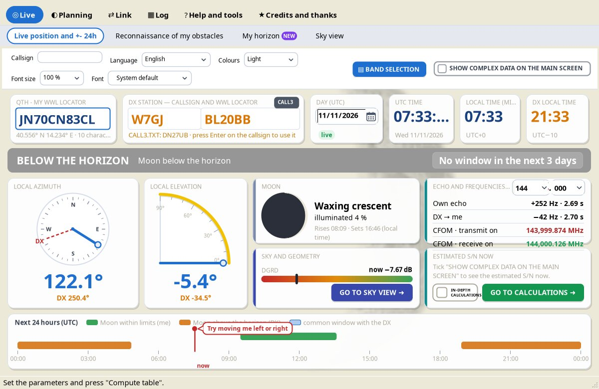</a> Live position and +- 24h</td><td width="33%" align="center"><a href="docs/screenshots/en-2.jpg">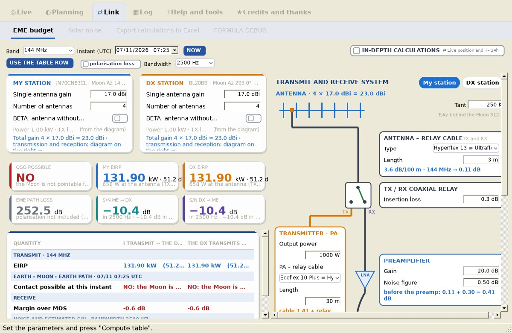</a> EME budget</td><td width="33%" align="center"><a href="docs/screenshots/en-3.jpg">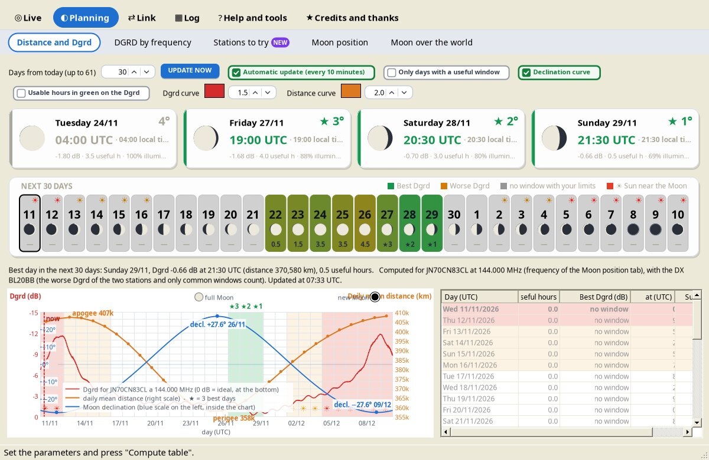</a> Distance and Dgrd</td></tr></table>

YAEC puts in one program everything you need to run an EME (Earth–Moon–Earth) station on 50, 70, 144, 222, 432 and 902 MHz and 23 cm (1296 MHz), especially when the station has limits: an antenna without elevation, a rotator with limited travel, obstacles that hide part of the sky. It tells you not only where the Moon is, but whether **your** antenna can really reach it, when, and under which conditions. The bands above 432 MHz are still being completed, but the DGRD is already computed correctly at every frequency; more advice for newcomers above 900 MHz will follow.

**Live**
- **Live position and +- 24h** – main screen updated every second: your locator and the DX's (4 to 14 characters), frequency, UTC, local and DX clocks, a status band (pointable, outside the limits, below the horizon, common window) with countdown, compass and elevation arc. Typing the DX callsign fills in its locator from CALL3.TXT.
- **Reconnaissance of my obstacles** – aerial or topographic map centred on your station with the sky drawn on it: Moon position, its path over the next 24 hours, rise and set, antenna limits that you drag with the mouse.
- **My horizon** – *Horizon from terrain*: panorama of the terrain around your station from SRTM1 elevation data (about 30 m), with Earth curvature and refraction, over the sky view (three colour scales) or a light-blue sky; Moon path, rise and set above the terrain, main obstacles named from OpenStreetMap and minutes of Moon lost. One checkbox makes the terrain the minimum elevation in the whole program. *Local noise map (NJ9R)*: azimuth × elevation grid where you type the noise seen in WSJT-X while turning the antenna; the hours with the Moon in a noisy direction get a ⚠.
- **Sky view** – the sky seen from your QTH with the sky-noise colours at your frequency, antenna limits, the DX horizon, radio sources, the Sun and the Moon path.

**Planning**
- **Distance and Dgrd** – 7 to 61 days of Dgrd and mean Moon distance, with the declination overlaid, perigee, apogee, new Moon, the three best days (in date order), a possible fourth useful day and a warning for the days when the Moon is close to the Sun. Only the hours in which the Moon is really pointable with your limits are counted.
- **DGRD by frequency** – the Dgrd at your working frequency with the real noise of your station and the sky averaged over the antenna beam, compared with the usual WSJT-X calculation; the choice applies to the whole program.
- **Stations to try** – for the chosen day, the stations active in the N0UK EME chat (144 MHz) with a common window with you, the best per locator field, ranked by an index from 0 to 100 from the S/N in both directions; the DX setup is read from what it writes in the chat. A rough example calculation, idea by Matteo IW5DHN.
- **Moon position** – table for the chosen period, coloured by pointability, with the common windows for you and the DX; CSV export for Excel.
- **Moon over the world** – world map coloured by the Moon elevation seen from every place; one click makes that point the DX.

**Link**
- **EME budget Yagi** – link budget for every band, stored band by band: six indicators (link possible, my EIRP, DX EIRP, path loss, S/N me → DX and DX → me, also with the Sun and in 2500 Hz), the full table of steps and an interactive diagram of the station (antenna, cables, relay, preamplifier, transverter, radio). Ground gain for antennas without elevation. Modes with a 60 s period: JT65, Q65-60A, Q65-60B, Q65-60C and custom. Echo mode (*I transmit and receive my own echo*): echo level, delay and Doppler.
- **EME budget dishes** – the same budget, echo included, for dish antennas at 432, 902 and 1296 MHz, prime focus or offset (W2IMU): gain with the PE1RKI formula, beamwidth 70·λ/D, single- or two-stage preamplifier, transverter and PA drive; on 23 cm, circular polarization with 0.4 dB of loss (KA1GT).
- **GRAVES radar** – the French GRAVES radar (143.050 MHz) as a test bench: when the Moon is in its beam and within your antenna limits, with Doppler and echo delay.
- **Solar noise** – downloads the solar fluxes measured by the RSTN network (NOAA) and estimates how much the Sun raises the receiver noise near new Moon.
- **Export calculations to Excel** and **Calculation check** – the budget as an Excel sheet, and every formula with the substituted values, step by step, for the Yagi or the dish budget.

**Log, help and tools**
- **WWL map and ADIF** – Maidenhead grid with worked and confirmed squares from your ADIF file or downloaded directly from LoTW, also by band and EME only.
- **USER MANUAL** and **THEORY AND TIPS ON EME** – full manuals inside the program in every language, with clickable index, search, formulas and sources; exportable to Word. The theory manual includes the advice of experienced EME operators, a section on internet chats and the VE7BQH antenna tables.
- **COAXIAL CABLES** – database of 50 Ω cables with attenuation from 50 to 1296 MHz (data-sheet values and the formula α = k1·√f + k2·f) and the source of every value; sortable, filterable, with a loss calculator and a button that sends the cable to the EME budget. You can add your own cables.

**Also**
- CALL3.TXT downloaded from W7GJ and WSJT-X Improved, merged, refreshed every 7 days and copied into WSJT-X on request.
- Warnings for polar-cap and auroral absorption (PCA) when a station is beyond the polar circles or in the auroral zone.
- 37 languages; light, night (blue), black and eight pastel and three IP-TRX-CTRL (blue, violet, green) colour schemes.
- Moon positions accurate to about 0.01° (Meeus, ELP-2000/82), all calculations on your computer; data in a single `data` folder.

### Italiano

<table><tr><td width="33%" align="center"><a href="docs/screenshots/it-1.jpg">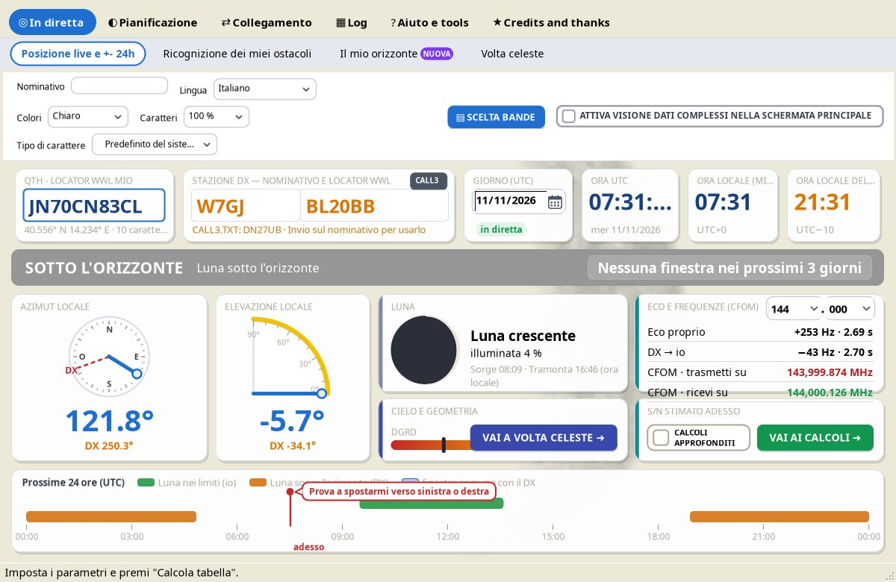</a> Posizione live e +- 24h</td><td width="33%" align="center"><a href="docs/screenshots/it-2.jpg">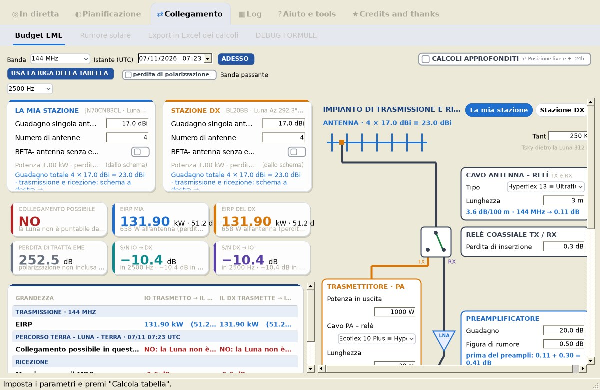</a> Budget EME</td><td width="33%" align="center"> Distanza e Dgrd</td></tr></table>

YAEC raccoglie in un solo programma tutto quello che serve per l'EME (Terra–Luna–Terra) su 50, 70, 144, 222, 432 e 902 MHz e sui 23 cm (1296 MHz), soprattutto quando la stazione ha dei vincoli: un'antenna senza elevazione, un rotore con escursione limitata, ostacoli che nascondono parte del cielo. Non dice solo dove si trova la Luna, ma se la **tua** antenna la raggiunge davvero, quando e in quali condizioni. Le bande sopra i 432 MHz sono in fase di completamento, ma la DGRD è già calcolata correttamente a ogni frequenza; seguiranno altri consigli per chi si avvicina da poco alle frequenze sopra i 900 MHz.

**In diretta**
- **Posizione live e +- 24h** – la schermata principale, aggiornata ogni secondo: locator tuo e del DX (da 4 a 14 caratteri), frequenza, orologi UTC, locale e del DX, fascia di stato (puntabile, fuori dai limiti, sotto l'orizzonte, finestra comune) con il conto alla rovescia, bussola e arco dell'elevazione. Scrivendo il nominativo del DX il locator arriva dal CALL3.TXT.
- **Ricognizione dei miei ostacoli** – mappa aerofotografica o topografica centrata sulla tua stazione con sopra il cielo: posizione della Luna, percorso nelle prossime 24 ore, sorgere e tramonto, limiti dell'antenna da trascinare con il mouse.
- **Il mio orizzonte** – *Orizzonte dal terreno*: panorama del terreno intorno alla tua stazione dai dati altimetrici SRTM1 (circa 30 m), con curvatura terrestre e rifrazione, sullo sfondo della Volta celeste (tre colorazioni) o di un cielo azzurro; percorso della Luna, sorgere e tramonto sopra il terreno, ostacoli principali con i nomi di OpenStreetMap e minuti di Luna persi. Con una casella il terreno diventa l'elevazione minima in tutto il programma. *Mappa del rumore locale (NJ9R)*: griglia azimut × elevazione in cui scrivi il rumore visto in WSJT-X girando l'antenna; le ore con la Luna in una direzione rumorosa hanno il ⚠.
- **Volta celeste** – il cielo visto dal tuo QTH con i colori del rumore del cielo alla tua frequenza, i limiti dell'antenna, l'orizzonte del DX, le radiosorgenti, il Sole e il percorso della Luna.

**Pianificazione**
- **Distanza e Dgrd** – da 7 a 61 giorni di Dgrd e distanza media della Luna, con la declinazione sovrapposta, perigeo, apogeo, luna nuova, i tre giorni migliori (in ordine di data), un possibile quarto giorno utile e l'avviso dei giorni con la Luna vicina al Sole. Contano solo le ore in cui la Luna è davvero puntabile con i tuoi limiti.
- **DGRD per frequenza** – il Dgrd alla tua frequenza di lavoro con il rumore vero della tua stazione e il cielo mediato sul fascio dell'antenna, confrontato con il calcolo di sempre di WSJT-X; la scelta vale in tutto il programma.
- **Stazioni da provare** – per il giorno scelto, le stazioni attive nella chat EME di N0UK (144 MHz) con una finestra comune con te, la migliore per campo di locator, ordinate con un indice da 0 a 100 ricavato dal S/N nei due sensi; l'impianto del DX è letto da quello che scrive in chat. Un calcolo di esempio, molto approssimativo, idea di Matteo IW5DHN.
- **Posizione della Luna** – tabella per il periodo scelto, colorata secondo la puntabilità, con le finestre comuni a te e al DX; esportazione CSV per Excel.
- **Luna sul mondo** – mappa del mondo colorata secondo l'elevazione della Luna vista da ogni località; con un clic il punto diventa il DX.

**Collegamento**
- **Budget EME yagi** – bilancio del collegamento per ogni banda, memorizzato banda per banda: sei indicatori (collegamento possibile, EIRP mia e del DX, perdita di tratta, S/N io → DX e DX → io, anche con il Sole e in 2500 Hz), la tabella di tutti i passaggi e lo schema interattivo dell'impianto (antenna, cavi, relè, preamplificatore, transverter, radio). Ground gain per le antenne senza elevazione. Modi con periodo di 60 s: JT65, Q65-60A, Q65-60B, Q65-60C e personalizzato. Calcolo dell'eco (*Io trasmetto e ricevo il mio eco*): livello, ritardo e Doppler dell'eco.
- **Budget EME dischi** – lo stesso bilancio, eco compreso, per le antenne a disco a 432, 902 e 1296 MHz, a primo fuoco oppure offset (W2IMU): guadagno con la formula di PE1RKI, larghezza del fascio 70·λ/D, preamplificatore a uno o due stadi, transverter e pilotaggio del PA; in 23 cm, polarizzazione circolare con 0,4 dB di perdita (KA1GT).
- **Radar GRAVES** – il radar francese GRAVES (143,050 MHz) come banco di prova: quando la Luna è nel suo fascio e nei limiti della tua antenna, con Doppler e ritardo dell'eco.
- **Rumore solare** – scarica i flussi solari misurati dalla rete RSTN (NOAA) e stima quanto il Sole alza il rumore del ricevitore vicino alla luna nuova.
- **Export in Excel dei calcoli** e **Controllo dei calcoli** – il budget come foglio Excel, e ogni formula con i valori sostituiti, passaggio per passaggio, per il Budget EME yagi o dischi.

**Log, aiuto e strumenti**
- **Mappa WWL e ADIF** – reticolo Maidenhead con i quadrati lavorati e confermati dal tuo file ADIF o scaricati direttamente da LoTW, anche per banda e solo EME.
- **MANUALE D'USO** e **TEORIA E CONSIGLI SULL'EME** – manuali completi dentro il programma in tutte le lingue, con indice cliccabile, ricerca, formule e fonti; esportabili in Word. Il manuale di teoria comprende i consigli di operatori EME esperti, un paragrafo sulle chat via Internet e le tabelle delle antenne di VE7BQH.
- **CAVI COASSIALI** – database dei cavi a 50 Ω con l'attenuazione da 50 a 1296 MHz (valori delle schede e formula α = k1·√f + k2·f) e la fonte di ogni valore; ordinabile, filtrabile, con il calcolo della perdita e il pulsante che porta il cavo nel Budget EME. Si possono aggiungere cavi personalizzati.

**Inoltre**
- CALL3.TXT scaricato da W7GJ e da WSJT-X Improved, unito, aggiornato ogni 7 giorni e copiato in WSJT-X a richiesta.
- Avvisi di assorbimento della calotta polare e aurorale (PCA) quando una stazione è oltre i circoli polari o nella zona aurorale.
- 37 lingue; schemi di colori chiaro, notte (blu), nero, otto pastello e tre di IP-TRX-CTRL (blu, viola, verde).
- Posizioni della Luna precise a circa 0,01° (Meeus, ELP-2000/82), tutti i calcoli sul tuo computer; dati in un'unica cartella `data`.

### Deutsch

<table><tr><td width="33%" align="center"><a href="docs/screenshots/de-1.jpg">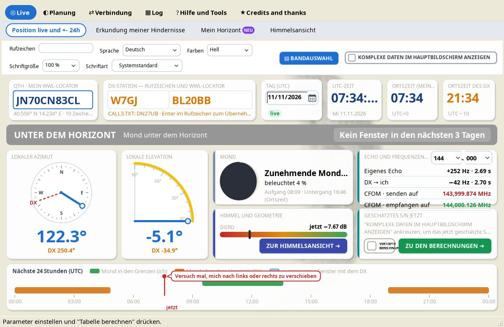</a> Position live und +- 24h</td><td width="33%" align="center"><a href="docs/screenshots/de-2.jpg">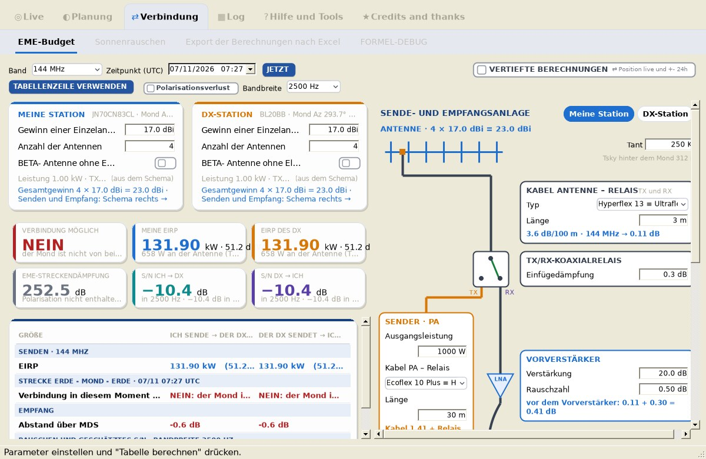</a> EME-Budget</td><td width="33%" align="center"><a href="docs/screenshots/de-3.jpg">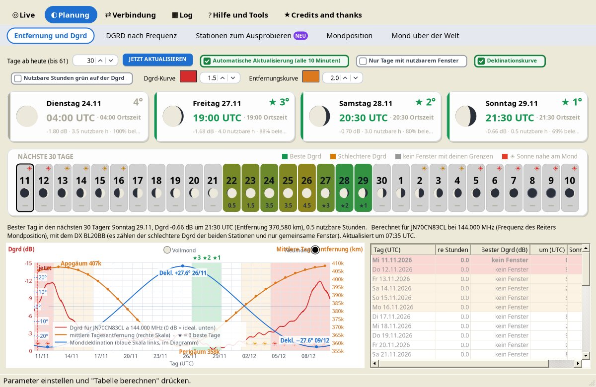</a> Entfernung und Dgrd</td></tr></table>

YAEC vereint in einem Programm alles, was man für den EME-Betrieb (Erde–Mond–Erde) auf 50, 70, 144, 222, 432 und 902 MHz und 23 cm (1296 MHz) braucht – vor allem, wenn die Station Einschränkungen hat: eine Antenne ohne Elevation, ein Rotor mit begrenztem Drehbereich, Hindernisse, die einen Teil des Himmels verdecken. Es zeigt nicht nur, wo der Mond steht, sondern ob **deine** Antenne ihn wirklich erreicht, wann und unter welchen Bedingungen. Die Bänder oberhalb von 432 MHz werden noch fertiggestellt, aber der DGRD wird schon auf jeder Frequenz richtig berechnet; weitere Tipps für Neueinsteiger oberhalb von 900 MHz folgen.

**Live**
- **Position live und +- 24h** – Hauptbildschirm, jede Sekunde aktualisiert: dein Locator und der des DX (4 bis 14 Zeichen), Frequenz, UTC-, Orts- und DX-Uhr, Statusband (ausrichtbar, außerhalb der Grenzen, unter dem Horizont, gemeinsames Fenster) mit Countdown, Kompass und Elevationsbogen. Bei Eingabe des DX-Rufzeichens kommt der Locator aus CALL3.TXT.
- **Erkundung meiner Hindernisse** – Luftbild- oder topografische Karte um deine Station mit dem Himmel darüber: Mondposition, Bahn der nächsten 24 Stunden, Auf- und Untergang, Antennengrenzen, die man mit der Maus zieht.
- **Mein Horizont** – *Horizont aus dem Gelände*: Panorama des Geländes um deine Station aus SRTM1-Höhendaten (etwa 30 m), mit Erdkrümmung und Refraktion, vor der Himmelsansicht (drei Farbskalen) oder einem hellblauen Himmel; Mondbahn, Auf- und Untergang über dem Gelände, Haupthindernisse mit Namen aus OpenStreetMap und verlorene Mondminuten. Ein Kästchen macht das Gelände im ganzen Programm zur Mindestelevation. *Karte des lokalen Rauschens (NJ9R)*: Raster Azimut × Elevation, in das du das in WSJT-X gesehene Rauschen beim Drehen der Antenne einträgst; Stunden mit dem Mond in einer verrauschten Richtung erhalten ein ⚠.
- **Himmelsansicht** – der Himmel von deinem QTH aus mit den Farben des Himmelsrauschens auf deiner Frequenz, Antennengrenzen, DX-Horizont, Radioquellen, Sonne und Mondbahn.

**Planung**
- **Entfernung und Dgrd** – 7 bis 61 Tage Dgrd und mittlere Mondentfernung, mit überlagerter Deklination, Perigäum, Apogäum, Neumond, den drei besten Tagen (nach Datum), einem möglichen vierten nutzbaren Tag und einer Warnung für Tage mit dem Mond nahe der Sonne. Gezählt werden nur die Stunden, in denen der Mond mit deinen Grenzen wirklich erreichbar ist.
- **DGRD nach Frequenz** – der Dgrd auf deiner Arbeitsfrequenz mit dem echten Rauschen deiner Station und dem über die Antennenkeule gemittelten Himmel, verglichen mit der üblichen Rechnung von WSJT-X; die Wahl gilt im ganzen Programm.
- **Stationen zum Ausprobieren** – für den gewählten Tag die im N0UK-EME-Chat aktiven Stationen (144 MHz) mit gemeinsamem Fenster, die beste je Locator-Feld, geordnet nach einem Index von 0 bis 100 aus dem S/N in beiden Richtungen; die Anlage des DX wird aus seinen Chat-Angaben gelesen. Eine grobe Beispielrechnung, Idee von Matteo IW5DHN.
- **Mondposition** – Tabelle für den gewählten Zeitraum, nach Ausrichtbarkeit eingefärbt, mit den gemeinsamen Fenstern für dich und den DX; CSV-Export für Excel.
- **Mond über der Welt** – Weltkarte, eingefärbt nach der Mondelevation an jedem Ort; ein Klick macht den Punkt zum DX.

**Verbindung**
- **EME-Budget Yagi** – Verbindungsbilanz für jedes Band, bandweise gespeichert: sechs Anzeigen (Verbindung möglich, meine EIRP, EIRP des DX, Streckendämpfung, S/N ich → DX und DX → ich, auch mit der Sonne und in 2500 Hz), die vollständige Tabelle aller Schritte und ein interaktives Schema der Station (Antenne, Kabel, Relais, Vorverstärker, Transverter, Funkgerät). Bodengewinn für Antennen ohne Elevation. Betriebsarten mit 60-s-Periode: JT65, Q65-60A, Q65-60B, Q65-60C und benutzerdefiniert. Echo-Rechnung (*Ich sende und empfange mein eigenes Echo*): Pegel, Laufzeit und Doppler des Echos.
- **EME-Budget Spiegel** – dieselbe Bilanz, mit Echo, für Parabolspiegel auf 432, 902 und 1296 MHz, mit Primärfokus oder Offset (W2IMU): Gewinn nach der Formel von PE1RKI, Keulenbreite 70·λ/D, ein- oder zweistufiger Vorverstärker, Transverter und Ansteuerung der PA; auf 23 cm Zirkularpolarisation mit 0,4 dB Verlust (KA1GT).
- **GRAVES-Radar** – das französische Radar GRAVES (143,050 MHz) als Prüfstand: wann der Mond in seinem Strahl und innerhalb deiner Antennengrenzen ist, mit Doppler und Echolaufzeit.
- **Sonnenrauschen** – lädt die vom RSTN-Netz (NOAA) gemessenen Sonnenflüsse und schätzt, wie stark die Sonne das Empfängerrauschen um Neumond erhöht.
- **Export der Berechnungen nach Excel** und **Rechenkontrolle** – das Budget als Excel-Blatt und jede Formel mit eingesetzten Werten, Schritt für Schritt, für das Yagi- oder das Spiegel-Budget.

**Log, Hilfe und Werkzeuge**
- **WWL-Karte und ADIF** – Maidenhead-Gitter mit gearbeiteten und bestätigten Feldern aus deiner ADIF-Datei oder direkt von LoTW geladen, auch nach Band und nur EME.
- **BENUTZERHANDBUCH** und **THEORIE UND TIPPS ZU EME** – vollständige Handbücher im Programm in allen Sprachen, mit anklickbarem Inhaltsverzeichnis, Suche, Formeln und Quellen; als Word exportierbar. Das Theorie-Handbuch enthält die Ratschläge erfahrener EME-Funker, einen Abschnitt über Internet-Chats und die Antennentabellen von VE7BQH.
- **KOAXIALKABEL** – Datenbank der 50-Ω-Kabel mit der Dämpfung von 50 bis 1296 MHz (Datenblattwerte und Formel α = k1·√f + k2·f) und der Quelle jedes Wertes; sortierbar, filterbar, mit Verlustrechner und einer Schaltfläche, die das Kabel ins EME-Budget übernimmt. Eigene Kabel können hinzugefügt werden.

**Außerdem**
- CALL3.TXT von W7GJ und WSJT-X Improved geladen, zusammengeführt, alle 7 Tage erneuert und auf Wunsch nach WSJT-X kopiert.
- Warnungen vor Polkappen- und Polarlichtabsorption (PCA), wenn eine Station jenseits der Polarkreise oder in der Polarlichtzone liegt.
- 37 Sprachen; Farbschemata hell, Nacht (blau), schwarz, acht Pastelltöne und drei aus IP-TRX-CTRL (blau, violett, grün).
- Mondpositionen auf etwa 0,01° genau (Meeus, ELP-2000/82), alle Berechnungen auf deinem Computer; Daten in einem einzigen Ordner `data`.

### Français

<table><tr><td width="33%" align="center"><a href="docs/screenshots/fr-1.jpg">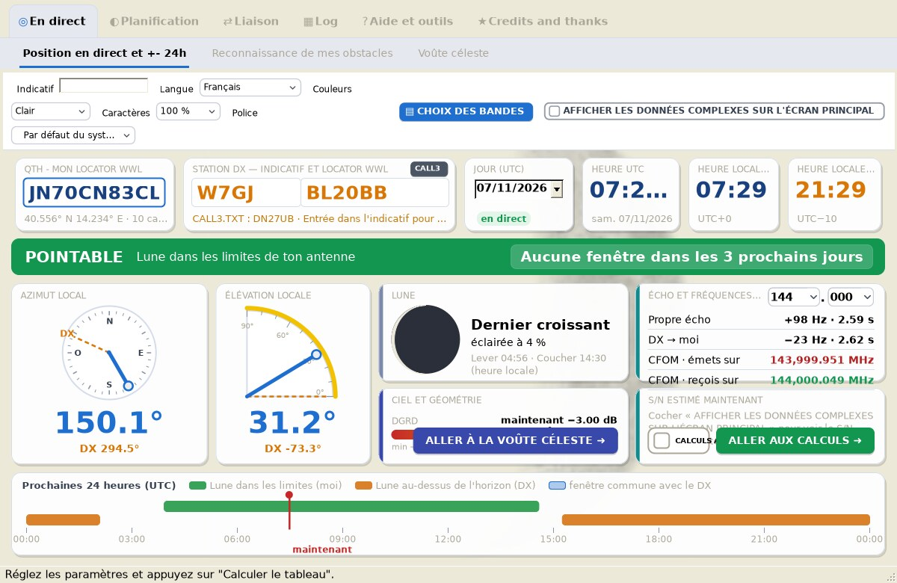</a> Position en direct et +- 24h</td><td width="33%" align="center"><a href="docs/screenshots/fr-2.jpg">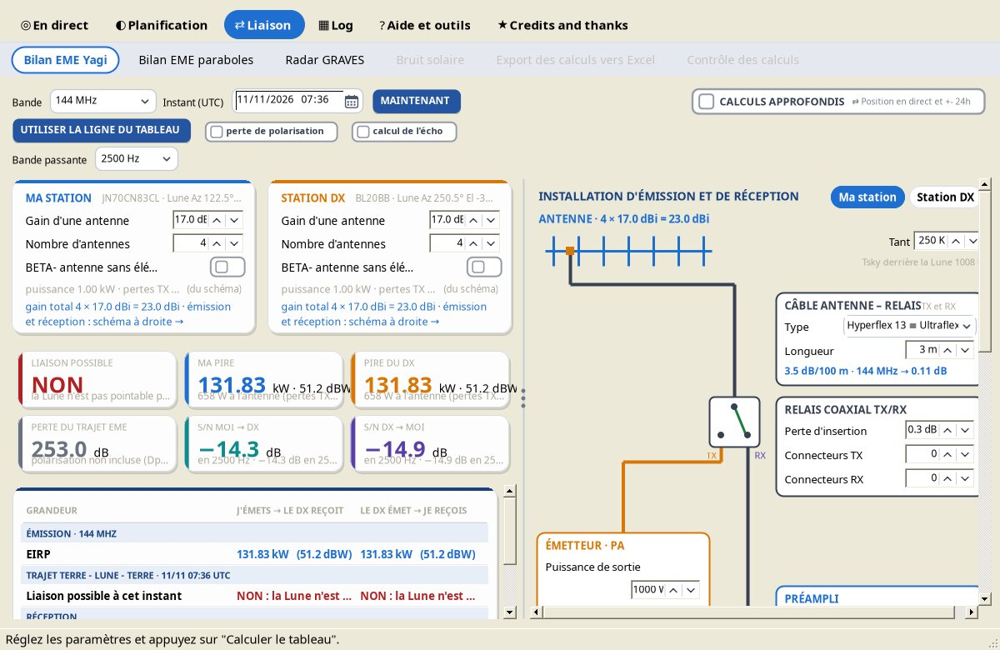</a> Bilan EME</td><td width="33%" align="center"><a href="docs/screenshots/fr-3.jpg">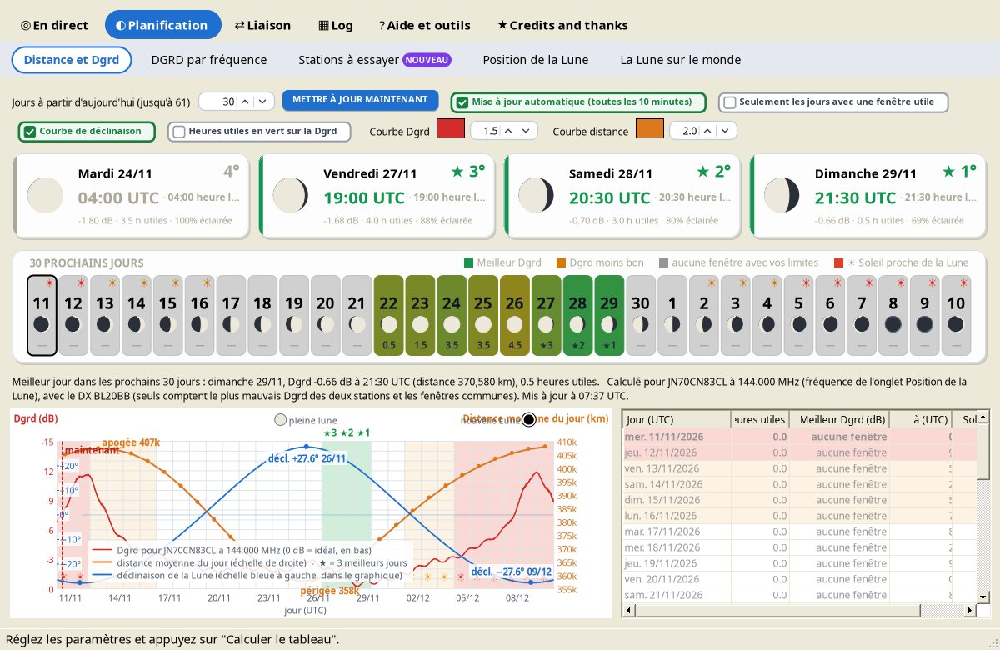</a> Distance et Dgrd</td></tr></table>

YAEC réunit dans un seul programme tout ce qu'il faut pour trafiquer en EME (Terre–Lune–Terre) sur 50, 70, 144, 222, 432 et 902 MHz et 23 cm (1296 MHz), surtout quand la station a des contraintes : une antenne sans élévation, un rotor à débattement limité, des obstacles qui cachent une partie du ciel. Il ne dit pas seulement où se trouve la Lune, mais si **votre** antenne peut vraiment l'atteindre, quand et dans quelles conditions. Les bandes au-dessus de 432 MHz sont en cours de finalisation, mais le DGRD est déjà calculé correctement à chaque fréquence ; d'autres conseils pour ceux qui débutent au-dessus de 900 MHz suivront.

**En direct**
- **Position en direct et +- 24h** – l'écran principal, mis à jour chaque seconde : votre locator et celui du DX (4 à 14 caractères), fréquence, horloges UTC, locale et du DX, bande d'état (pointable, hors limites, sous l'horizon, fenêtre commune) avec compte à rebours, boussole et arc d'élévation. En saisissant l'indicatif du DX, son locator vient de CALL3.TXT.
- **Reconnaissance de mes obstacles** – carte aérienne ou topographique centrée sur votre station avec le ciel dessiné dessus : position de la Lune, trajet des 24 prochaines heures, lever et coucher, limites de l'antenne à faire glisser à la souris.
- **Mon horizon** – *Horizon du relief* : panorama du relief autour de ta station à partir des altitudes SRTM1 (environ 30 m), avec la courbure terrestre et la réfraction, sur le fond de la voûte céleste (trois échelles de couleurs) ou d'un ciel bleu clair ; trajectoire de la Lune, lever et coucher au-dessus du relief, principaux obstacles nommés d'après OpenStreetMap et minutes de Lune perdues. Une case fait du relief l'élévation minimale dans tout le programme. *Carte du bruit local (NJ9R)* : grille azimut × élévation où tu notes le bruit vu dans WSJT-X en tournant l'antenne ; les heures où la Lune est dans une direction bruyante reçoivent un ⚠.
- **Voûte céleste** – le ciel vu de votre QTH avec les couleurs du bruit du ciel à votre fréquence, les limites de l'antenne, l'horizon du DX, les radiosources, le Soleil et le trajet de la Lune.

**Planification**
- **Distance et Dgrd** – de 7 à 61 jours de Dgrd et de distance moyenne de la Lune, avec la déclinaison superposée, périgée, apogée, nouvelle lune, les trois meilleurs jours (dans l'ordre chronologique), un éventuel quatrième jour utile et une alerte pour les jours où la Lune est proche du Soleil. Seules comptent les heures où la Lune est vraiment pointable avec vos limites.
- **DGRD par fréquence** – le Dgrd à votre fréquence de travail avec le bruit réel de votre station et le ciel moyenné sur le faisceau de l'antenne, comparé au calcul habituel de WSJT-X ; le choix vaut pour tout le programme.
- **Stations à essayer** – pour le jour choisi, les stations actives sur le chat EME de N0UK (144 MHz) ayant une fenêtre commune avec toi, la meilleure par champ de locator, classées par un indice de 0 à 100 tiré du S/N dans les deux sens ; l'installation du DX est lue dans ce qu'il écrit sur le chat. Un calcul d'exemple, très approximatif, idée de Matteo IW5DHN.
- **Position de la Lune** – tableau pour la période choisie, coloré selon la pointabilité, avec les fenêtres communes à vous et au DX ; export CSV pour Excel.
- **La Lune sur le monde** – carte du monde colorée selon l'élévation de la Lune vue de chaque lieu ; un clic fait de ce point le DX.

**Liaison**
- **Bilan EME Yagi** – bilan de liaison pour chaque bande, mémorisé bande par bande : six indicateurs (liaison possible, ma PIRE, PIRE du DX, perte de trajet, S/B moi → DX et DX → moi, aussi avec le Soleil et en 2500 Hz), le tableau complet des étapes et un schéma interactif de la station (antenne, câbles, relais, préampli, transverter, radio). Gain de sol pour les antennes sans élévation. Modes à période de 60 s : JT65, Q65-60A, Q65-60B, Q65-60C et personnalisé. Calcul de l'écho (*J'émets et je reçois mon propre écho*) : niveau, retard et Doppler de l'écho.
- **Bilan EME paraboles** – le même bilan, écho compris, pour les paraboles sur 432, 902 et 1296 MHz, à foyer primaire ou offset (W2IMU) : gain avec la formule de PE1RKI, ouverture du faisceau 70·λ/D, préampli à un ou deux étages, transverter et puissance d'attaque du PA ; sur 23 cm, polarisation circulaire avec 0,4 dB de perte (KA1GT).
- **Radar GRAVES** – le radar français GRAVES (143,050 MHz) comme banc d'essai : quand la Lune est dans son faisceau et dans les limites de votre antenne, avec le Doppler et le retard de l'écho.
- **Bruit solaire** – télécharge les flux solaires mesurés par le réseau RSTN (NOAA) et estime de combien le Soleil augmente le bruit du récepteur près de la nouvelle lune.
- **Export des calculs vers Excel** et **Contrôle des calculs** – le bilan sous forme de feuille Excel, et chaque formule avec les valeurs substituées, étape par étape, pour le bilan Yagi ou paraboles.

**Log, aide et outils**
- **Carte WWL et ADIF** – grille Maidenhead avec les carrés contactés et confirmés à partir de votre fichier ADIF ou téléchargés directement de LoTW, aussi par bande et EME seulement.
- **MANUEL D'UTILISATION** et **THÉORIE ET CONSEILS SUR L'EME** – manuels complets dans le programme, dans toutes les langues, avec sommaire cliquable, recherche, formules et sources ; exportables en Word. Le manuel de théorie comprend les conseils d'opérateurs EME expérimentés, une section sur les chats Internet et les tableaux d'antennes de VE7BQH.
- **CÂBLES COAXIAUX** – base de données des câbles 50 Ω avec l'atténuation de 50 à 1296 MHz (valeurs des fiches techniques et formule α = k1·√f + k2·f) et la source de chaque valeur ; triable, filtrable, avec un calcul de perte et un bouton qui envoie le câble au bilan EME. On peut ajouter ses propres câbles.

**Et aussi**
- CALL3.TXT téléchargé chez W7GJ et WSJT-X Improved, fusionné, renouvelé tous les 7 jours et copié dans WSJT-X sur demande.
- Alertes d'absorption de la calotte polaire et aurorale (PCA) quand une station est au-delà des cercles polaires ou dans la zone aurorale.
- 37 langues ; thèmes de couleurs clair, nuit (bleu), noir, huit pastels et trois d'IP-TRX-CTRL (bleu, violet, vert).
- Positions de la Lune précises à environ 0,01° (Meeus, ELP-2000/82), tous les calculs sur votre ordinateur ; données dans un seul dossier `data`.

### Español

<table><tr><td width="33%" align="center"><a href="docs/screenshots/es-1.jpg">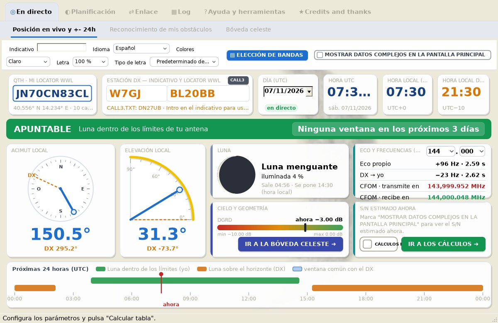</a> Posición en vivo y +- 24h</td><td width="33%" align="center"><a href="docs/screenshots/es-2.jpg">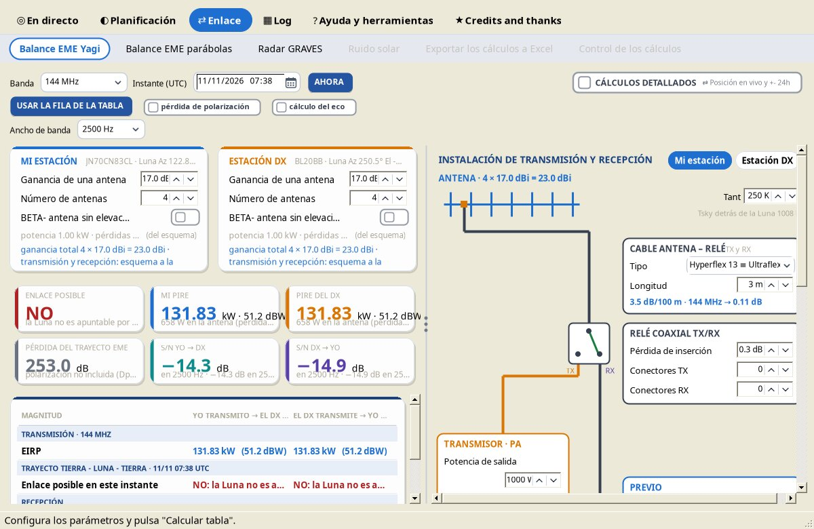</a> Balance EME</td><td width="33%" align="center"><a href="docs/screenshots/es-3.jpg">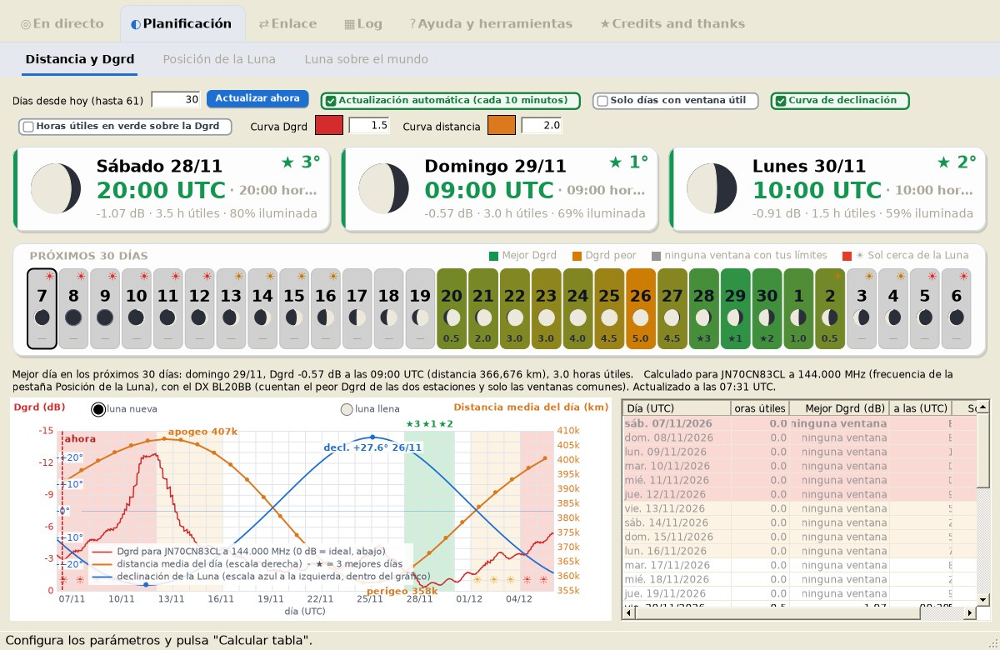</a> Distancia y Dgrd</td></tr></table>

YAEC reúne en un solo programa todo lo necesario para operar EME (Tierra–Luna–Tierra) en 50, 70, 144, 222, 432 y 902 MHz y 23 cm (1296 MHz), sobre todo cuando la estación tiene limitaciones: una antena sin elevación, un rotor de recorrido limitado, obstáculos que ocultan parte del cielo. No solo dice dónde está la Luna, sino si **tu** antena puede alcanzarla de verdad, cuándo y en qué condiciones. Las bandas por encima de 432 MHz están en fase de finalización, pero el DGRD ya se calcula correctamente en cada frecuencia; seguirán más consejos para quien se inicia por encima de 900 MHz.

**En directo**
- **Posición en vivo y +- 24h** – la pantalla principal, actualizada cada segundo: tu locator y el del DX (de 4 a 14 caracteres), frecuencia, relojes UTC, local y del DX, franja de estado (apuntable, fuera de límites, bajo el horizonte, ventana común) con cuenta atrás, brújula y arco de elevación. Al escribir el indicativo del DX, su locator llega del CALL3.TXT.
- **Reconocimiento de mis obstáculos** – mapa aéreo o topográfico centrado en tu estación con el cielo dibujado encima: posición de la Luna, trayectoria de las próximas 24 horas, salida y puesta, límites de la antena que se arrastran con el ratón.
- **Mi horizonte** – *Horizonte del terreno*: panorama del terreno alrededor de tu estación con los datos de altitud SRTM1 (unos 30 m), con curvatura terrestre y refracción, sobre el fondo de la bóveda celeste (tres escalas de color) o de un cielo celeste; trayectoria de la Luna, salida y puesta sobre el terreno, obstáculos principales con los nombres de OpenStreetMap y minutos de Luna perdidos. Una casilla convierte el terreno en la elevación mínima en todo el programa. *Mapa del ruido local (NJ9R)*: cuadrícula acimut × elevación donde anotas el ruido visto en WSJT-X al girar la antena; las horas con la Luna en una dirección ruidosa llevan ⚠.
- **Bóveda celeste** – el cielo visto desde tu QTH con los colores del ruido del cielo en tu frecuencia, los límites de la antena, el horizonte del DX, las radiofuentes, el Sol y la trayectoria de la Luna.

**Planificación**
- **Distancia y Dgrd** – de 7 a 61 días de Dgrd y distancia media de la Luna, con la declinación superpuesta, perigeo, apogeo, luna nueva, los tres mejores días (por orden de fecha), un posible cuarto día útil y un aviso para los días con la Luna cerca del Sol. Solo cuentan las horas en que la Luna es realmente apuntable con tus límites.
- **DGRD por frecuencia** – el Dgrd en tu frecuencia de trabajo con el ruido real de tu estación y el cielo promediado sobre el haz de la antena, comparado con el cálculo habitual de WSJT-X; la elección vale en todo el programa.
- **Estaciones para probar** – para el día elegido, las estaciones activas en el chat EME de N0UK (144 MHz) con una ventana común contigo, la mejor por campo de locator, ordenadas por un índice de 0 a 100 obtenido del S/N en ambos sentidos; el equipo del DX se lee de lo que escribe en el chat. Un cálculo de ejemplo, muy aproximado, idea de Matteo IW5DHN.
- **Posición de la Luna** – tabla para el periodo elegido, coloreada según la apuntabilidad, con las ventanas comunes para ti y el DX; exportación CSV para Excel.
- **La Luna sobre el mundo** – mapa del mundo coloreado según la elevación de la Luna vista desde cada lugar; con un clic ese punto pasa a ser el DX.

**Enlace**
- **Balance EME Yagi** – balance del enlace para cada banda, guardado banda por banda: seis indicadores (enlace posible, mi PIRE, PIRE del DX, pérdida de trayecto, S/R yo → DX y DX → yo, también con el Sol y en 2500 Hz), la tabla completa de pasos y un esquema interactivo de la estación (antena, cables, relé, preamplificador, transverter, radio). Ganancia de suelo para antenas sin elevación. Modos con periodo de 60 s: JT65, Q65-60A, Q65-60B, Q65-60C y personalizado. Cálculo del eco (*Yo transmito y recibo mi propio eco*): nivel, retardo y Doppler del eco.
- **Balance EME parábolas** – el mismo balance, eco incluido, para antenas parabólicas en 432, 902 y 1296 MHz, de foco primario u offset (W2IMU): ganancia con la fórmula de PE1RKI, ancho de haz 70·λ/D, preamplificador de una o dos etapas, transverter y excitación del PA; en 23 cm, polarización circular con 0,4 dB de pérdida (KA1GT).
- **Radar GRAVES** – el radar francés GRAVES (143,050 MHz) como banco de pruebas: cuándo la Luna está en su haz y dentro de los límites de tu antena, con el Doppler y el retardo del eco.
- **Ruido solar** – descarga los flujos solares medidos por la red RSTN (NOAA) y estima cuánto aumenta el Sol el ruido del receptor cerca de la luna nueva.
- **Exportar los cálculos a Excel** y **Control de los cálculos** – el balance como hoja de Excel, y cada fórmula con los valores sustituidos, paso a paso, para el balance Yagi o parábolas.

**Log, ayuda y herramientas**
- **Mapa WWL y ADIF** – cuadrícula Maidenhead con los cuadrados trabajados y confirmados desde tu fichero ADIF o descargados directamente de LoTW, también por banda y solo EME.
- **MANUAL DE USO** y **TEORÍA Y CONSEJOS SOBRE EME** – manuales completos dentro del programa en todos los idiomas, con índice clicable, búsqueda, fórmulas y fuentes; exportables a Word. El manual de teoría incluye los consejos de operadores EME experimentados, un apartado sobre los chats de Internet y las tablas de antenas de VE7BQH.
- **CABLES COAXIALES** – base de datos de cables de 50 Ω con la atenuación de 50 a 1296 MHz (valores de las hojas de datos y fórmula α = k1·√f + k2·f) y la fuente de cada valor; ordenable, filtrable, con cálculo de pérdida y un botón que lleva el cable al balance EME. Se pueden añadir cables propios.

**Además**
- CALL3.TXT descargado de W7GJ y de WSJT-X Improved, fusionado, renovado cada 7 días y copiado en WSJT-X a petición.
- Avisos de absorción del casquete polar y auroral (PCA) cuando una estación está más allá de los círculos polares o en la zona auroral.
- 37 idiomas; esquemas de colores claro, noche (azul), negro, ocho pastel y tres de IP-TRX-CTRL (azul, violeta, verde).
- Posiciones de la Luna con una precisión de unos 0,01° (Meeus, ELP-2000/82), todos los cálculos en tu ordenador; datos en una sola carpeta `data`.

### Português

<table><tr><td width="33%" align="center"><a href="docs/screenshots/pt-1.jpg">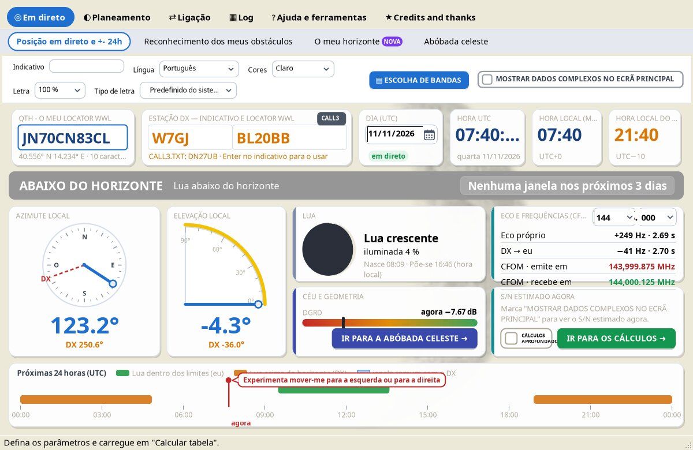</a> Posição em direto e +- 24h</td><td width="33%" align="center"><a href="docs/screenshots/pt-2.jpg">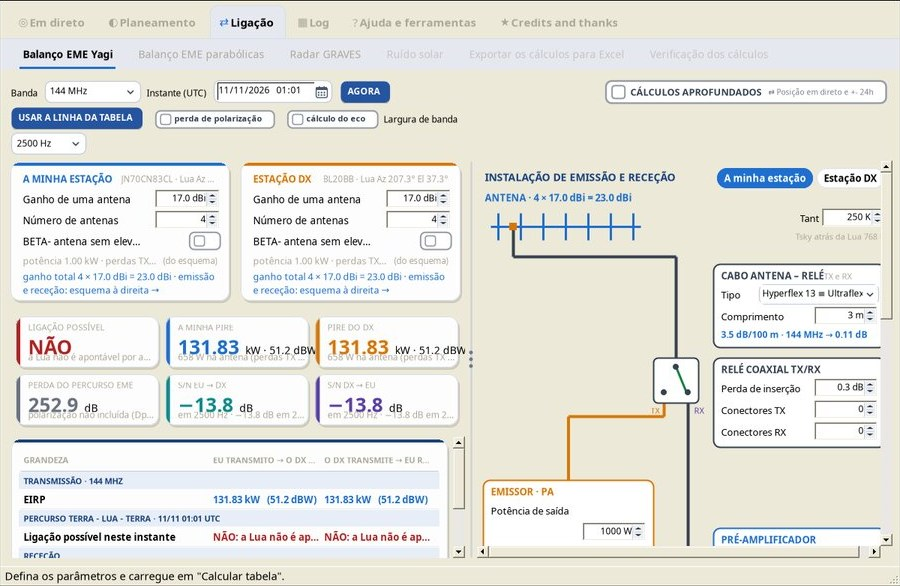</a> Balanço EME Yagi</td><td width="33%" align="center"><a href="docs/screenshots/pt-3.jpg">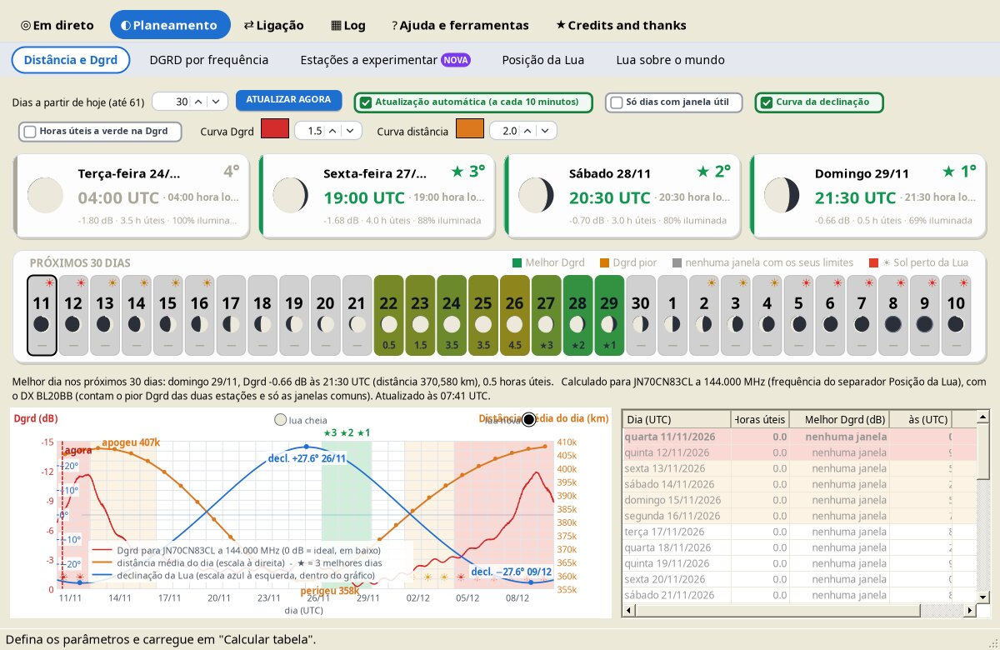</a> Distância e Dgrd</td></tr></table>

O YAEC reúne num só programa tudo o que é preciso para trabalhar em EME (Terra–Lua–Terra) em 50, 70, 144, 222, 432 e 902 MHz e 23 cm (1296 MHz), sobretudo quando a estação tem limitações: uma antena sem elevação, um rotor de curso limitado, obstáculos que escondem parte do céu. Não diz apenas onde está a Lua, mas se a **tua** antena a alcança mesmo, quando e em que condições. As bandas acima de 432 MHz estão a ser concluídas, mas a DGRD já é calculada corretamente em todas as frequências; seguir-se-ão mais conselhos para quem começa acima de 900 MHz.

**Em direto**
- **Posição em direto e +- 24h** – o ecrã principal, atualizado a cada segundo: o teu locator e o do DX (de 4 a 14 caracteres), frequência, relógios UTC, local e do DX, faixa de estado (apontável, fora dos limites, abaixo do horizonte, janela comum) com contagem decrescente, bússola e arco de elevação. Ao escrever o indicativo do DX, o locator vem do CALL3.TXT.
- **Reconhecimento dos meus obstáculos** – mapa aéreo ou topográfico centrado na tua estação com o céu desenhado por cima: posição da Lua, percurso nas próximas 24 horas, nascimento e ocaso, limites da antena que se arrastam com o rato.
- **O meu horizonte** – *Horizonte do relevo*: panorama do terreno em redor da tua estação a partir das altitudes SRTM1 (cerca de 30 m), com curvatura terrestre e refração, sobre o fundo da abóbada celeste (três escalas de cores) ou de um céu azul-claro; trajetória da Lua, nascer e ocaso acima do terreno, obstáculos principais com os nomes do OpenStreetMap e minutos de Lua perdidos. Uma caixa torna o terreno a elevação mínima em todo o programa. *Mapa do ruído local (NJ9R)*: grelha azimute × elevação onde anotas o ruído visto no WSJT-X ao rodar a antena; as horas com a Lua numa direção ruidosa recebem ⚠.
- **Abóbada celeste** – o céu visto do teu QTH com as cores do ruído do céu na tua frequência, os limites da antena, o horizonte do DX, as radiofontes, o Sol e o percurso da Lua.

**Planeamento**
- **Distância e Dgrd** – de 7 a 61 dias de Dgrd e distância média da Lua, com a declinação sobreposta, perigeu, apogeu, lua nova, os três melhores dias (por ordem de data), um eventual quarto dia útil e um aviso para os dias com a Lua perto do Sol. Só contam as horas em que a Lua é realmente apontável com os teus limites.
- **DGRD por frequência** – a Dgrd na tua frequência de trabalho com o ruído real da tua estação e o céu médio sobre o feixe da antena, comparada com o cálculo habitual do WSJT-X; a escolha vale para todo o programa.
- **Estações a experimentar** – para o dia escolhido, as estações ativas no chat EME de N0UK (144 MHz) com uma janela comum contigo, a melhor por campo de locator, ordenadas por um índice de 0 a 100 obtido do S/N nos dois sentidos; a instalação do DX é lida do que escreve no chat. Um cálculo de exemplo, muito aproximado, ideia de Matteo IW5DHN.
- **Posição da Lua** – tabela para o período escolhido, colorida segundo a apontabilidade, com as janelas comuns a ti e ao DX; exportação CSV para Excel.
- **Lua sobre o mundo** – mapa do mundo colorido segundo a elevação da Lua vista de cada lugar; com um clique esse ponto passa a ser o DX.

**Ligação**
- **Balanço EME Yagi** – balanço da ligação para cada banda, guardado banda a banda: seis indicadores (ligação possível, o meu EIRP, EIRP do DX, perda de percurso, S/N eu → DX e DX → eu, também com o Sol e em 2500 Hz), a tabela completa dos passos e um esquema interativo da estação (antena, cabos, relé, pré-amplificador, transverter, rádio). Ganho do solo para antenas sem elevação. Modos com período de 60 s: JT65, Q65-60A, Q65-60B, Q65-60C e personalizado. Cálculo do eco (*Eu transmito e recebo o meu próprio eco*): nível, atraso e Doppler do eco.
- **Balanço EME parabólicas** – o mesmo balanço, eco incluído, para antenas parabólicas em 432, 902 e 1296 MHz, de foco primário ou offset (W2IMU): ganho com a fórmula de PE1RKI, largura do feixe 70·λ/D, pré-amplificador de um ou dois andares, transverter e excitação do PA; em 23 cm, polarização circular com 0,4 dB de perda (KA1GT).
- **Radar GRAVES** – o radar francês GRAVES (143,050 MHz) como banco de ensaio: quando a Lua está no seu feixe e dentro dos limites da tua antena, com o Doppler e o atraso do eco.
- **Ruído solar** – descarrega os fluxos solares medidos pela rede RSTN (NOAA) e estima quanto o Sol aumenta o ruído do recetor perto da lua nova.
- **Exportar os cálculos para Excel** e **Verificação dos cálculos** – o balanço como folha de Excel, e cada fórmula com os valores substituídos, passo a passo, para o balanço Yagi ou parabólicas.

**Registo, ajuda e ferramentas**
- **Mapa WWL e ADIF** – grelha Maidenhead com os quadrados trabalhados e confirmados a partir do teu ficheiro ADIF ou descarregados diretamente do LoTW, também por banda e só EME.
- **MANUAL DE UTILIZAÇÃO** e **TEORIA E CONSELHOS SOBRE EME** – manuais completos dentro do programa em todas as línguas, com índice clicável, pesquisa, fórmulas e fontes; exportáveis para Word. O manual de teoria inclui os conselhos de operadores EME experientes, uma secção sobre os chats na Internet e as tabelas de antenas de VE7BQH.
- **CABOS COAXIAIS** – base de dados de cabos de 50 Ω com a atenuação de 50 a 1296 MHz (valores das fichas técnicas e fórmula α = k1·√f + k2·f) e a fonte de cada valor; ordenável, filtrável, com cálculo de perda e um botão que leva o cabo para o balanço EME. Podem acrescentar-se cabos próprios.

**E ainda**
- CALL3.TXT descarregado de W7GJ e do WSJT-X Improved, fundido, renovado a cada 7 dias e copiado para o WSJT-X a pedido.
- Avisos de absorção da calote polar e auroral (PCA) quando uma estação está para lá dos círculos polares ou na zona auroral.
- 37 línguas; esquemas de cores claro, noite (azul), preto, oito pastel e três do IP-TRX-CTRL (azul, violeta, verde).
- Posições da Lua com uma precisão de cerca de 0,01° (Meeus, ELP-2000/82), todos os cálculos no teu computador; dados numa única pasta `data`.

### Türkçe

<table><tr><td width="33%" align="center"><a href="docs/screenshots/tr-1.jpg">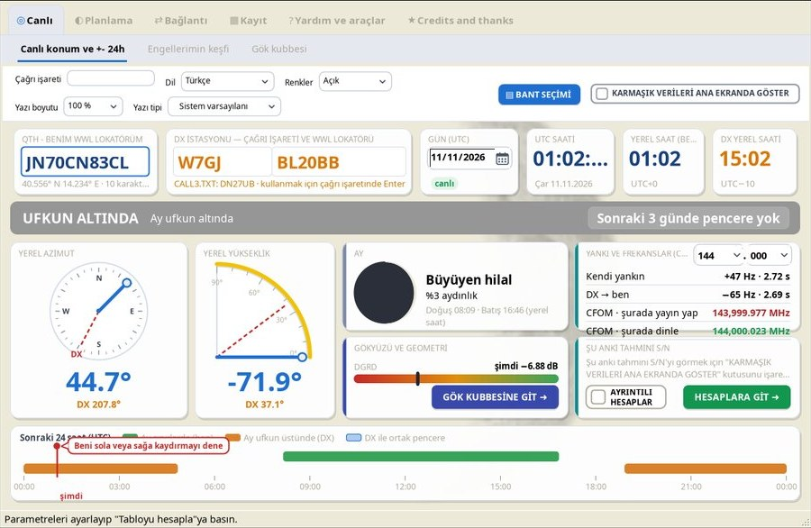</a> Canlı konum ve +- 24h</td><td width="33%" align="center"><a href="docs/screenshots/tr-2.jpg">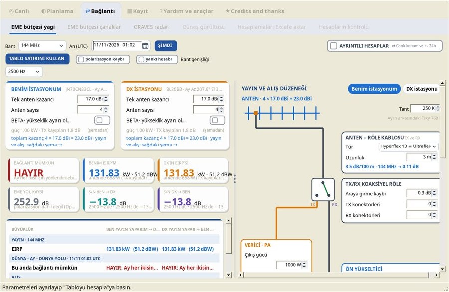</a> EME bütçesi yagi</td><td width="33%" align="center"><a href="docs/screenshots/tr-3.jpg">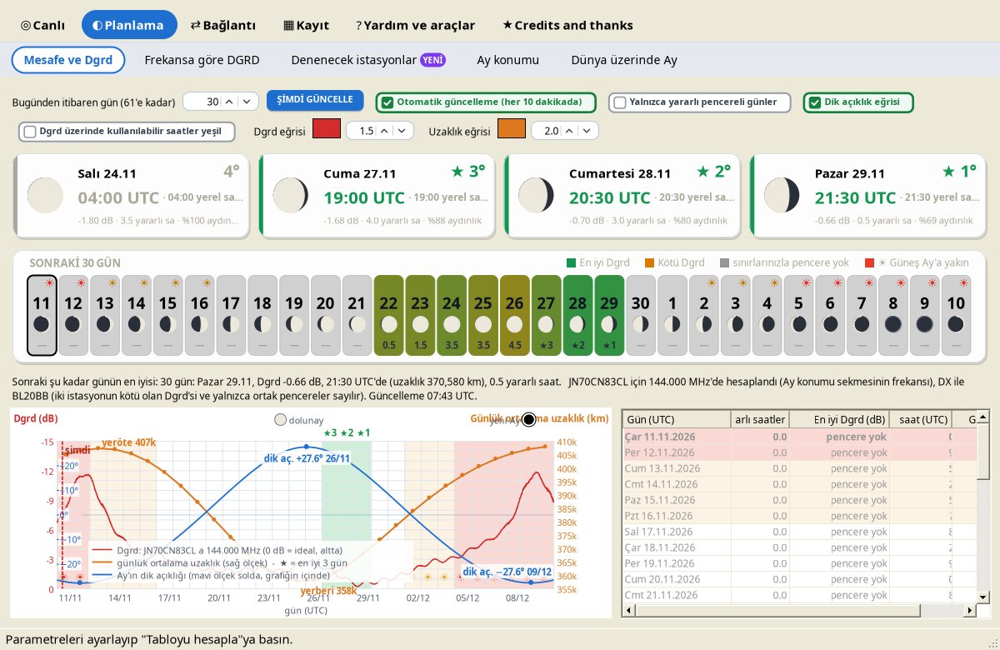</a> Mesafe ve Dgrd</td></tr></table>

YAEC, 50, 70, 144, 222, 432 ve 902 MHz ile 23 cm (1296 MHz) bantlarında EME (Dünya–Ay–Dünya) çalışmak için gereken her şeyi tek bir programda toplar; özellikle istasyonun kısıtları olduğunda: elevasyonu olmayan bir anten, sınırlı dönüşlü bir rotor, gökyüzünün bir kısmını gizleyen engeller. Yalnızca Ay'ın nerede olduğunu değil, **sizin** antenin ona gerçekten ulaşıp ulaşamadığını, ne zaman ve hangi koşullarda ulaştığını söyler. 432 MHz üstündeki bantlar tamamlanma aşamasındadır, ancak DGRD her frekansta zaten doğru hesaplanır; 900 MHz üstüne yeni başlayanlar için daha fazla öneri gelecek.

**Canlı**
- **Canlı konum ve +- 24h** – her saniye güncellenen ana ekran: sizin ve DX'in lokatörü (4 ila 14 karakter), frekans, UTC, yerel ve DX saatleri, geri sayımlı bir durum şeridi (yönlendirilebilir, sınırların dışında, ufkun altında, ortak pencere), pusula ve elevasyon yayı. DX'in çağrı işareti yazıldığında lokatörü CALL3.TXT'den gelir.
- **Engellerimin keşfi** – istasyonunuzu merkeze alan, üzerine gökyüzü çizilmiş hava fotoğrafı veya topografik harita: Ay'ın konumu, sonraki 24 saatteki yolu, doğuş ve batış, fareyle sürüklenen anten sınırları.
- **Ufkum** – *Araziden ufuk*: istasyonunun çevresindeki arazinin SRTM1 yükseklik verilerinden (yaklaşık 30 m), Dünya eğriliği ve kırılmayla hesaplanan panoraması, gök kubbesi (üç renk ölçeği) ya da açık mavi bir gök arka planında; Ay'ın yolu, arazinin üzerinde doğuş ve batış, OpenStreetMap adlarıyla başlıca engeller ve kaybedilen Ay dakikaları. Bir onay kutusu araziyi tüm programda en düşük yükseklik açısı yapar. *Yerel gürültü haritası (NJ9R)*: anteni döndürürken WSJT-X'te görülen gürültüyü yazdığın azimut × yükseklik ızgarası; Ay'ın gürültülü bir yönde olduğu saatler ⚠ alır.
- **Gök kubbesi** – QTH'nizden görülen gökyüzü; frekansınızdaki gök gürültüsü renkleri, anten sınırları, DX'in ufku, radyo kaynakları, Güneş ve Ay'ın yolu.

**Planlama**
- **Mesafe ve Dgrd** – 7 ila 61 günlük Dgrd ve ortalama Ay mesafesi; üzerine bindirilmiş deklinasyon, yerberi, yeröte, yeni Ay, en iyi üç gün (tarih sırasıyla), olası dördüncü kullanışlı gün ve Ay'ın Güneş'e yakın olduğu günler için uyarı. Yalnızca Ay'ın sınırlarınızla gerçekten yönlendirilebilir olduğu saatler sayılır.
- **Frekansa göre DGRD** – istasyonunuzun gerçek gürültüsü ve anten hüzmesi üzerinde ortalanmış gökyüzüyle çalışma frekansınızdaki Dgrd, alışılmış WSJT-X hesabıyla karşılaştırmalı; seçim tüm programda geçerlidir.
- **Denenecek istasyonlar** – seçilen gün için N0UK EME sohbetinde etkin olan ve seninle ortak penceresi bulunan istasyonlar (144 MHz), her lokatör alanından en iyisi, iki yöndeki S/N'den elde edilen 0–100 endeksine göre sıralı; DX'in donanımı sohbette yazdıklarından okunur. Çok kaba bir örnek hesap, fikir Matteo IW5DHN'den.
- **Ay konumu** – seçilen dönem için, yönlendirilebilirliğe göre renklendirilmiş tablo; sizin ve DX'in ortak pencereleriyle; Excel için CSV dışa aktarma.
- **Dünya üzerinde Ay** – her yerden görülen Ay elevasyonuna göre renklendirilmiş dünya haritası; tek tıkla o nokta DX olur.

**Bağlantı**
- **EME bütçesi yagi** – her bant için bağlantı bütçesi, bant bant saklanır: altı gösterge (bağlantı mümkün, benim EIRP'm, DX'in EIRP'si, yol kaybı, S/N ben → DX ve DX → ben, Güneş ile ve 2500 Hz'de de), tüm adımların tablosu ve istasyonun etkileşimli şeması (anten, kablolar, röle, ön yükselteç, transverter, telsiz). Elevasyonsuz antenler için yer kazancı. 60 s periyotlu modlar: JT65, Q65-60A, Q65-60B, Q65-60C ve özel. Yankı hesabı (*Ben yayın yapar ve kendi yankımı alırım*): yankının seviyesi, gecikmesi ve Doppler'i.
- **EME bütçesi çanaklar** – aynı bütçe, yankı dahil, 432, 902 ve 1296 MHz'de birincil odaklı veya ofset (W2IMU) parabolik antenler için: PE1RKI formülüyle kazanç, 70·λ/D hüzme genişliği, tek veya iki katlı ön yükselteç, transverter ve PA sürüşü; 23 cm'de 0,4 dB kayıplı dairesel polarizasyon (KA1GT).
- **GRAVES radarı** – deneme tezgâhı olarak Fransız GRAVES radarı (143,050 MHz): Ay'ın onun hüzmesinde ve anteninizin sınırları içinde olduğu zamanlar, Doppler ve yankı gecikmesiyle.
- **Güneş gürültüsü** – RSTN ağının (NOAA) ölçtüğü Güneş akılarını indirir ve yeni Ay yakınında Güneş'in alıcı gürültüsünü ne kadar artırdığını tahmin eder.
- **Hesaplamaları Excel'e aktar** ve **Hesapların kontrolü** – bütçe bir Excel sayfası olarak ve her formül yerine konmuş değerleriyle adım adım, yagi veya çanak bütçesi için.

**Kayıt, yardım ve araçlar**
- **WWL haritası ve ADIF** – ADIF dosyanızdan veya doğrudan LoTW'den indirilen çalışılmış ve onaylanmış karelerle Maidenhead ızgarası, bant bazında ve yalnızca EME olarak da.
- **KULLANIM KILAVUZU** ve **EME ÜZERİNE TEORİ VE ÖNERİLER** – programın içinde, tüm dillerde, tıklanabilir içindekiler, arama, formüller ve kaynaklarla eksiksiz kılavuzlar; Word'e aktarılabilir. Teori kılavuzunda deneyimli EME operatörlerinin önerileri, internet sohbetleri üzerine bir bölüm ve VE7BQH anten tabloları bulunur.
- **KOAKSİYEL KABLOLAR** – 50 Ω kabloların 50 ila 1296 MHz arasındaki zayıflamasını (veri sayfası değerleri ve α = k1·√f + k2·f formülü) ve her değerin kaynağını içeren veritabanı; sıralanabilir, süzülebilir, kayıp hesabı ve kabloyu EME bütçesine gönderen bir düğmeyle. Kendi kablolarınızı ekleyebilirsiniz.

**Ayrıca**
- W7GJ'den ve WSJT-X Improved'dan indirilen, birleştirilen, 7 günde bir yenilenen ve istenirse WSJT-X'e kopyalanan CALL3.TXT.
- Bir istasyon kutup dairelerinin ötesinde veya auroral bölgede olduğunda kutup başlığı ve auroral soğurma (PCA) uyarıları.
- 37 dil; açık, gece (mavi), siyah, sekiz pastel ve IP-TRX-CTRL'den üç (mavi, mor, yeşil) renk şeması.
- Yaklaşık 0,01° doğrulukta Ay konumları (Meeus, ELP-2000/82), tüm hesaplar bilgisayarınızda; veriler tek bir `data` klasöründe.

### Čeština

<table><tr><td width="33%" align="center"><a href="docs/screenshots/cs-1.jpg">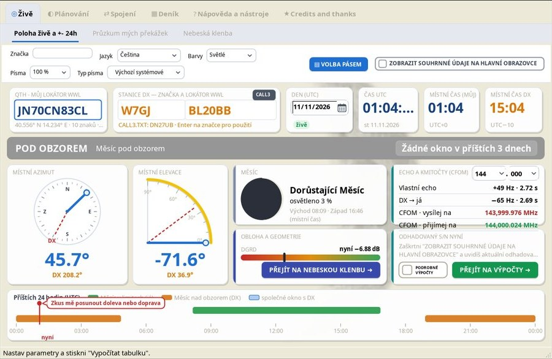</a> Poloha živě a +- 24h</td><td width="33%" align="center"><a href="docs/screenshots/cs-2.jpg">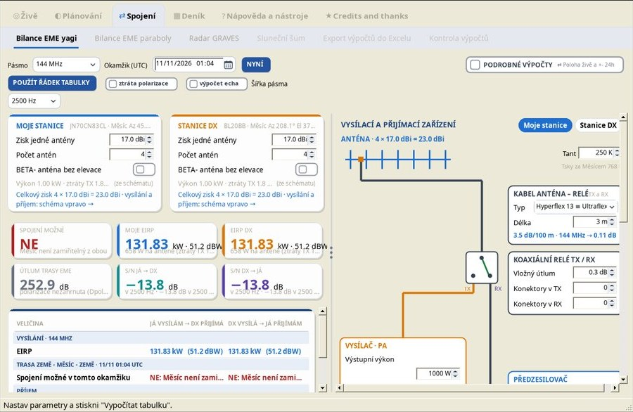</a> Bilance EME yagi</td><td width="33%" align="center"><a href="docs/screenshots/cs-3.jpg">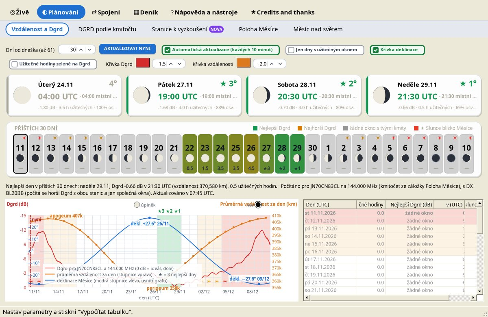</a> Vzdálenost a Dgrd</td></tr></table>

YAEC shromažďuje v jediném programu vše, co je potřeba pro provoz EME (Země–Měsíc–Země) na 50, 70, 144, 222, 432 a 902 MHz a v pásmu 23 cm (1296 MHz), zejména když má stanice omezení: anténu bez elevace, rotátor s omezeným rozsahem, překážky, které zakrývají část oblohy. Neříká jen, kde je Měsíc, ale zda na něj **tvá** anténa opravdu dosáhne, kdy a za jakých podmínek. Pásma nad 432 MHz se dokončují, ale DGRD se již počítá správně na každém kmitočtu; budou následovat další rady pro začátečníky nad 900 MHz.

**Živě**
- **Poloha živě a +- 24h** – hlavní obrazovka, aktualizovaná každou sekundu: tvůj lokátor a lokátor DX (4 až 14 znaků), kmitočet, hodiny UTC, místní a DX, stavový pruh (zamiřitelný, mimo limity, pod obzorem, společné okno) s odpočtem, kompas a oblouk elevace. Po napsání značky DX se lokátor doplní z CALL3.TXT.
- **Průzkum mých překážek** – letecká nebo topografická mapa vystředěná na tvou stanici s oblohou nakreslenou navrch: poloha Měsíce, dráha v příštích 24 hodinách, východ a západ, limity antény, které se táhnou myší.
- **Můj obzor** – *Obzor z terénu*: panorama terénu kolem tvé stanice z výškových dat SRTM1 (asi 30 m), se zakřivením Země a refrakcí, na pozadí nebeské klenby (tři barevné škály) nebo světle modrého nebe; dráha Měsíce, východ a západ nad terénem, hlavní překážky s názvy z OpenStreetMap a ztracené minuty Měsíce. Jedno políčko udělá z terénu minimální elevaci v celém programu. *Mapa místního rušení (NJ9R)*: mřížka azimut × elevace, do které zapisuješ šum viděný ve WSJT-X při otáčení antény; hodiny s Měsícem v hlučném směru dostanou ⚠.
- **Nebeská klenba** – obloha viděná z tvého QTH s barvami šumu oblohy na tvém kmitočtu, limity antény, obzor DX, rádiové zdroje, Slunce a dráha Měsíce.

**Plánování**
- **Vzdálenost a Dgrd** – 7 až 61 dní Dgrd a průměrné vzdálenosti Měsíce, s překrytou deklinací, perigeem, apogeem, novem, třemi nejlepšími dny (podle data), případným čtvrtým užitečným dnem a upozorněním na dny s Měsícem blízko Slunce. Počítají se jen hodiny, kdy je Měsíc s tvými limity opravdu zamiřitelný.
- **DGRD podle kmitočtu** – Dgrd na tvém pracovním kmitočtu se skutečným šumem tvé stanice a oblohou průměrovanou přes svazek antény, porovnaná s obvyklým výpočtem WSJT-X; volba platí v celém programu.
- **Stanice k vyzkoušení** – pro zvolený den stanice aktivní v EME chatu N0UK (144 MHz) se společným oknem, nejlepší v každém poli lokátoru, seřazené podle indexu 0 až 100 z S/N v obou směrech; vybavení DX se čte z toho, co píše v chatu. Hrubý ukázkový výpočet, nápad Matteo IW5DHN.
- **Poloha Měsíce** – tabulka pro zvolené období, obarvená podle zamiřitelnosti, se společnými okny pro tebe a DX; export CSV pro Excel.
- **Měsíc nad světem** – mapa světa obarvená podle elevace Měsíce viděné z každého místa; jedním kliknutím se bod stane stanicí DX.

**Spojení**
- **Bilance EME yagi** – bilance spojení pro každé pásmo, ukládaná pásmo po pásmu: šest ukazatelů (spojení možné, moje EIRP, EIRP DX, útlum trasy, S/N já → DX a DX → já, i se Sluncem a v 2500 Hz), úplná tabulka kroků a interaktivní schéma stanice (anténa, kabely, relé, předzesilovač, transvertor, rádio). Ground gain pro antény bez elevace. Druhy provozu s periodou 60 s: JT65, Q65-60A, Q65-60B, Q65-60C a vlastní. Výpočet echa (*Vysílám a přijímám své echo*): úroveň, zpoždění a Doppler echa.
- **Bilance EME paraboly** – stejná bilance, včetně echa, pro parabolické antény na 432, 902 a 1296 MHz, s primárním ohniskem nebo offsetové (W2IMU): zisk podle vzorce PE1RKI, šířka svazku 70·λ/D, jedno- nebo dvoustupňový předzesilovač, transvertor a buzení PA; v pásmu 23 cm kruhová polarizace se ztrátou 0,4 dB (KA1GT).
- **Radar GRAVES** – francouzský radar GRAVES (143,050 MHz) jako zkušební stolice: kdy je Měsíc v jeho svazku a v limitech tvé antény, s Dopplerem a zpožděním echa.
- **Sluneční šum** – stáhne sluneční toky měřené sítí RSTN (NOAA) a odhadne, o kolik Slunce zvýší šum přijímače v blízkosti novu.
- **Export výpočtů do Excelu** a **Kontrola výpočtů** – bilance jako list Excelu a každý vzorec s dosazenými hodnotami, krok za krokem, pro bilanci yagi nebo parabol.

**Deník, nápověda a nástroje**
- **Mapa WWL a ADIF** – síť Maidenhead s pracovanými a potvrzenými čtverci z tvého souboru ADIF nebo stažené přímo z LoTW, i podle pásma a jen EME.
- **PŘÍRUČKA K POUŽITÍ** a **TEORIE A RADY K EME** – úplné příručky uvnitř programu ve všech jazycích, s klikatelným obsahem, vyhledáváním, vzorci a zdroji; exportovatelné do Wordu. Příručka teorie obsahuje rady zkušených operátorů EME, oddíl o chatech na internetu a tabulky antén VE7BQH.
- **KOAXIÁLNÍ KABELY** – databáze kabelů 50 Ω s útlumem od 50 do 1296 MHz (hodnoty z katalogových listů a vzorec α = k1·√f + k2·f) a zdrojem každé hodnoty; řaditelná, filtrovatelná, s výpočtem ztráty a tlačítkem, které přenese kabel do bilance EME. Lze přidat vlastní kabely.

**Dále**
- CALL3.TXT stažený od W7GJ a z WSJT-X Improved, sloučený, obnovovaný každých 7 dní a na požádání zkopírovaný do WSJT-X.
- Upozornění na absorpci v polární čepičce a aurorální absorpci (PCA), když je stanice za polárními kruhy nebo v aurorální zóně.
- 37 jazyků; barevná schémata světlé, noční (modré), černé, osm pastelových a tři z IP-TRX-CTRL (modré, fialové, zelené).
- Polohy Měsíce s přesností asi 0,01° (Meeus, ELP-2000/82), všechny výpočty na tvém počítači; data v jediné složce `data`.

### Slovenčina

<table><tr><td width="33%" align="center"><a href="docs/screenshots/sk-1.jpg">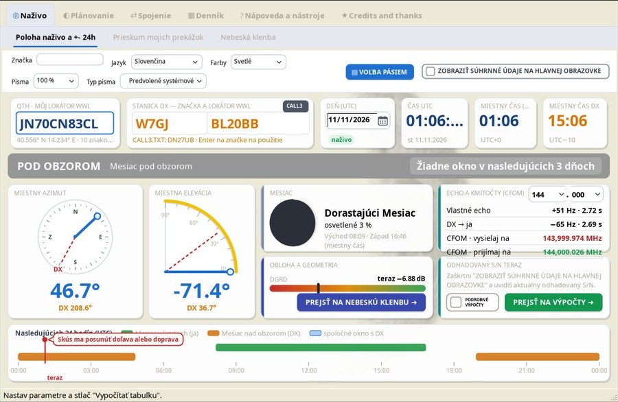</a> Poloha naživo a +- 24h</td><td width="33%" align="center"><a href="docs/screenshots/sk-2.jpg">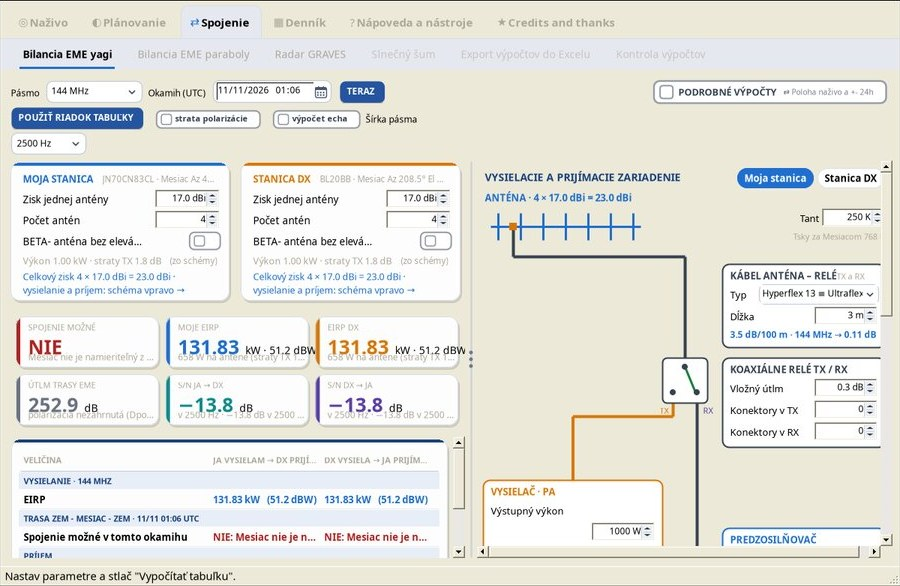</a> Bilancia EME yagi</td><td width="33%" align="center"><a href="docs/screenshots/sk-3.jpg">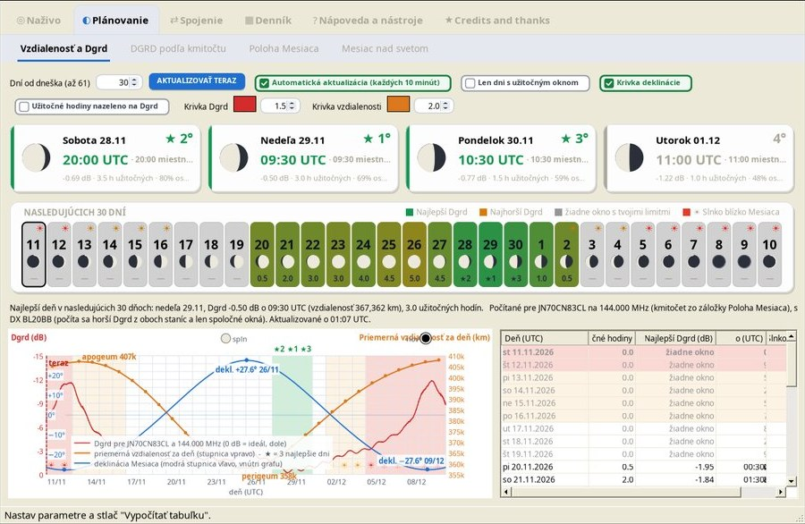</a> Vzdialenosť a Dgrd</td></tr></table>

YAEC zhromažďuje v jedinom programe všetko, čo treba na prevádzku EME (Zem–Mesiac–Zem) na 50, 70, 144, 222, 432 a 902 MHz a v pásme 23 cm (1296 MHz), najmä keď má stanica obmedzenia: anténu bez elevácie, rotátor s obmedzeným rozsahom, prekážky, ktoré zakrývajú časť oblohy. Nehovorí len, kde je Mesiac, ale či naň **tvoja** anténa naozaj dosiahne, kedy a za akých podmienok. Pásma nad 432 MHz sa dokončujú, ale DGRD sa už počíta správne na každom kmitočte; budú nasledovať ďalšie rady pre začiatočníkov nad 900 MHz.

**Naživo**
- **Poloha naživo a +- 24h** – hlavná obrazovka, aktualizovaná každú sekundu: tvoj lokátor a lokátor DX (4 až 14 znakov), kmitočet, hodiny UTC, miestne a DX, stavový pás (namieriteľný, mimo limitov, pod obzorom, spoločné okno) s odpočtom, kompas a oblúk elevácie. Po napísaní značky DX sa lokátor doplní z CALL3.TXT.
- **Prieskum mojich prekážok** – letecká alebo topografická mapa vycentrovaná na tvoju stanicu s oblohou nakreslenou navrchu: poloha Mesiaca, dráha v nasledujúcich 24 hodinách, východ a západ, limity antény, ktoré sa ťahajú myšou.
- **Môj obzor** – *Obzor z terénu*: panoráma terénu okolo tvojej stanice z výškových dát SRTM1 (asi 30 m), so zakrivením Zeme a refrakciou, na pozadí nebeskej klenby (tri farebné škály) alebo svetlomodrej oblohy; dráha Mesiaca, východ a západ nad terénom, hlavné prekážky s názvami z OpenStreetMap a stratené minúty Mesiaca. Jedno políčko urobí z terénu minimálnu eleváciu v celom programe. *Mapa miestneho rušenia (NJ9R)*: mriežka azimut × elevácia, do ktorej zapisuješ šum videný vo WSJT-X pri otáčaní antény; hodiny s Mesiacom v hlučnom smere dostanú ⚠.
- **Nebeská klenba** – obloha videná z tvojho QTH s farbami šumu oblohy na tvojom kmitočte, limity antény, obzor DX, rádiové zdroje, Slnko a dráha Mesiaca.

**Plánovanie**
- **Vzdialenosť a Dgrd** – 7 až 61 dní Dgrd a priemernej vzdialenosti Mesiaca, s prekrytou deklináciou, perigeom, apogeom, novom, tromi najlepšími dňami (podľa dátumu), prípadným štvrtým užitočným dňom a upozornením na dni s Mesiacom blízko Slnka. Počítajú sa len hodiny, keď je Mesiac s tvojimi limitmi naozaj namieriteľný.
- **DGRD podľa kmitočtu** – Dgrd na tvojom pracovnom kmitočte so skutočným šumom tvojej stanice a oblohou priemerovanou cez zväzok antény, porovnaný s obvyklým výpočtom WSJT-X; voľba platí v celom programe.
- **Stanice na vyskúšanie** – pre zvolený deň stanice aktívne v EME čete N0UK (144 MHz) so spoločným oknom, najlepšia v každom poli lokátora, zoradené podľa indexu 0 až 100 zo S/N v oboch smeroch; vybavenie DX sa číta z toho, čo píše v čete. Hrubý ukážkový výpočet, nápad Matteo IW5DHN.
- **Poloha Mesiaca** – tabuľka pre zvolené obdobie, zafarbená podľa namieriteľnosti, so spoločnými oknami pre teba a DX; export CSV pre Excel.
- **Mesiac nad svetom** – mapa sveta zafarbená podľa elevácie Mesiaca videnej z každého miesta; jedným kliknutím sa bod stane stanicou DX.

**Spojenie**
- **Bilancia EME yagi** – bilancia spojenia pre každé pásmo, ukladaná pásmo po pásme: šesť ukazovateľov (spojenie možné, moje EIRP, EIRP DX, útlm trasy, S/N ja → DX a DX → ja, aj so Slnkom a v 2500 Hz), úplná tabuľka krokov a interaktívna schéma stanice (anténa, káble, relé, predzosilňovač, transvertor, rádio). Ground gain pre antény bez elevácie. Druhy prevádzky s periódou 60 s: JT65, Q65-60A, Q65-60B, Q65-60C a vlastný. Výpočet echa (*Vysielam a prijímam svoje echo*): úroveň, oneskorenie a Doppler echa.
- **Bilancia EME paraboly** – rovnaká bilancia, vrátane echa, pre parabolické antény na 432, 902 a 1296 MHz, s primárnym ohniskom alebo offsetové (W2IMU): zisk podľa vzorca PE1RKI, šírka zväzku 70·λ/D, jedno- alebo dvojstupňový predzosilňovač, transvertor a budenie PA; v pásme 23 cm kruhová polarizácia so stratou 0,4 dB (KA1GT).
- **Radar GRAVES** – francúzsky radar GRAVES (143,050 MHz) ako skúšobná stolica: kedy je Mesiac v jeho zväzku a v limitoch tvojej antény, s Dopplerom a oneskorením echa.
- **Slnečný šum** – stiahne slnečné toky merané sieťou RSTN (NOAA) a odhadne, o koľko Slnko zvýši šum prijímača v blízkosti novu.
- **Export výpočtov do Excelu** a **Kontrola výpočtov** – bilancia ako hárok Excelu a každý vzorec s dosadenými hodnotami, krok za krokom, pre bilanciu yagi alebo parabol.

**Denník, nápoveda a nástroje**
- **Mapa WWL a ADIF** – sieť Maidenhead s pracovanými a potvrdenými štvorcami z tvojho súboru ADIF alebo stiahnutými priamo z LoTW, aj podľa pásma a len EME.
- **PRÍRUČKA NA POUŽITIE** a **TEÓRIA A RADY K EME** – úplné príručky vnútri programu vo všetkých jazykoch, s klikateľným obsahom, vyhľadávaním, vzorcami a zdrojmi; exportovateľné do Wordu. Príručka teórie obsahuje rady skúsených operátorov EME, oddiel o chatoch na internete a tabuľky antén VE7BQH.
- **KOAXIÁLNE KÁBLE** – databáza káblov 50 Ω s útlmom od 50 do 1296 MHz (hodnoty z katalógových listov a vzorec α = k1·√f + k2·f) a zdrojom každej hodnoty; zoraditeľná, filtrovateľná, s výpočtom straty a tlačidlom, ktoré prenesie kábel do bilancie EME. Možno pridať vlastné káble.

**Ďalej**
- CALL3.TXT stiahnutý od W7GJ a z WSJT-X Improved, zlúčený, obnovovaný každých 7 dní a na požiadanie skopírovaný do WSJT-X.
- Upozornenia na absorpciu v polárnej čiapočke a aurorálnu absorpciu (PCA), keď je stanica za polárnymi kruhmi alebo v aurorálnej zóne.
- 37 jazykov; farebné schémy svetlá, nočná (modrá), čierna, osem pastelových a tri z IP-TRX-CTRL (modrá, fialová, zelená).
- Polohy Mesiaca s presnosťou asi 0,01° (Meeus, ELP-2000/82), všetky výpočty na tvojom počítači; údaje v jedinom priečinku `data`.

### 中文

<table><tr><td width="33%" align="center"><a href="docs/screenshots/zh-1.jpg">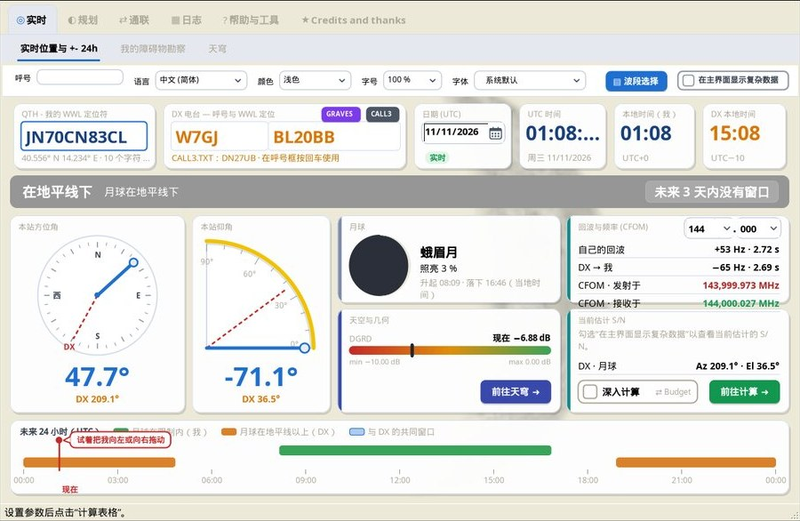</a> 实时位置与 +- 24h</td><td width="33%" align="center"><a href="docs/screenshots/zh-2.jpg">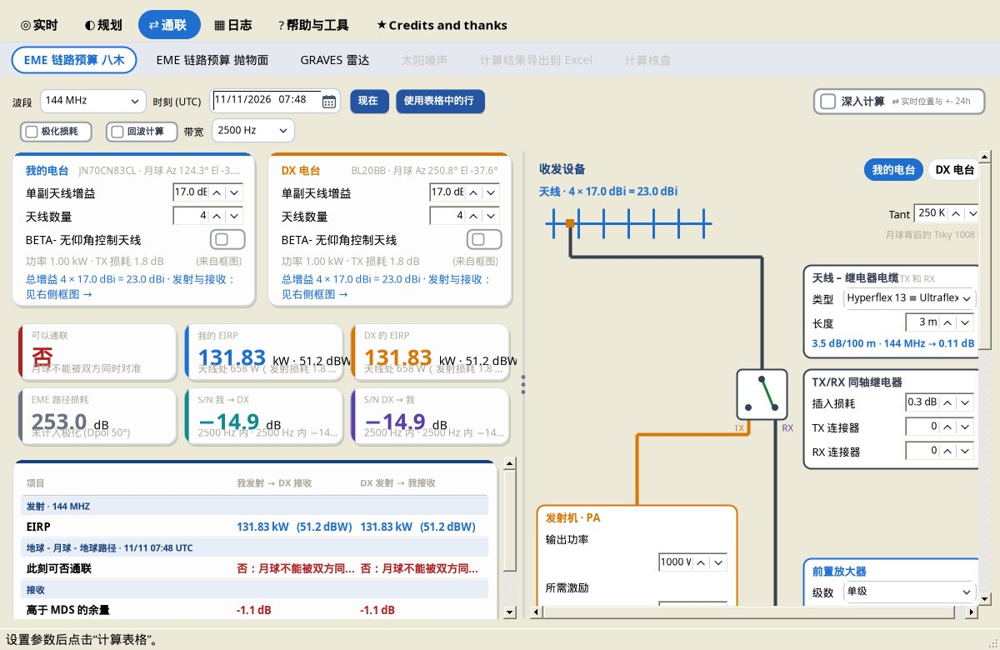</a> EME 链路预算 八木</td><td width="33%" align="center"><a href="docs/screenshots/zh-3.jpg">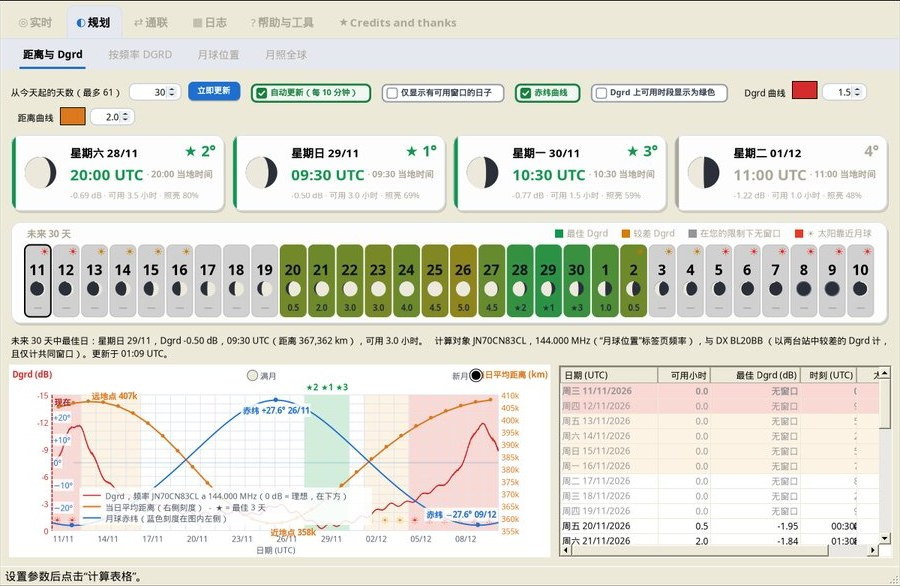</a> 距离与 Dgrd</td></tr></table>

YAEC 把在 50、70、144、222、432、902 MHz 和 23 cm（1296 MHz）上进行 EME（地–月–地）通信所需的一切集中在一个程序里，尤其适合有限制的电台：没有仰角的天线、转动范围有限的转台、遮挡部分天空的障碍物。它不仅告诉你月亮在哪里，还告诉你**你的**天线能否真正对准它、何时、在什么条件下。432 MHz 以上的频段仍在完善中，但 DGRD 已在每个频率上正确计算；之后还会为刚接触 900 MHz 以上频段的人提供更多建议。

**实时**
- **实时位置与 +- 24h** – 每秒更新的主屏幕：你和 DX 的定位码（4 至 14 个字符）、频率、UTC、本地和 DX 时钟、带倒计时的状态条（可对准、超出限制、在地平线下、共同窗口）、罗盘和仰角弧。输入 DX 呼号后，定位码从 CALL3.TXT 自动填入。
- **我的障碍物勘察** – 以你的电台为中心的航拍或地形图，上面叠加天空：月亮位置、未来 24 小时的轨迹、升起和落下、可用鼠标拖动的天线限制。
- **我的地平线** – *地形地平线*：根据 SRTM1 高程数据（约 30 米）计算你电台周围的地形全景，考虑地球曲率和折射，背景为天穹（三种配色）或浅蓝色天空；月球轨迹、在地形之上的升起与落下、带 OpenStreetMap 名称的主要障碍物以及损失的月球分钟数。勾选一个框即可在整个程序中把地形用作最低仰角。*本地噪声图 (NJ9R)*：方位角 × 仰角网格，转动天线时记下 WSJT-X 中看到的噪声；月球处于噪声方向的时段标 ⚠。
- **天穹** – 从你的 QTH 看到的天空，以你所用频率的天空噪声着色，并显示天线限制、DX 的地平线、射电源、太阳和月亮轨迹。

**规划**
- **距离与 Dgrd** – 7 至 61 天的 Dgrd 和月球平均距离，叠加赤纬、近地点、远地点、新月、三个最佳日（按日期排序）、可能的第四个可用日，以及月亮靠近太阳日子的提醒。只计算月亮在你的限制范围内真正可对准的时段。
- **按频率 DGRD** – 你的工作频率上的 Dgrd，使用你电台的真实噪声和在天线波束上平均的天空，并与 WSJT-X 的常规计算对比；该选择在整个程序中生效。
- **值得尝试的电台** – 所选日期中，N0UK EME 聊天里与你有共同窗口的活跃电台（144 MHz），每个定位网格取最佳一个，按由双向 S/N 得出的 0–100 指数排序；DX 的设备取自其在聊天中所写内容。非常粗略的示例计算，创意来自 Matteo IW5DHN。
- **月球位置** – 所选时段的表格，按可对准性着色，显示你和 DX 的共同窗口；可导出为 Excel 用的 CSV。
- **月照全球** – 按各地所见月亮仰角着色的世界地图；单击即可把该点设为 DX。

**通联**
- **EME 链路预算 八木** – 每个频段的链路预算，按频段分别保存：六个指标（能否通联、我的 EIRP、DX 的 EIRP、路径损耗、S/N 我 → DX 和 DX → 我，也包括有太阳时和 2500 Hz 下的值）、全部步骤的表格，以及电台的交互式示意图（天线、电缆、继电器、前置放大器、变频器、电台）。无仰角天线的地面增益。60 s 周期的模式：JT65、Q65-60A、Q65-60B、Q65-60C 和自定义。回波计算（*我发射并接收自己的回波*）：回波电平、延迟和多普勒。
- **EME 链路预算 抛物面** – 同样的预算（含回波），用于 432、902 和 1296 MHz 的抛物面天线，可选主焦点或偏馈（W2IMU）：按 PE1RKI 公式计算增益，波束宽度 70·λ/D，单级或两级前置放大器，变频器和功放激励；在 23 cm 上使用圆极化，损耗 0.4 dB（KA1GT）。
- **GRAVES 雷达** – 把法国 GRAVES 雷达（143.050 MHz）作为测试台：月亮何时位于其波束中且在你的天线限制内，并给出多普勒和回波延迟。
- **太阳噪声** – 下载 RSTN 网络（NOAA）测得的太阳通量，估算新月附近太阳使接收机噪声升高多少。
- **计算结果导出到 Excel** 和 **计算核查** – 把预算导出为 Excel 工作表，并逐步列出代入数值的每个公式，可选八木或抛物面预算。

**日志、帮助和工具**
- **WWL 与 ADIF 地图** – Maidenhead 网格，显示来自你的 ADIF 文件或直接从 LoTW 下载的已通联和已确认方格，也可按频段或仅 EME 显示。
- **使用手册** 和 **EME 理论与建议** – 程序内置、提供所有语言的完整手册，含可点击目录、搜索、公式和来源；可导出为 Word。理论手册包含资深 EME 操作员的建议、关于网络聊天室的章节以及 VE7BQH 天线表。
- **同轴电缆** – 50 Ω 电缆数据库，含 50 至 1296 MHz 的衰减（数据手册数值和公式 α = k1·√f + k2·f）以及每个数值的来源；可排序、筛选，带损耗计算和把电缆送入 EME 预算的按钮。可以添加自己的电缆。

**此外**
- 从 W7GJ 和 WSJT-X Improved 下载并合并的 CALL3.TXT，每 7 天更新一次，可按需复制到 WSJT-X。
- 当电台位于极圈以外或极光区时，提示极盖吸收和极光吸收（PCA）。
- 37 种语言；浅色、夜间（蓝色）、黑色、八种柔和配色以及三种 IP-TRX-CTRL 配色（蓝、紫、绿）。
- 月球位置精度约 0.01°（Meeus，ELP-2000/82），所有计算都在你的电脑上完成；数据集中在一个 `data` 文件夹里。

### 日本語

<table><tr><td width="33%" align="center"><a href="docs/screenshots/ja-1.jpg">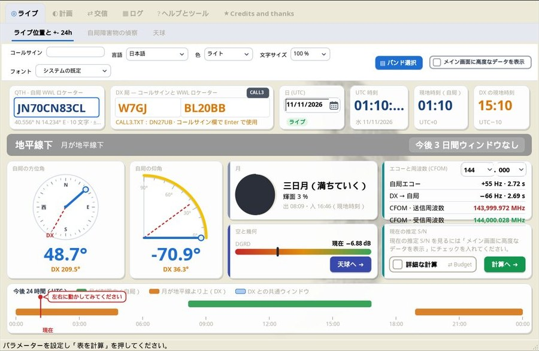</a> ライブ位置と +- 24h</td><td width="33%" align="center"><a href="docs/screenshots/ja-2.jpg">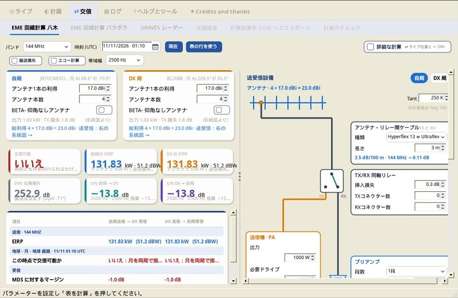</a> EME 回線計算 八木</td><td width="33%" align="center"><a href="docs/screenshots/ja-3.jpg">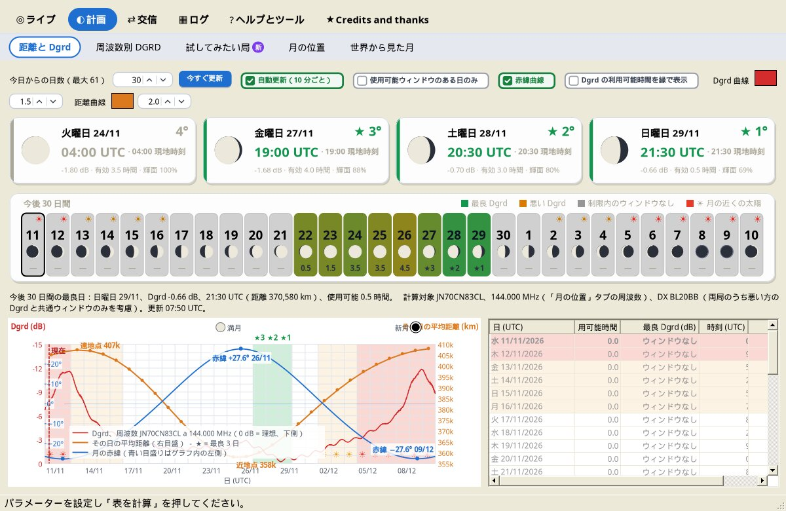</a> 距離と Dgrd</td></tr></table>

YAEC は、50、70、144、222、432、902 MHz と 23 cm（1296 MHz）で EME（地球–月–地球）運用に必要なものを一つのプログラムにまとめています。特に、仰角のないアンテナ、回転範囲が限られたローテーター、空の一部を隠す障害物など、制約のある局に向いています。月がどこにあるかだけでなく、**あなたの**アンテナが本当に月に向けられるか、いつ、どんな条件でかを示します。432 MHz より上のバンドは整備中ですが、DGRD はすでにすべての周波数で正しく計算されます。900 MHz 以上を始めたばかりの方へのアドバイスも今後追加します。

**ライブ**
- **ライブ位置と +- 24h** – 毎秒更新されるメイン画面：自局と DX のロケーター（4～14 文字）、周波数、UTC・ローカル・DX の時計、カウントダウン付きの状態帯（指向可能、制限外、地平線下、共通ウィンドウ）、コンパスと仰角の弧。DX のコールサインを入力すると、ロケーターが CALL3.TXT から入ります。
- **自局障害物の偵察** – 自局を中心にした航空写真または地形図に空を重ねて表示：月の位置、今後 24 時間の軌跡、出と入り、マウスでドラッグできるアンテナの制限。
- **自局の地平線** – *地形からの地平線*：SRTM1 標高データ（約 30 m）から地球の曲率と屈折を考慮して計算した局周辺の地形パノラマを、天球（3 配色）または水色の空の上に表示。月の軌跡、地形上の出と入り、OpenStreetMap の名前付きの主な障害物、失われる月の分数。チェックボックス 1 つで地形をプログラム全体の最低仰角にできます。*ローカル雑音マップ (NJ9R)*：アンテナを回しながら WSJT-X で見たノイズを入力する方位角 × 仰角のグリッド。月がノイズの多い方向にある時間には ⚠ が付きます。
- **天球** – 自局 QTH から見た空を、使用周波数の空の雑音の色で表示し、アンテナの制限、DX の地平線、電波源、太陽、月の軌跡も示します。

**計画**
- **距離と Dgrd** – 7～61 日分の Dgrd と月の平均距離。赤緯の重ね表示、近地点、遠地点、新月、最良の 3 日（日付順）、4 日目の候補、月が太陽に近い日の警告付き。月が制限内で本当に指向できる時間だけを数えます。
- **周波数別 DGRD** – 自局の実際の雑音とアンテナビームで平均した空を使った運用周波数での Dgrd を、通常の WSJT-X の計算と比較。選択はプログラム全体に適用されます。
- **試してみたい局** – 選んだ日に N0UK EME チャットでアクティブで共通ウィンドウがある局（144 MHz）を、ロケーター フィールドごとに最良の 1 局ずつ、双方向の S/N から求めた 0〜100 の指数で並べます。DX の設備はチャットへの書き込みから読み取ります。非常に大まかな計算例で、Matteo IW5DHN のアイデアです。
- **月の位置** – 選んだ期間の表。指向の可否で色分けし、自局と DX の共通ウィンドウを表示。Excel 用 CSV 書き出し。
- **世界から見た月** – 各地から見た月の仰角で色分けした世界地図。クリックするとその地点が DX になります。

**交信**
- **EME 回線計算 八木** – バンドごとに保存される回線計算：6 つの指標（交信可能か、自局 EIRP、DX の EIRP、伝搬損失、S/N 自局 → DX と DX → 自局、太陽ありと 2500 Hz 換算も）、全ステップの表、局の対話型ブロック図（アンテナ、ケーブル、リレー、プリアンプ、トランスバーター、無線機）。仰角のないアンテナのグラウンドゲイン。周期 60 s のモード：JT65、Q65-60A、Q65-60B、Q65-60C とカスタム。エコー計算（*自局送信 → 自局エコー受信*）：エコーのレベル、遅延、ドップラー。
- **EME 回線計算 パラボラ** – 同じ回線計算（エコーを含む）を、432、902、1296 MHz のパラボラアンテナ（プライムフォーカスまたはオフセット、W2IMU）に適用：PE1RKI の式による利得、ビーム幅 70·λ/D、1 段または 2 段のプリアンプ、トランスバーターと PA のドライブ。23 cm では損失 0.4 dB の円偏波（KA1GT）。
- **GRAVES レーダー** – フランスの GRAVES レーダー（143.050 MHz）を試験台として使用：月がそのビーム内かつアンテナの制限内にあるとき、ドップラーとエコー遅延付き。
- **太陽雑音** – RSTN 網（NOAA）が測定した太陽フラックスをダウンロードし、新月付近で太陽が受信雑音をどれだけ上げるかを推定します。
- **計算結果を Excel へエクスポート** と **計算のチェック** – 回線計算を Excel シートとして出力し、すべての式を値を代入して一歩ずつ表示。八木またはパラボラの回線計算を選べます。

**ログ、ヘルプ、ツール**
- **WWL・ADIF 地図** – ADIF ファイルから、または LoTW から直接ダウンロードした交信済み・確認済みのグリッドを Maidenhead 格子上に表示。バンド別や EME のみの表示も可能。
- **取扱説明書** と **EME の理論とアドバイス** – プログラム内蔵の完全なマニュアル（全言語）。クリックできる目次、検索、数式、出典付きで、Word に書き出せます。理論マニュアルには経験豊富な EME 運用者のアドバイス、インターネットのチャットに関する節、VE7BQH のアンテナ表が含まれます。
- **同軸ケーブル** – 50 Ω ケーブルのデータベース。50～1296 MHz の減衰量（データシートの値と式 α = k1·√f + k2·f）と各値の出典付き。並べ替え・絞り込み、損失計算、ケーブルを EME 回線計算に送るボタンがあります。独自のケーブルも追加できます。

**その他**
- W7GJ と WSJT-X Improved からダウンロードして統合し、7 日ごとに更新、必要に応じて WSJT-X にコピーする CALL3.TXT。
- 局が極圏の外側やオーロラ帯にあるときの極冠吸収・オーロラ吸収（PCA）の警告。
- 37 言語。ライト、ナイト（青）、ブラック、8 種類のパステル、IP-TRX-CTRL の 3 配色（青、紫、緑）。
- 月の位置の精度は約 0.01°（Meeus、ELP-2000/82）。すべての計算はあなたのパソコン上で行い、データは一つの `data` フォルダーにまとめます。

### 한국어

YAEC는 50, 70, 144, 222, 432, 902 MHz와 23 cm(1296 MHz)에서 EME(지구–달–지구) 운용에 필요한 모든 것을 하나의 프로그램에 모았습니다. 특히 앙각이 없는 안테나, 회전 범위가 제한된 로테이터, 하늘 일부를 가리는 장애물처럼 제약이 있는 국에 유용합니다. 달이 어디 있는지뿐 아니라 **당신의** 안테나가 정말 달에 닿을 수 있는지, 언제, 어떤 조건에서인지 알려 줍니다. 432 MHz 이상의 밴드는 아직 보완 중이지만 DGRD는 이미 모든 주파수에서 올바르게 계산됩니다. 900 MHz 이상을 처음 시작하는 분을 위한 조언도 추가될 예정입니다.

**실시간**
- **실시간 위치 및 +- 24h** – 매초 갱신되는 주 화면: 내 로케이터와 DX 로케이터(4~14자), 주파수, UTC·현지·DX 시계, 카운트다운이 있는 상태 띠(지향 가능, 한계 밖, 지평선 아래, 공통 창), 나침반과 앙각 호. DX 호출 부호를 입력하면 로케이터가 CALL3.TXT에서 채워집니다.
- **내 장애물 정찰** – 내 국을 중심으로 한 항공 사진 또는 지형도 위에 하늘을 겹쳐 표시: 달의 위치, 다음 24시간 경로, 월출과 월몰, 마우스로 끌어 조정하는 안테나 한계.
- **내 지평선** – *지형 지평선*: SRTM1 고도 데이터(약 30 m)로 지구 곡률과 굴절을 고려해 계산한 국 주변 지형의 파노라마를 천구(세 가지 색상) 또는 하늘색 하늘 위에 표시합니다. 달의 경로, 지형 위의 출몰, OpenStreetMap 이름이 붙은 주요 장애물, 잃는 달의 분. 확인란 하나로 지형을 프로그램 전체의 최소 앙각으로 사용합니다. *국지 잡음 지도(NJ9R)*: 안테나를 돌리며 WSJT-X에서 본 잡음을 입력하는 방위각 × 앙각 격자; 달이 잡음이 많은 방향에 있는 시간에는 ⚠ 표시.
- **하늘 보기** – 내 QTH에서 본 하늘을 사용 주파수의 하늘 잡음 색으로 보여 주며, 안테나 한계, DX의 지평선, 전파원, 태양과 달의 경로를 표시합니다.

**계획**
- **거리와 Dgrd** – 7~61일간의 Dgrd와 달의 평균 거리, 적위 겹쳐 보기, 근지점, 원지점, 신월, 최고의 3일(날짜순), 가능한 네 번째 유효일, 달이 태양에 가까운 날의 경고. 내 한계 안에서 달을 정말 지향할 수 있는 시간만 셉니다.
- **주파수별 DGRD** – 내 국의 실제 잡음과 안테나 빔에서 평균한 하늘을 사용한 운용 주파수의 Dgrd를 일반적인 WSJT-X 계산과 비교합니다. 선택은 프로그램 전체에 적용됩니다.
- **시도해 볼 국** – 선택한 날에 N0UK EME 채팅에서 활동하며 공통 창이 있는 국(144 MHz)을 로케이터 필드마다 가장 좋은 한 국씩, 양방향 S/N에서 구한 0~100 지수로 정렬합니다. DX의 설비는 채팅에 쓴 내용에서 읽습니다. 매우 대략적인 예시 계산이며, 아이디어는 Matteo IW5DHN입니다.
- **달의 위치** – 선택한 기간의 표를 지향 가능 여부에 따라 색으로 표시하고, 나와 DX의 공통 창을 보여 줍니다. Excel용 CSV 내보내기.
- **세계 위의 달** – 각 지역에서 본 달의 앙각으로 색칠한 세계 지도. 클릭하면 그 지점이 DX가 됩니다.

**교신**
- **EME 링크 버짓 야기** – 밴드별로 저장되는 링크 버짓: 6개 지표(교신 가능 여부, 내 EIRP, DX EIRP, 경로 손실, S/N 나 → DX와 DX → 나, 태양 포함 및 2500 Hz 기준), 모든 단계의 표, 국의 대화형 계통도(안테나, 케이블, 릴레이, 프리앰프, 트랜스버터, 무선기). 앙각 없는 안테나의 그라운드 게인. 60 s 주기 모드: JT65, Q65-60A, Q65-60B, Q65-60C, 사용자 지정. 에코 계산(*내가 송신하고 내 에코를 수신*): 에코의 레벨, 지연, 도플러.
- **EME 링크 버짓 파라볼라** – 같은 버짓(에코 포함)을 432, 902, 1296 MHz의 파라볼라 안테나(주초점 또는 오프셋, W2IMU)에 적용: PE1RKI 공식에 의한 이득, 빔폭 70·λ/D, 1단 또는 2단 프리앰프, 트랜스버터와 PA 구동. 23 cm에서는 손실 0.4 dB의 원편파(KA1GT).
- **GRAVES 레이더** – 프랑스 GRAVES 레이더(143.050 MHz)를 시험대로 사용: 달이 레이더 빔 안에 있고 내 안테나 한계 안에 있는 때를 도플러와 에코 지연과 함께 보여 줍니다.
- **태양 잡음** – RSTN 망(NOAA)이 측정한 태양 플럭스를 내려받아, 신월 무렵 태양이 수신기 잡음을 얼마나 올리는지 추정합니다.
- **계산 결과 Excel 내보내기**와 **계산 검증** – 버짓을 Excel 시트로 내보내고, 모든 공식을 값을 대입하여 단계별로 보여 줍니다. 야기 또는 파라볼라 버짓을 선택할 수 있습니다.

**로그, 도움말, 도구**
- **WWL 지도와 ADIF** – ADIF 파일이나 LoTW에서 직접 내려받은 교신·확인 그리드를 Maidenhead 격자에 표시합니다. 밴드별, EME만 보기도 가능합니다.
- **사용 설명서**와 **EME 이론과 조언** – 프로그램에 내장된 모든 언어의 완전한 설명서로, 클릭 가능한 목차, 검색, 공식, 출처가 있으며 Word로 내보낼 수 있습니다. 이론 설명서에는 숙련된 EME 운용자의 조언, 인터넷 채팅에 관한 절, VE7BQH 안테나 표가 들어 있습니다.
- **동축 케이블** – 50 Ω 케이블 데이터베이스로, 50~1296 MHz의 감쇠(데이터시트 값과 공식 α = k1·√f + k2·f)와 각 값의 출처를 담고 있습니다. 정렬·필터, 손실 계산, 케이블을 EME 버짓으로 보내는 버튼이 있으며, 직접 케이블을 추가할 수 있습니다.

**그 밖에**
- W7GJ와 WSJT-X Improved에서 내려받아 합치고 7일마다 갱신하며, 요청하면 WSJT-X로 복사하는 CALL3.TXT.
- 국이 극권 너머나 오로라대에 있을 때 극관 흡수와 오로라 흡수(PCA) 경고.
- 37개 언어; 밝은, 야간(파랑), 검정, 8가지 파스텔과 IP-TRX-CTRL의 3가지(파랑, 보라, 초록) 색 구성.
- 약 0.01° 정확도의 달 위치(Meeus, ELP-2000/82), 모든 계산은 내 컴퓨터에서 수행하며 데이터는 하나의 `data` 폴더에 저장합니다.

## For developers

You do not need to compile anything to use YAEC: the installer and the packages above are built automatically. If you want to build it yourself on Windows, `compila.bat` compiles `YAEC.cs` with the C# compiler included in Windows (.NET Framework 4, C# 5). Every push is compiled by GitHub Actions on Windows and started on Linux with Mono; when the `VERSION` file on `main` holds a new version, the workflow publishes the release with the Windows installer (Inno Setup) and the Linux and macOS packages (`.github/workflows/build.yml`).

## License

See `LICENZA.txt`.
