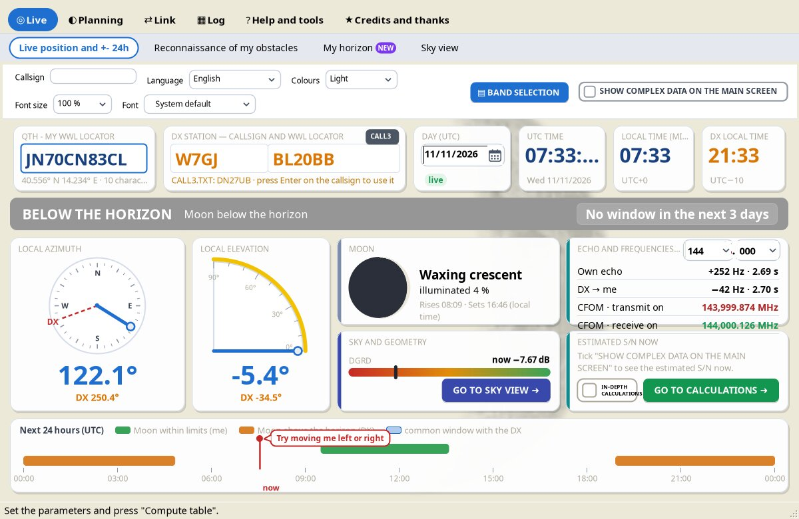
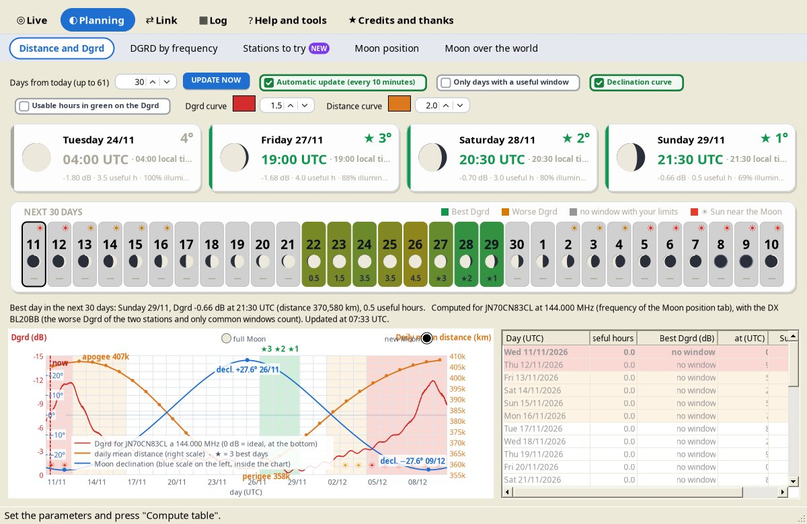
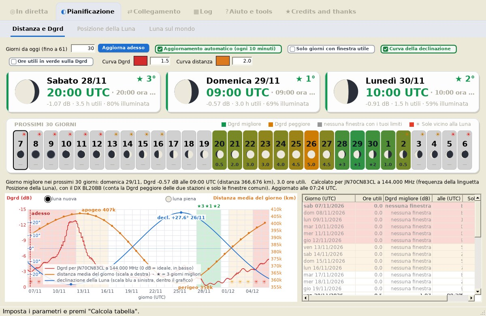

# YAEC – Yet Another EME Calc

*a cura di Costantino IC8TEM*

Moon position, pointing windows, EME link budget, sky and solar noise calculator for radio amateurs, in 37 languages. Windows, Linux and macOS (Linux and macOS with Mono).

Posizione della Luna, finestre di puntamento, budget del collegamento EME, rumore del cielo e del Sole per radioamatori, in 37 lingue. Windows, Linux e macOS (Linux e macOS con Mono).

[](https://ko-fi.com/ic8tem)

## Videos

| | English | Italiano |
|---|---|---|
| [▶ What YAEC calculates](docs/video/YAEC_presentation_en.mp4) (2 min) · [subtitles](docs/video/YAEC_presentation_en.srt) | A tour of the calculation tabs | Le linguette di calcolo |
| [▶ Getting started](docs/video/YAEC_getting_started_en.mp4) (5 min) · [subtitles](docs/video/YAEC_getting_started_en.srt) | A first EME evening step by step | Una prima serata EME passo passo |

## README in 37 languages

[English](lingue/README_en.txt) · [Italiano](lingue/README_it.txt) · [Deutsch](lingue/README_de.txt) · [Français](lingue/README_fr.txt) · [Español](lingue/README_es.txt) · [Português](lingue/README_pt.txt) · [Português (Brasil)](lingue/README_pt-BR.txt) · [Nederlands](lingue/README_nl.txt) · [Svenska](lingue/README_sv.txt) · [Norsk](lingue/README_nb.txt) · [Dansk](lingue/README_da.txt) · [Íslenska](lingue/README_is.txt) · [Eesti](lingue/README_et.txt) · [Latviešu](lingue/README_lv.txt) · [Lietuvių](lingue/README_lt.txt) · [Polski](lingue/README_pl.txt) · [Čeština](lingue/README_cs.txt) · [Slovenčina](lingue/README_sk.txt) · [Magyar](lingue/README_hu.txt) · [Română](lingue/README_ro.txt) · [Ελληνικά](lingue/README_el.txt) · [Русский](lingue/README_ru.txt) · [Українська](lingue/README_uk.txt) · [Türkçe](lingue/README_tr.txt) · [Afrikaans](lingue/README_af.txt) · [العربية](lingue/README_ar.txt) · [עברית](lingue/README_he.txt) · [اردو](lingue/README_ur.txt) · [हिन्दी](lingue/README_hi.txt) · [বাংলা](lingue/README_bn.txt) · [Bahasa Indonesia](lingue/README_id.txt) · [Tagalog](lingue/README_tl.txt) · [ไทย](lingue/README_th.txt) · [中文 (简体)](lingue/README_zh.txt) · [中文 (繁體)](lingue/README_zh-TW.txt) · [日本語](lingue/README_ja.txt) · [한국어](lingue/README_ko.txt)

The program, its two manuals and the licence are in the same 37 languages; the language is chosen at the top of the main screen.

## Download

Download from the **[Releases](../../releases/latest)** page (x.y = version). Every release has `SHA256SUMS.txt` to check the files.

| System | Package |
|---|---|
| **Windows** 64 / 32 bit, ARM64 (Windows 7 SP1 to 11) | `YAEC-x.y-windows-x64-setup.exe` · `-x86-setup.exe` · `-arm64-setup.exe` (or the `-portatile.zip` of each) |
| **Debian, Ubuntu, Mint, Raspberry Pi OS** | `yaec_x.y_amd64.deb` · `_arm64.deb` · `_armhf.deb` |
| **Fedora, openSUSE** · **Arch, Manjaro** · **Slackware** | `yaec-x.y.x86_64.rpm` · `yaec-x.y-1-x86_64.pkg.tar.zst` · `yaec-x.y-x86_64-1_ic8tem.txz` |
| **Any Linux** | `YAEC-x.y-x86_64.AppImage` · `-aarch64.AppImage`, or `YAEC-x.y-linux-x64/-arm64/-armv7l/-x86.tar.gz` |
| **Alpine, FreeBSD, OpenBSD** | `YAEC-x.y-alpine-x64/-arm64.tar.gz` · `-freebsd-x64.tar.gz` · `-openbsd-x64.tar.gz` |
| **macOS** Apple Silicon (M1–M4) · Intel | `YAEC-x.y-mac-apple-silicon.dmg` · `YAEC-x.y-mac-intel.dmg` |

Windows 7, ARM64, i686, Slackware, AppImage, Alpine, FreeBSD and OpenBSD are not yet tested: reports are welcome.

## Installation

**English**
- **Windows** – run `YAEC-x.y-windows-x64-setup.exe`: it installs into *Documents\YAEC* without administrator rights. SmartScreen: *More info* → *Run anyway*. Without installing: extract the `-portatile.zip` and run `YAEC.exe`.
- **Debian, Ubuntu, Mint, Raspberry Pi** – `sudo apt install ./yaec_x.y_amd64.deb` (Mono is installed too), then start `yaec`.
- **Other Linux and BSD** – install Mono (`mono-complete`), extract the `.tar.gz` and run `./install.sh`; or use the AppImage.
- **macOS (experimental)**
  1. Install [Mono for macOS](https://www.mono-project.com/download/stable/) and [XQuartz](https://www.xquartz.org).
  2. Open the `.dmg` and drag YAEC into *Applications*; the first time, right-click YAEC → *Open* (the app is not signed by Apple).
  3. **Mac with an Apple processor (M1–M4):** Mono runs through **Rosetta 2**. If YAEC does not start (*"Bad CPU type in executable"* in `~/Library/Application Support/YAEC/data/mono-log.txt`), open *Terminal* and run

     ```
     sudo softwareupdate --install-rosetta --agree-to-license
     ```

     It asks for your Mac password, which is not shown while you type. Then start YAEC again.
- **Updates** – from 1.9.1 YAEC updates itself at start-up (Windows, AppImage, `.tar.gz`, macOS app), checking SHA-256; `.deb`, `.rpm`, Arch and Slackware packages are updated with the package manager.

**Italiano**
- **Windows** – avvia `YAEC-x.y-windows-x64-setup.exe`: installa in *Documenti\YAEC* senza diritti di amministratore. SmartScreen: *Ulteriori informazioni* → *Esegui comunque*. Senza installare: estrai il `-portatile.zip` e avvia `YAEC.exe`.
- **Debian, Ubuntu, Mint, Raspberry Pi** – `sudo apt install ./yaec_x.y_amd64.deb` (installa anche Mono), poi avvia `yaec`.
- **Altri Linux e BSD** – installa Mono (`mono-complete`), estrai il `.tar.gz` e lancia `./install.sh`; oppure usa l'AppImage.
- **macOS (sperimentale)**
  1. Installa [Mono per macOS](https://www.mono-project.com/download/stable/) e [XQuartz](https://www.xquartz.org).
  2. Apri il `.dmg` e trascina YAEC in *Applicazioni*; la prima volta clic destro su YAEC → *Apri* (l'app non è firmata da Apple).
  3. **Mac con processore Apple (M1–M4):** Mono funziona tramite **Rosetta 2**. Se YAEC non parte (*«Bad CPU type in executable»* in `~/Library/Application Support/YAEC/data/mono-log.txt`), apri *Terminale* e scrivi

     ```
     sudo softwareupdate --install-rosetta --agree-to-license
     ```

     Chiede la password del Mac, che non si vede mentre la scrivi. Poi riavvia YAEC.
- **Aggiornamenti** – dalla 1.9.1 YAEC si aggiorna da solo all'avvio (Windows, AppImage, `.tar.gz`, app per macOS), con il controllo SHA-256; i pacchetti `.deb`, `.rpm`, Arch e Slackware si aggiornano con il gestore dei pacchetti.

Other languages: the README of each language in the [`lingue`](lingue) folder (links above).

## Features

<table><tr><td width="33%" align="center"><a href="docs/screenshots/en-1.jpg"></a><br><sub>Live position and +- 24h</sub></td><td width="33%" align="center"><a href="docs/screenshots/en-2.jpg"></a><br><sub>EME budget Yagi</sub></td><td width="33%" align="center"><a href="docs/screenshots/en-3.jpg"></a><br><sub>Distance and Dgrd</sub></td></tr></table>

- **Live** – Moon position every second with your antenna limits and the DX's, common window and countdown; map of your obstacles; your horizon from SRTM1 terrain data; sky view with sky-noise colours.
- **Planning** – Dgrd and distance for 7 to 61 days with the best days; Dgrd at your frequency; antenna temperature with the Skynoise method; stations to try from the N0UK chat and the PA0PLY directory; Moon tables and Moon over the world.
- **Link** – EME budget for Yagis and dishes (50 MHz to 23 cm) with an interactive station diagram, polarization risk, GRAVES radar, solar noise, Excel export and step-by-step calculation check.
- **Log, help and tools** – WWL map from ADIF or LoTW; user manual and *Theory and tips on EME*; database of coaxial cables.
- CALL3.TXT from W7GJ and WSJT-X Improved, merged and kept up to date; Moon positions to about 0.01° (Meeus, ELP-2000/82); all data in one `data` folder.

<table><tr><td width="33%" align="center"><a href="docs/screenshots/it-1.jpg"></a><br><sub>Posizione live e +- 24h</sub></td><td width="33%" align="center"><a href="docs/screenshots/it-2.jpg"></a><br><sub>Budget EME yagi</sub></td><td width="33%" align="center"><a href="docs/screenshots/it-3.jpg"></a><br><sub>Distanza e Dgrd</sub></td></tr></table>

- **Live** – posizione della Luna ogni secondo con i limiti della tua antenna e di quella del DX, finestra comune e conto alla rovescia; mappa dei tuoi ostacoli; il tuo orizzonte dai dati SRTM1; volta celeste con i colori del rumore del cielo.
- **Pianificazione** – Dgrd e distanza da 7 a 61 giorni con i giorni migliori; Dgrd alla tua frequenza; temperatura d'antenna con il metodo Skynoise; stazioni da provare dalla chat N0UK e dall'elenco PA0PLY; tabelle della Luna e Luna sul mondo.
- **Collegamento** – budget EME per yagi e dischi (da 50 MHz ai 23 cm) con lo schema interattivo della stazione, rischio di polarizzazione, radar GRAVES, rumore solare, esportazione in Excel e controllo dei calcoli passo passo.
- **Log, aiuto e strumenti** – mappa WWL da ADIF o LoTW; manuale d'uso e *Teoria e consigli sull'EME*; banca dati dei cavi coassiali.
- CALL3.TXT di W7GJ e WSJT-X Improved, uniti e aggiornati; posizioni della Luna a circa 0,01° (Meeus, ELP-2000/82); tutti i dati in una sola cartella `data`.

## Latest versions

**English**
- **1.9.7** – Translations completed in Bengali, Arabic and Turkish (62 missing texts: losses and gains of the RX/TX chain, Friis formula, main screen, description of the tabs); Windows 7, 8 and 8.1 declared in the program manifest.
- **1.9.6** – Polarization risk: in the two station boxes you choose the antenna polarization (H, V, H and V (XPOL), circular; for the DX also «by band»); YAEC flags when the contact is at risk without the second polarization (MNR up to 432 MHz, spatial offset higher up) with a strip in Common window, a row on the DX card, the ⇄ symbol in the calendar and a tag in Stations to try; the pop-up warning appears only when the risk is red; new paragraph in the manual; PA0PLY EME directory (432 and 1296 MHz) updated every day: Stations to try also on 432 and 1296 MHz with the station of the band's EME budget, new EME station lists tab (N0UK chat and PA0PLY directory, with source, credits and thanks) and DX setup taken from the lists when its callsign is written.
- **1.9.5** – EME budget yagi and dishes: cost of 0.1 dB more loss ahead of the preamp (PA3CSG) and new Station test section with G/T on cold sky and the predicted Y-factor on the Sun, Moon, Cas A and ground (G3LTF, VK3UM's EMECalc); EME budget dishes: illumination drop at the edge and dish mesh, with Tant estimated from sky, spillover and mesh, and G3LTF's measured G/T for comparison; new paragraph in the manual; DX terrain: SRTM1 horizon around its locator in the My horizon tab, taken into account by common windows, the 24-hour bar, the Sky view and Stations to try (locator of at least 6 characters); antenna SWR in the station test (AEH eq. 41-19); Sun diameter from 0.524° to 0.542° with the Earth–Sun distance; note «YAEC computes, it does not design equipment» in the sources and tips.

**Italiano**
- **1.9.7** – Traduzioni completate in bengalese, arabo e turco (62 testi mancanti: perdite e guadagni della catena RX/TX, formula di Friis, schermata principale, descrizione delle linguette); Windows 7, 8 e 8.1 dichiarati nel manifesto del programma.
- **1.9.6** – Rischio di polarizzazione: nei riquadri delle due stazioni si sceglie la polarizzazione dell'antenna (H, V, H e V (XPOL), circolare; per il DX anche «secondo la banda»); YAEC segnala quando il collegamento è a rischio senza la seconda polarizzazione (MNR fino a 432 MHz, spostamento spaziale più in alto) con una striscia in Finestra comune, una riga nella scheda del DX, il simbolo ⇄ nel calendario e un'etichetta in Stazioni da provare; l'avviso a comparsa scatta solo con il rischio rosso; nuovo paragrafo nel manuale; elenco EME di PA0PLY (432 e 1296 MHz) aggiornato ogni giorno: Stazioni da provare anche a 432 e 1296 MHz con la stazione del Budget EME della banda, nuova linguetta Elenchi delle stazioni EME (chat di N0UK ed elenco di PA0PLY, con fonte, crediti e ringraziamenti) e impianto del DX preso dagli elenchi quando se ne scrive il nominativo.
- **1.9.5** – Budget EME yagi e dischi: costo di 0,1 dB di perdita in più prima del preampli (PA3CSG) e nuova sezione Prova della stazione con il G/T sul cielo freddo e il fattore Y previsto su Sole, Luna, Cas A e terreno (G3LTF, EMECalc di VK3UM); Budget EME dischi: calo dell'illuminazione al bordo e rete del disco, con la Tant stimata da cielo, ricaduta e rete, e il G/T misurato da G3LTF a confronto; nuovo paragrafo nel manuale; terreno del DX: orizzonte SRTM1 attorno al suo locator nella linguetta Il mio orizzonte, con finestre comuni, barra delle 24 ore, Volta celeste e Stazioni da provare che ne tengono conto (locator di almeno 6 caratteri); ROS dell'antenna nella prova della stazione (AEH eq. 41-19); diametro del Sole da 0,524° a 0,542° con la distanza Terra–Sole; nota «YAEC calcola, non progetta apparati» nelle fonti e nei consigli.

Full history in every README language: [CHANGELOG.md](CHANGELOG.md); in the program: *Help and tools*.

## For developers

You do not need to compile anything to use YAEC: the installer and the packages above are built automatically. If you want to build it yourself on Windows, `compila.bat` compiles `YAEC.cs` with the C# compiler included in Windows (.NET Framework 4, C# 5). Every push is compiled by GitHub Actions on Windows and started on Linux with Mono; when the `VERSION` file on `main` holds a new version, the workflow publishes the release with the Windows installer (Inno Setup) and the Linux and macOS packages (`.github/workflows/build.yml`).

## License

See `LICENZA.txt`.
