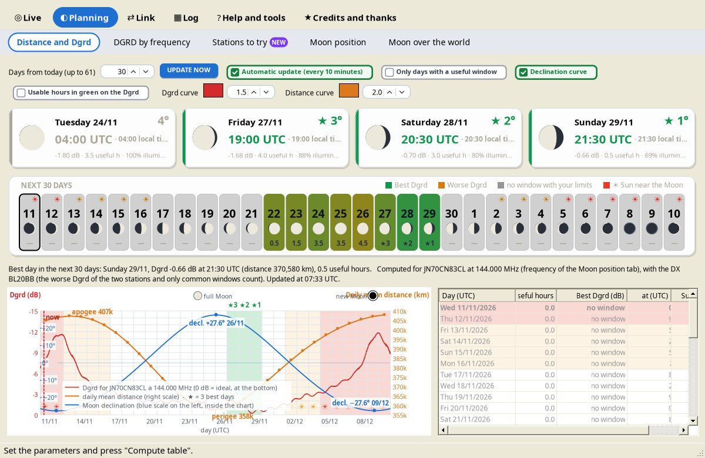

# Distance and Dgrd

*Group: Planning.* Use this tab to **choose the day** before switching on: the same equipment performs very differently from one day to the next.

## What it shows

- **The three best days** (★), in date order, in large cards.
- A **calendar of the days**: colour = Dgrd, grey = no window, Moon phase, useful hours.
- A **chart** of 7 to 61 days with the **Dgrd** (0 dB = ideal, at the bottom) and the **daily mean Moon distance** (right scale), with perigee, apogee, new Moon and full Moon.
- The **Moon declination** curve (blue, scale inside the left edge) with the northern and southern maxima and their dates; green area = Moon on the side of your hemisphere (higher and up for more hours), orange = opposite hemisphere.
- A **table of the days**, coloured like the chart bands (green = three best days, red and orange = Sun close to the Moon).
- The **☀ symbol** on days when the Moon is near the Sun: red = within 3 beamwidths of your antenna, orange = within 6.

**Only the hours in which the Moon is really pointable with your limits are counted.** With the DX active, only the common windows count and the worse Dgrd of the two stations is used.

## Controls

| Control | What it does |
|---|---|
| **Days from today (up to 61)** | How many days to show in the chart and in the table (7 to 61). |
| **Only days with a useful window** | Hides the days in which the Moon never enters your limits (and the DX's, if enabled). |
| **Declination curve** | Shows or hides the declination curve. |
| **Usable hours in green on the Dgrd** | Colours green the parts of the Dgrd curve in the hours with the Moon inside your limits (or in the common window). |
| Colour and thickness of the **Dgrd curve** and **Distance curve** | Bar above the chart. |
| **Click a day** | Highlights its 24 hours (UTC) on the chart; click again to remove it. |

The frequency and the limits are those of the [Moon position](Moon-Position) tab (shared with the whole program).

## What Dgrd means

**Dgrd** (*degradation*) tells how many dB the Moon echo is worse, at that moment, than in the best possible conditions: Moon at perigee and cold sky behind it. It does not depend on your station, only on the Moon and the sky – which is why it is used to choose days and hours, while the [EME budget](EME-Budget) calculates the link.

As in WSJT-X:

$$Dgrd = -40\log_{10}\frac{d}{356\,903\ \text{km}} - 10\log_{10}\frac{T_{sky}+80\ \text{K}}{T_{sky,min}+80\ \text{K}}, \qquad T_{sky,min}=13\left(\frac{408}{f}\right)^{2.6}\ \text{K}$$

- **0 dB** is ideal; values are always negative. −3 dB = half the S/N of the ideal case, −6 dB = a quarter.
- **Distance:** between perigee (≈ 356 900 km) and apogee (≈ 406 700 km) the echo changes by about 2.3 dB. It looks small, but doubling the antennas gains only 3 dB in theory.
- **Sky noise:** when the Moon is in front of the Milky Way, Dgrd can drop by several dB, more than distance does.
- Typical values are −1 to −2 dB. With the Moon on the galactic centre I2FAK saw −11 dB.
- For a small station every dB counts: a day at −1 dB and one at −5 dB can make the difference between a QSO and no decode.

## The Moon's declination

- In about 27.3 days the declination goes from its northern to its southern maximum and back. With the Moon on the side of your hemisphere it rises higher and stays up longer.
- Approximate maximum elevation and hours above the horizon (no obstacles, no refraction): $El_{max} \approx 90° - |\varphi - \delta|$, $\cos H_0 = -\tan\varphi\tan\delta$, hours $= 2H_0/15°$. Example at 41° N: with δ = +28° the Moon reaches about 77° and stays up about 15.7 h; with δ = −28° it stops at about 21° and stays up about 8.3 h.
- In north–south QSOs the two stations prefer opposite declinations: the longest common windows often come with the Moon near declination 0°.
- **18.6-year cycle:** the monthly swing changes from about ±18.3° to about ±28.6°. The maximum (major lunar standstill) was in 2024 – 2025; towards 2034 the swing will be at its minimum.
- The lowest declination coincides with Sagittarius (noisiest sky): for northern stations that week combines a low Moon, few useful hours and high Tsky.

## The Sun near the Moon

Around new Moon the Sun gets close to the Moon in the sky. When it enters the main lobe or the first side lobes, the system noise rises by many dB and the echo can disappear even with an excellent Dgrd. YAEC computes for each day the minimum Sun–Moon distance in the useful hours and compares it with your beamwidth, θ ≈ √(41253/G) (from the gain set in the EME budget). Large antennas suffer less: with a 2 – 3° beam you can work a few degrees from the Sun, while a single 144 MHz Yagi (beam about 20°) needs tens of degrees. See [Solar noise](Solar-Noise).

Sources: WSJT-X `lib/astro.f90` (K1JT); Franco I2FAK, video interviews ([part 1](https://www.youtube.com/watch?v=aNsnSweIvPY), [part 2](https://www.youtube.com/watch?v=GPVNLiUiD_s)); Bob Atkins KA1GT, "New Moon EME operation" (Icarus offset).
