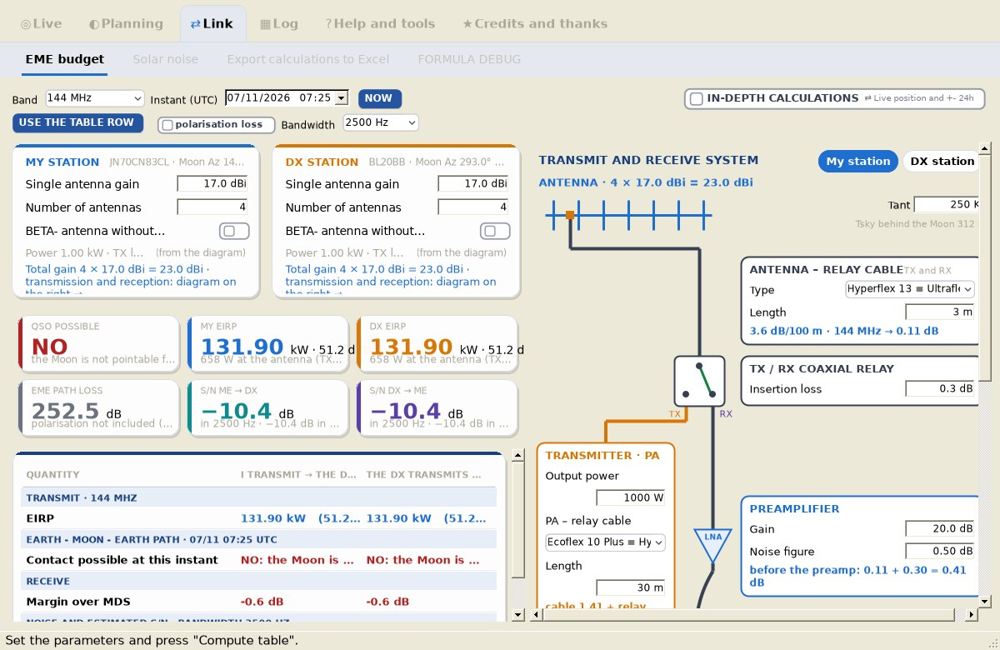

# EME budget Yagi

*Group: Link.* The **link budget** between you and the DX for each selected band (50 – 432 MHz; **next version: 50 – 1296 MHz**), with the data of **each band stored separately**. It is also a test bench: change a cable, a preamplifier or the antenna and see at once what it is worth.

> **Tab name.** In 1.5 this tab is called **EME budget**. In the next version it is called **EME budget Yagi**, and next to it there is the new **[EME budget dishes](EME-Budget-Dishes)** tab (432, 902 and 1296 MHz) with the same layout and calculation for dish antennas.

## Layout

- **Top bar:** **Band**, **Instant (UTC)** (**Now** or **Use the table row** – the row selected in [Moon position](Moon-Position)), **Bandwidth**, the **polarisation loss** box (adds the spatial polarization loss due to Dpol with linear antennas, without Faraday rotation) and the **IN-DEPTH CALCULATIONS** box (the same box as on the main screen).
- **Left:** the two station cards (**My station**, **DX station**), the six indicators and the table of all the steps, in three bands: TRANSMISSION, PATH, RECEPTION.
- **Right:** the **TRANSMIT AND RECEIVE SYSTEM** diagram of the chosen station. Drag its edge to widen or narrow it; double-click to go back to the initial width.

## The six indicators (KPIs)

| Indicator | Meaning |
|---|---|
| **QSO POSSIBLE** | YES if the Moon is pointable from both stations at the chosen instant (common window). |
| **My EIRP** | Your radiated power, including antenna power and TX losses. |
| **DX EIRP** | The same for the DX. |
| **EME PATH LOSS** | Radar-equation path loss at the topocentric distances of the two stations. |
| **S/N me → DX** | Estimated S/N at the DX, in the chosen bandwidth, with the Sun when it is calculated, and referred to 2500 Hz. |
| **S/N DX → me** | Estimated S/N at your station, likewise. |

The S/N is shown **referred to 2500 Hz** (the WSJT-X reference) next to the **typical threshold** of the chosen mode, as a reference only: with Deep Search, message averaging or AP decoding you can decode lower. YAEC does not show a "margin" because decoding is all-or-nothing.

## Station diagram

| Box | Fields | Notes |
|---|---|---|
| **ANTENNA** | Single antenna gain (dBi = dBd + 2.15), number of antennas, antenna temperature **Tant (K)** | Total gain = G + 10·log10(N) (ideal combining). Take Tant from the VE7BQH tables (computed at 30° elevation). |
| BETA- antenna without elevation | Height above ground (m) | Adds the **ground gain** for antennas fixed on the horizon (see below). |
| **ANTENNA – RELAY CABLE** | Type, length (m) | Counts in TX and, in RX, before the preamp. |
| **TX / RX COAXIAL RELAY** | Insertion loss (dB, typically 0.3), **TX connectors**, **RX connectors** | NJ9R's advice: about 1 dB every 8 – 10 connectors, 0.11 dB each. TX connectors = those between the PA and the antenna (they count in transmission); RX connectors = those between the antenna and the preamplifier (they count in reception, before the preamp). |
| **TRANSMITTER · PA** | Output power (W), **Required drive** (W, next version), PA – relay cable type and length | Required drive = the drive power the amplifier needs to deliver the set output power (next version). |
| **PREAMPLIFIER** | **Stages** (*single stage* / *two stages*, next version), gain (dB), noise figure (dB) | The most important figure for reception. With two stages the total gain reaches about 30 dB and the noise of cable and transverter becomes negligible. |
| **DOWNLEAD CABLE** | Type, length (m) | Between the mast-head preamplifier and the station. |
| **TRANSVERTER** | Tick it if the radio does not work directly on the band; model, noise figure, gain; **TX output** (W) and **Cable to PA** (type, length) (next version) | Models from the table in THEORY AND TIPS ON EME § 1.7.1 (NF and gain filled in) or *custom*. With gain 0 it is ignored. Next version: the box compares the power that reaches the PA after the cable with the required drive and writes *drive sufficient* or *insufficient drive*. |
| Cables to the radio | Loss (dB) | Jumpers between transverter output and radio input. |
| **RADIO** | **Radio MDS** (dBm), **Mode · required S/N** | MDS between −100 and −140 dBm. With *custom* mode, **Required S/N in 2500 Hz** is entered by hand. |

Cable types come from the [COAXIAL CABLES](Coaxial-Cables) database; losses are computed automatically for the band and length (next version: also at 902 and 1296 MHz). The **use in the EME budget** button in that tab sends a cable here.

## Modes (60 s period)

| Mode | Typical threshold, single message (2500 Hz) | Source |
|---|---|---|
| JT65 | −25 dB | WSJT-X User Guide § 7.1 |
| Q65-60A | −27.6 dB | K1JT et al., *Quick-Start Guide to Q65* (2021) |
| Q65-60B | ≈ −27.6 dB | derived (same symbol length) |
| Q65-60C | ≈ −27.6 dB | derived (same symbol length) |
| custom | your value | – |

Thresholds are for 50 % decode on an AWGN channel without AP. For Q65, AP decoding adds 1.5 – 3.6 dB (Q65-60A: −30.2 dB); a Doppler spread of 5 Hz worsens Q65-60A by about 2 dB, 10 Hz by about 3 dB. The Q65 guide recommends **Q65-60A on 50 and 144 MHz** and **Q65-60B on 432 MHz**.

JT65 limits by kind of decoding (K1JT, EME 2006, JT65B simulations):

| JT65 decoding | S/N (2500 Hz) |
|---|---|
| Any message, including plain text | −24 dB |
| Callsign in the database (Deep Search) | −28 dB |
| Any message with averaging | −29 dB |
| Synchronization only | −30 dB |
| Shorthand RO, RRR, 73 | −32 dB |

More in THEORY AND TIPS ON EME § 1.12 (Q65 submodes, JT65 vs Q65, WSJT-X settings, W7GJ DXpedition procedure).

## How it is calculated

Path loss (radar equation, lunar reflectivity 0.065, lunar radius 1737.4 km, topocentric distances $d_1$, $d_2$ at the chosen instant – so perigee/apogee, about 2.3 dB, is included):

$$\lambda = c/f,\quad \sigma = 0.065\,\pi R_M^2,\quad L_{EME} = 10\log_{10}\frac{(4\pi)^3 d_1^2 d_2^2}{\sigma\lambda^2}\ \text{dB}$$

Path loss band by band, with both stations at the same distance from the centre of the Earth (THEORY AND TIPS ON EME § 1.6, next version):

| Band | Perigee (356 900 km) | Mean distance (384 400 km) | Apogee (406 700 km) |
|---|---|---|---|
| 50 MHz | 241.7 dB | 242.9 dB | 243.9 dB |
| 70 MHz | 244.6 dB | 245.9 dB | 246.8 dB |
| 144 MHz | 250.8 dB | 252.1 dB | 253.1 dB |
| 222 MHz | 254.6 dB | 255.9 dB | 256.8 dB |
| 432 MHz | 260.4 dB | 261.6 dB | 262.6 dB |
| 902 MHz | 266.7 dB | 268.0 dB | 269.0 dB |
| 1296 MHz | 269.9 dB | 271.2 dB | 272.2 dB |

Moving up in band costs path loss (from 50 to 1296 MHz about 28 dB more), but for the same size the antenna gains more: a dish of fixed diameter gains 6 dB for every doubling of the frequency, in transmission and in reception, and the sky noise drops.

EIRP and signal at the receiving antenna:

$$EIRP = P_{dBW} - L_{TX} + G_{ant} + 10\log_{10}N + G_g, \qquad S_{ant} = EIRP + 30 - L_{EME} - L_{pol} + G_{RX}$$

Receiver noise figure with the **Friis formula** (HP/Agilent AN 57-1); the radio NF comes from its MDS in bandwidth B:

$$F_{tot} = F_1 + \frac{F_2-1}{G_1} + \frac{F_3-1}{G_1G_2}+\dots,\qquad NF_{radio} = MDS + 174 - 10\log_{10}B$$

> Choose the bandwidth in which your radio MDS is specified (usually 500 Hz) for a correct radio NF.

System temperature, noise and S/N:

$$T_{sys} = T_{ant} + \Delta T_{sky} + T_{sun} + T_e,\qquad N = 10\log_{10}(kT_{sys}B)+30,\qquad S/N = S_{ant} - N$$

with $\Delta T_{sky}$ = excess of the sky behind the Moon over the reference (200 K at 144 MHz, scaled with index 2.6), and $T_{sun}$ from [Solar noise](Solar-Noise). Conversion to 2500 Hz: $S/N_{2500} = S/N_B + 10\log_{10}(B/2500)$.

Every step, with the values substituted, is in [Calculation check](Excel-Export-and-Calculation-Check).

## Ground gain (BETA)

For antennas **without elevation**, tick **BETA- antenna without elevation** and enter the height of the antenna electrical centre above ground. Model: flat reflecting ground, horizontal polarization, computed at the Moon elevation:

$$G_g = 20\log_{10}\left|2\sin\left(\frac{2\pi h \sin El}{\lambda}\right)\right| \quad (\le +6\ \text{dB}),\qquad \text{first lobe at } \arcsin(\lambda/4h)$$

With height 0 a fixed +6 dB is applied. It is marked BETA because +6 dB is a theoretical limit: tests by IK1UWL with an array high above the sea measured about 3 dB, many close peaks and nulls (strong QSB at low elevation), and a gain hole below 2°. IK3XTV notes it is lower in town, better in open country and near the sea; it is used between about 1° and 18 – 20° elevation.

## Practical advice

- **Published gains are optimistic** (NJ9R): take about 2 dB off the data-sheet figure and think in dBd. Try it here: lower the gain by 2 dB and see what margin is left. NJ9R suggests about 14 dBd as a starting point for receiving with some margin.
- **Preamp at the antenna**, right after the relay; its gain should be at least 10 dB more than cable loss + radio NF. If the Friis NF is much higher than the preamp NF, the preamp gain is not enough.
- Antenna tables: [VE7BQH tables on DXMaps](https://dxmaps.com/ve7bqh_e.html) (Lionel Edwards VE7BQH; gain, G/T and Tant).

> The budget describes an ideal path. Local noise and Faraday rotation can wipe out the calculated margin in a few moments: the calculation is a reference, not a promise.
