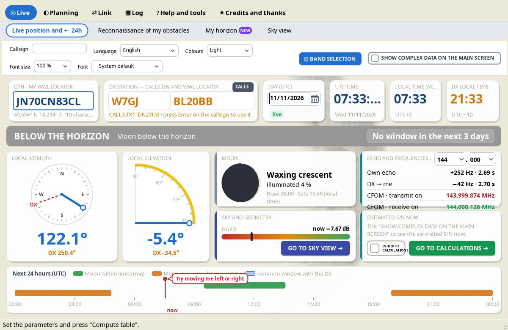
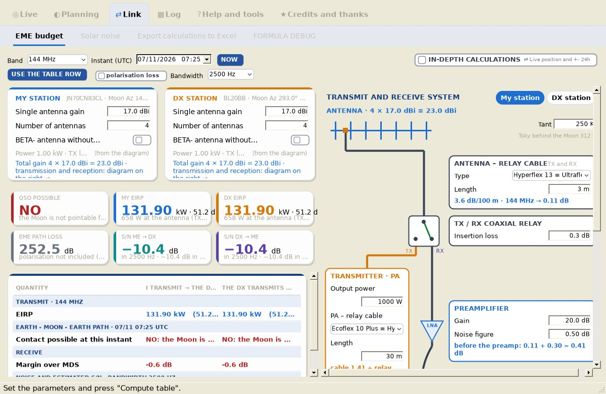
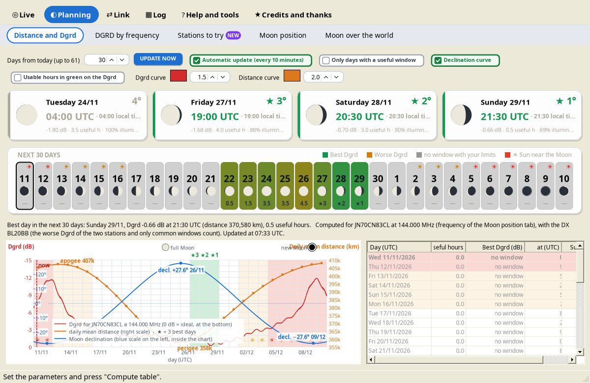

# YAEC – Yet Another EME Calc

*by Costantino IC8TEM*

**YAEC** is a free program for radio amateurs who work **EME (Earth–Moon–Earth)** on **50, 70, 144, 222 and 432 MHz** (next version: also **902 and 1296 MHz**). It computes the Moon position, the pointing windows, the EME link budget, sky noise and solar noise, all on your own computer, in **28 languages**, on **Windows, Linux and macOS** (Linux and macOS with Mono).

> This wiki describes YAEC **1.5** (the current release). Features marked **(next version)** are already in development and will arrive with the next release.

YAEC was created to put in a single program everything that is useful for operating an EME station, **especially when the station has limits**: an antenna without elevation, a rotator with limited travel, obstacles (buildings, trees, hills, the coastline) that hide part of the sky. The most common EME programs tell you where the Moon is; YAEC also tells you whether **your** antenna can really reach it, when, under which conditions (distance, sky noise, polarization, Sun) and how much signal you can expect.

<table><tr>
<td width="33%" align="center"> Live position and +- 24h</td>
<td width="33%" align="center"> EME budget</td>
<td width="33%" align="center"> Distance and Dgrd</td>
</tr></table>

## Who it is for

- Operators who are **starting EME** with a small station (a single Yagi, maybe without elevation) and want to know when a QSO is realistic.
- Stations with **mechanical or site constraints** that need to know the real windows, not only moonrise and moonset.
- Anyone who wants to **understand the numbers**: every formula of the budget is visible with the values substituted, and every data item cites its source.

## Main features

The tabs are gathered in six groups in the bar at the top. Click a group in the first row, then a tab in the second; each group remembers the last tab opened.

| Group | Tabs |
|---|---|
| **Live** | [Live position and +- 24h](Live-Position) · [Reconnaissance of my obstacles](Reconnaissance-of-My-Obstacles) · [Sky view](Sky-View) |
| **Planning** | [Distance and Dgrd](Distance-and-Dgrd) · [DGRD by frequency](DGRD-by-Frequency) (next version) · [Moon position](Moon-Position) · [Moon over the world](Moon-over-the-World) |
| **Link** | [EME budget Yagi](EME-Budget) (in 1.5: *EME budget*) · [EME budget dishes](EME-Budget-Dishes) (next version) · [GRAVES radar](GRAVES-Radar) · [Solar noise](Solar-Noise) · [Export calculations to Excel and Calculation check](Excel-Export-and-Calculation-Check) |
| **Log** | [WWL map and ADIF](WWL-Map-and-ADIF) |
| **Help and tools** | [USER MANUAL and THEORY AND TIPS ON EME](Manuals) · [COAXIAL CABLES](Coaxial-Cables) |
| **Credits and thanks** | ABOUT & CREDITS · AUTHOR CONTACTS AND ACKNOWLEDGEMENTS · LICENCE (see [Credits and thanks](Credits-and-Thanks) and [Licence](Licence)) |

In short:

- **Live position and +- 24h** – main screen updated every second: your locator and the DX's (4 to 14 characters), frequency, UTC / local / DX clocks, a status band (pointable, outside the limits, below the horizon, common window) with countdown, compass and elevation arc. Typing the DX callsign fills in its locator from [CALL3.TXT](CALL3-TXT), with an orange border if the station has been active in the N0UK EME chat in the last 90 days; the [GRAVES](GRAVES-Radar) button sets the GRAVES radar as the DX.
- **Reconnaissance of my obstacles** – aerial or topographic map centred on your station with the sky drawn on it; drag the antenna limits with the mouse.
- **Sky view** – the sky from your QTH coloured by sky noise at your frequency, with antenna limits (and dashed purple boxes around the pointable area), DX horizon, radio sources, Sun and Moon path.
- **Distance and Dgrd** – 7 to 61 days of Dgrd and Moon distance, declination, perigee/apogee, new Moon, the three best days (plus a possible fourth useful day) and a warning when the Moon is near the Sun. Only the hours in which the Moon is really pointable with your limits are counted.
- **DGRD by frequency** (next version) – the Dgrd at your working frequency with your station's real noise (Tant and Te from the EME budget) and the sky averaged over the antenna beam, compared with the usual WSJT-X calculation; the choice applies to the whole program.
- **Moon position** – table for any period, coloured by pointability, with the common windows; CSV export.
- **Moon over the world** – world map coloured by Moon elevation; one click makes that point the DX.
- **EME budget Yagi** (in 1.5: *EME budget*) – link budget for every band, with six indicators, the full table of steps and an interactive diagram of the station (antenna, cables, relay, preamplifier, transverter, radio). Modes with a 60 s period: JT65, Q65-60A, Q65-60B, Q65-60C and custom. Next version: one- or two-stage preamplifier, transverter TX output with the cable to the PA and a check of the drive power.
- **EME budget dishes** (next version) – the same budget for dish antennas at 432, 902 and 1296 MHz: diameter, efficiency, f/D and mount, gain with the PE1RKI formula.
- **GRAVES radar** – the French radar on 143.050 MHz as a test bench: Moon in the beam, common window, echo Doppler and delay, next beam pass, the sky seen from GRAVES, the 24 UTC hours and how to hear the echo.
- **Solar noise** – solar fluxes measured by the RSTN network (NOAA) and the noise added by the Sun near new Moon.
- **Export calculations to Excel** and **Calculation check** – the budget as an editable sheet, and every formula with substituted values.
- **WWL map and ADIF** – worked and confirmed Maidenhead squares from your ADIF file or directly from LoTW.
- **USER MANUAL** and **THEORY AND TIPS ON EME** – full manuals inside the program, in every language, exportable to Word.
- **COAXIAL CABLES** – database of 50 Ω cables with sourced attenuation figures and a loss calculator (next version: also at 902 and 1296 MHz, with the formula α = k1·√f + k2·f).
- [Warnings](Warnings) for polar-cap and auroral absorption, strong polarization offset and the Sun near the Moon.
- Light, Night (blue), Black and eight pastel colour schemes; 10 recommended fonts for each system; 28 languages. Next version: rounded drop-downs, dates and text boxes, buttons in capitals.
- Moon positions accurate to about 0.01° (Meeus, ELP-2000/82); all data in a single `data` folder.

## Free software

YAEC is **free**: you can use it without limits for your amateur radio activity, for study and for teaching. The **source is always included**. Commercial use (selling it or including it in paid products) is not allowed without the author's written permission. See [Licence](Licence).

## Where to start

1. [Installation](Installation)
2. [Getting started](Getting-Started)
3. [Troubleshooting and FAQ](Troubleshooting-FAQ) if something does not work.

Downloads: **[Releases](https://github.com/ic8tem/YAEC/releases/latest)** on GitHub.
