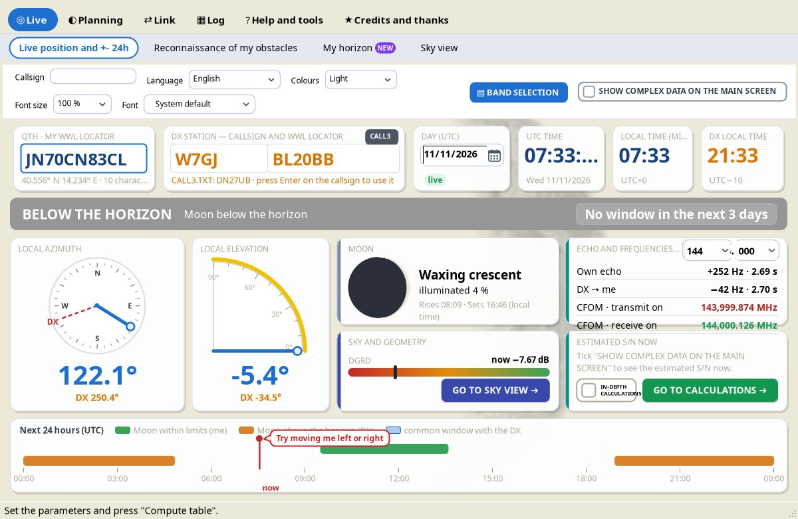

# Live position and +- 24h

*Group: Live.* The main screen, updated every second. It shows where the Moon is now (or at any moment within the chosen day), whether **your** antenna can reach it and whether the DX can see it too.

## Layout from top to bottom

### Settings bar
Callsign, Language, Colours, Font size, Font, the **BAND SELECTION** button and the **SHOW COMPLEX DATA ON THE MAIN SCREEN** box. See [Settings and data folder](Settings-and-Data-Folder).

### Station cards and clocks
- **QTH - My WWL locator** – your locator (4 to 14 characters) with the accuracy of the position; the card says whether it is *suitable for obstacles* (8 or 10 characters recommended).
- **DX station — callsign and WWL locator** – the DX callsign and locator. With the callsign, the locator comes from [CALL3.TXT](CALL3-TXT) (press Enter to use it). The callsign box gets an **orange border** if the station has written in the N0UK EME chat in the last 90 days; the tooltip gives the date of the last message (see [CALL3.TXT – active stations](CALL3-TXT#active-stations)). Two buttons in this card:
  - **CALL3** – update CALL3.TXT or copy it into the WSJT-X folder;
  - **GRAVES** – set the French GRAVES radar (JN27SI) as the DX ([GRAVES radar](GRAVES-Radar)).
- **DATE**, **UTC TIME**, **LOCAL TIME** and **DX LOCAL TIME** (the DX time zone is derived from its locator).

### Status band
A full-width coloured band with a countdown:

| Colour | Meaning |
|---|---|
| Green | **MOON POINTABLE** – inside your antenna limits |
| Blue | **COMMON WINDOW WITH THE DX** – pointable by you and above the DX horizon / inside the DX limits |
| Orange | **MOON OUTSIDE THE LIMITS** – above the horizon but outside your azimuth or elevation limits |
| Grey | **MOON BELOW THE HORIZON** |

The text says how long the current window lasts or when the next one starts (looking up to 3 days ahead).

### Compass and elevation arc
Azimuth compass and elevation arc with your antenna limits in **yellow** and the DX direction in **orange**; **LOCAL AZIMUTH**, **LOCAL ELEVATION**, **DX AZIMUTH**, **DX ELEVATION**.

### Four data cards

| Card | Contents |
|---|---|
| **MOON** | Phase and illuminated %, rise and set (local time). |
| **ECHO AND FREQUENCIES (CFOM)** | The working frequency (MHz + kHz; the MHz list follows the bands chosen with BAND SELECTION, up to 432 MHz in 1.5 and up to 1296 MHz in the next version), own echo Doppler, Doppler DX → me, and the CFOM frequencies: *CFOM · transmit on* and *CFOM · receive on*. |
| **SKY AND GEOMETRY** | Tsky behind the Moon, distance, declination, hour angle, the **DGRD** bar (from the minimum to the maximum of the Distance and Dgrd chart, with the current value) and **GO TO SKY VIEW**. |
| **ESTIMATED S/N NOW** | With *SHOW COMPLEX DATA ON THE MAIN SCREEN* ticked: S/N me → DX and DX → me in the chosen bandwidth and in 2500 Hz, with the typical threshold of the mode as a reference, the DX data (Dpol, MNR, Dgrd), the **IN-DEPTH CALCULATIONS** box and **GO TO CALCULATIONS**. Needs a valid locator and an active DX. |

### Next 24 hours
At the bottom, the bar of the 24 hours of the UTC day with the useful windows and the common windows with the DX.

## Past and future (+- 24h)

- Open the **calendar** to choose another day (past or future).
- **Drag the red line** in the 24-hour bar to choose the time. (Next version: until you drag it the first time, a balloon next to the red line says *Try moving me left or right*.)
- **▶ Now** returns to live tracking with the current time.

## Warnings shown here

- **Possible ionospheric absorption** – when you or the DX are in the polar cap or the auroral zone; the warning stays on the main screen.
- **Polarization between the two stations** – when Dpol reaches 60° or more within 24 hours.

See [Warnings](Warnings).

## Key values explained

| Value | Meaning |
|---|---|
| **Doppler / echo** | One-way Doppler between you and the Moon is positive when the Moon approaches (rising). Your own echo is shifted by twice that. |
| **CFOM** | Constant Frequency On the Moon: transmit on f0 − my Doppler and receive on f0 + my Doppler. If both stations do it they always meet on f0 "on the Moon", without knowing each other's Doppler. WSJT-X uses the same scheme ("Constant frequency on Moon" Doppler tracking). |
| **Tsky** | Sky temperature behind the Moon at your frequency (K). High values = Moon in front of the Milky Way. |
| **Dgrd** | Degradation relative to ideal conditions (WSJT-X formula): Moon distance + sky noise. 0 dB = ideal; more negative = worse. See [Distance and Dgrd](Distance-and-Dgrd). Next version: the noise model (receiver and sky) is chosen in the [DGRD by frequency](DGRD-by-Frequency) tab. |
| **Dpol** | Spatial polarization offset between the two stations, −90° to +90° (linear antennas). |
| **MNR** | Maximum non-reciprocity, −20·log\|cos 2·Dpol\|: how much worse one direction can be than the other with unfavourable Faraday rotation. |
| **Hour angle** | Negative = east and rising, 0 = culmination, positive = descending; 15° = 1 hour. |

Approximate Doppler of the own echo by band (Theory manual § 1.10, from Bob Atkins KA1GT):

| Band | Maximum echo Doppler | Compensation |
|---|---|---|
| 50 MHz | ≈ ±120 Hz | not needed |
| 70 MHz | ≈ ±165 Hz | not needed |
| 144 MHz | up to ≈ 340 Hz | recommended |
| 222 MHz | ≈ ±525 Hz | needed |
| 432 MHz | up to ≈ 1000 Hz | needed |

> For CFOM the radio must accept frequency changes via CAT also during transmission; some rigs do not. With a transverter, set the transverter offset in your digital program so that the frequency shown is the real one. References: [Doppler 101](https://bobatkins.com/radio/EME_doppler_101.html), [CFOM](https://bobatkins.com/radio/CFOM.html) (KA1GT).
